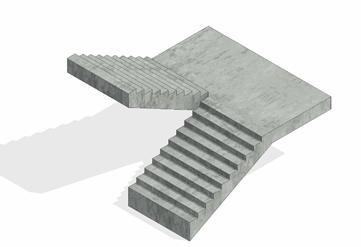

### *Требования к моделированию*

Таблица 56

<table header="row">
  <tr><td colspan="4">Инструмент моделирования</td></tr>
  <tr>
    <td colspan="4">
      - Системное семейство категории «Лестницы».
    </td>
  </tr>
  <tr><td colspan="4">Внешний вид</td></tr>
  <tr>
    <td colspan="4">
      
    </td>
  </tr>
  <tr><td colspan="4">Проектируемый объем</td></tr>
  <tr>
    <td rowspan="4">Этап</td>
    <td>К</td>
    <td>
      Выполняется:

      - В модели АР условно в условных габаритах по всем типовым и уникальным этажам.
    </td>
    <td></td>
  </tr>
  <tr>
    <td>ПД</td>
    <td rowspan="3">
      Лестницы разрабатываются в модели КР

      В АР разрабатывается только отделка (см. п. 10.22 «Отделка лестниц, рамп, пандусов»).
    </td>
    <td></td>
  </tr>
  <tr><td>ТД</td><td></td></tr>
  <tr><td>РД</td><td></td></tr>
  <tr><td colspan="4">Примечание</td></tr>
  <tr>
    <td colspan="4">
      - См. пункт 10.22 «Отделка лестниц, рамп, пандусов»
    </td>
  </tr>
  <tr><td colspan="4">Запрещенные действия</td></tr>
  <tr>
    <td colspan="4">
      - Разработка элементов модели участвующих в оформлении документации в рабочих наборах начинающихся с «(50)\_»
    </td>
  </tr>
</table>

### *Требования к параметризации*

Таблица 57

<table header="row">
  <tr><td colspan="2" rowspan="2">Атрибут</td><td colspan="4">Этап</td><td rowspan="2">Пример заполнения</td></tr>
  <tr><td>К</td><td>ПД</td><td>ТД</td><td>РД</td></tr>
  <tr><td colspan="7">Уровень геометрической проработки модели</td></tr>
  <tr><td rowspan="3">Геометрия</td><td>Условные габариты</td><td>●</td><td></td><td></td><td></td><td></td></tr>
  <tr><td>Условное расположение</td><td>●</td><td></td><td></td><td></td><td></td></tr>
  <tr><td>Внешний образ/вид</td><td>●</td><td></td><td></td><td></td><td></td></tr>
</table>
