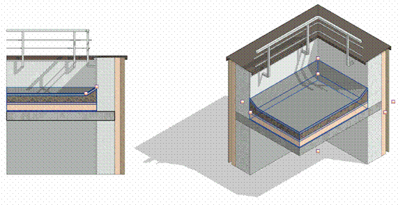

### *Требования к моделированию*

Таблица 60

<table header="row">
  <tr><td colspan="4">Инструмент моделирования</td></tr>
  <tr>
    <td colspan="4">
      Системное семейство категории «Крыши» инструментом:

      - «Крыша по контуру»
      - «Крыша выдавливанием»
      - «Крыша по грани».
    </td>
  </tr>
  <tr><td colspan="4">Внешний вид</td></tr>
  <tr>
    <td colspan="4">
      
    </td>
  </tr>
  <tr><td colspan="4">Проектируемый объем</td></tr>
  <tr><td rowspan="4">Этап</td><td>К</td><td>Моделируется кровля без уклонов</td><td></td></tr>
  <tr>
    <td>ПД</td>
    <td>
      Выполняется:

      - Путем моделирования с уклонами в виде многослойной структуры на уровнях кровли. Допускается моделирование основных слоев с заполнением точного состава кровли в параметр «G_Состав конструкции»
      - Заполнение основных параметров, необходимых для идентификации элемента.
    </td>
    <td></td>
  </tr>
  <tr>
    <td>ТД</td>
    <td>
      Выполняется:

      - Путем моделирования с уклонами в виде многослойной структуры на уровнях кровли. Допускается моделирование основных слоев с заполнением точного состава кровли в параметр «G_Состав конструкции»
      - Заполнение параметров, необходимых для формирования сводной ведомости объемов работ.
    </td>
    <td></td>
  </tr>
  <tr>
    <td>РД</td>
    <td>
      Выполняется:

      Путем моделирования кровли с уклонами в виде многослойной структуры на уровнях кровли. Допускается моделирование основных слоев с заполнением точного состава кровли в параметр «G_Состав конструкции»

      Заполнение всех параметров, необходимых для формирования спецификаций и ведомостей элементов в рабочей документации.
    </td>
    <td></td>
  </tr>
  <tr><td colspan="4">Примечание</td></tr>
  <tr>
    <td colspan="4">
      - \-
    </td>
  </tr>
  <tr><td colspan="4">Запрещенные действия</td></tr>
  <tr>
    <td colspan="4">
      - Разработка элементов модели участвующих в оформлении документации в рабочих наборах начинающихся с «(50)\_».
    </td>
  </tr>
</table>

### *Требования к параметризации*

Таблица 61

<table header="row">
  <tr><td colspan="2" rowspan="2">Атрибут</td><td colspan="4">Этап</td><td rowspan="2">Пример заполнения</td></tr>
  <tr><td>К</td><td>ПД</td><td>ТД</td><td>РД</td></tr>
  <tr><td colspan="7">Уровень геометрической проработки модели</td></tr>
  <tr><td rowspan="9">Геометрия</td><td>Условные габариты</td><td>●</td><td></td><td></td><td></td><td></td></tr>
  <tr><td>Точные габариты</td><td></td><td>●</td><td>●</td><td>●</td><td></td></tr>
  <tr><td>Условное расположение</td><td>●</td><td></td><td></td><td></td><td></td></tr>
  <tr><td>Точное расположение</td><td></td><td>●</td><td>●</td><td>●</td><td></td></tr>
  <tr><td>Внешний образ/вид</td><td></td><td>●</td><td>●</td><td>●</td><td></td></tr>
  <tr><td>Однослойная структура</td><td>●</td><td></td><td></td><td></td><td></td></tr>
  <tr><td>Многослойная структура</td><td></td><td>●</td><td>●</td><td>●</td><td></td></tr>
  <tr><td>Материалы1</td><td></td><td>●</td><td>●</td><td>●</td><td></td></tr>
  <tr><td>Уклон</td><td></td><td>●</td><td>●</td><td>●</td><td></td></tr>
  <tr><td colspan="7">Уровень проработки атрибутивной информации</td></tr>
  <tr><td rowspan="3">Размеры</td><td>Площадь / G_Площадь</td><td></td><td>●</td><td>●</td><td>●</td><td>8 м²</td></tr>
  <tr><td>Периметр</td><td></td><td>●</td><td>●</td><td>●</td><td>12200 мм</td></tr>
  <tr><td>Толщина / ADSK_Размер_Толщина</td><td></td><td>●</td><td>●</td><td>●</td><td>280 мм</td></tr>
  <tr><td rowspan="4">Идентификация</td><td>Описание</td><td></td><td></td><td>●</td><td>●</td><td>Кровля плоская</td></tr>
  <tr><td>ADSK_Наименование</td><td></td><td></td><td>●</td><td>●</td><td>По ГОСТ</td></tr>
  <tr><td>ADSK_Предел огнестойкости1</td><td></td><td>●</td><td>●</td><td>●</td><td>REI45</td></tr>
  <tr>
    <td>G_Состав конструкции</td>
    <td></td>
    <td></td>
    <td>●</td>
    <td>●</td>
    <td>
      1\. Мембрана изоляционная – 2 слоя

      2\. Праймер битумный – 2 слоя

      3\. Утеплитель – 150мм

      ….
    </td>
  </tr>
  <tr><td>Маркировка</td><td>ADSK_Марка</td><td></td><td></td><td></td><td>●</td><td>ЗФ-12</td></tr>
  <tr><td rowspan="2">Ресурсы</td><td>ADSK_Единица измерения1</td><td></td><td>●</td><td>●</td><td>●</td><td>м²</td></tr>
  <tr><td>ADSK_Завод-изготовитель1</td><td></td><td></td><td></td><td>●</td><td>Россия</td></tr>
  <tr><td rowspan="3">Положение</td><td>ADSK_Номер здания</td><td></td><td>●</td><td>●</td><td>●</td><td>Строение 1</td></tr>
  <tr><td>ADSK_Этаж</td><td></td><td>●</td><td>●</td><td>●</td><td>3</td></tr>
  <tr><td>ADSK_Номер секции</td><td></td><td>●</td><td>●</td><td>●</td><td>К1</td></tr>
  <tr><td>Прочее</td><td>ADSK_Комплект чертежей3</td><td></td><td></td><td></td><td>●</td><td>АР1</td></tr>
</table>

1 - Заполняется только у элементов, для которых явное указание требуется, согласно проектным решениям.

2 - Всем элементам (каждому отдельному слою) должен быть назначен конкретный материал из библиотеки материалов.

3 - Заполняется если из модели выпускается несколько комплектов документации.
