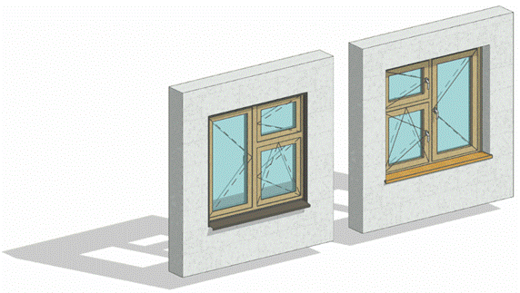

### *Требования к моделированию*

Таблица 66

<table header="row">
  <tr><td colspan="3">Инструмент моделирования</td></tr>
  <tr>
    <td colspan="3">
      - Загружаемые семейства категории «Окна».
    </td>
  </tr>
  <tr><td colspan="3">Внешний вид</td></tr>
  <tr>
    <td colspan="3">
      
    </td>
  </tr>
  <tr><td colspan="3">Проектируемый объем</td></tr>
  <tr>
    <td rowspan="4">Этап</td>
    <td>К</td>
    <td>
      Выполняется:

      - Моделирование условное в упрощенном виде на типовых этажах и уникальных этажах.
      - Схематичное отображение на фасаде.
    </td>
  </tr>
  <tr>
    <td>ПД</td>
    <td>
      Выполняется:

      - Точное расположение всех окон, согласно планировочным решениям во всех помещениях типовых и уникальных этажей, согласно проектным решениям.
      - Трёхмерная геометрия с учётом глубины конструкции, монтажные зазоры, точное расположение, точные габариты.
      - Заполнение основных параметров, необходимых для идентификации элемента.
    </td>
  </tr>
  <tr>
    <td>ТД</td>
    <td>
      Выполняется:

      - Точное расположение всех окон, согласно планировочным решениям во всех помещениях типовых и уникальных этажей, согласно проектным решениям.
      - Трёхмерная геометрия с учётом глубины конструкции, монтажные зазоры, точное расположение, точные габариты.
      - С элементами конструкции: рама, створки, импосты и пр.
      - Заполнение параметров, необходимых для формирования сводной ведомости объемов работ.
    </td>
  </tr>
  <tr>
    <td>РД</td>
    <td>
      Выполняется:

      - Точное расположение всех окон, согласно планировочным решениям во всех помещениях типовых и уникальных этажей, согласно проектным решениям.
      - Трёхмерная геометрия с учётом глубины конструкции, монтажные зазоры, точное расположение, точные габариты.
      - С элементами конструкции: рама, створки, импосты и пр.
      - Отображение световых проемов, решеток, фурнитуры.
      - Заполнение всех параметров, необходимых для формирования спецификаций и ведомостей элементов в рабочей документации.
    </td>
  </tr>
  <tr><td colspan="3">Примечание</td></tr>
  <tr>
    <td colspan="3">
      - Окна должны содержать 3D линии открывания. Тип линии должен соответствовать направлению открывания створок: «от себя» - пунктир, «к себе» - сплошная.
      - Моделирование фурнитуры выполняется условно.
      - Окна с разным открыванием необходимо выполнить отдельными типоразмерами или задать открывание с помощью параметра в свойствах экземпляра окна.
      - Для размещения окон в несущие конструкции допускается дублирование конструкций, с условием дальнейшего размещения конструкций в скрытый рабочий набор (50)\_Имитация.
    </td>
  </tr>
  <tr><td colspan="3">Запрещенные действия</td></tr>
  <tr>
    <td colspan="3">
      - Разработка элементов модели участвующих в оформлении документации в рабочих наборах начинающихся с «(50)\_»
      - Запрещается использовать инструмент «Зеркало», так как это может привести к несоответствию значений параметра открывания и отображению на чертеже.
    </td>
  </tr>
</table>

### *Требования к параметризации*

Таблица 67

<table header="row">
  <tr><td colspan="2" rowspan="2">Атрибут</td><td colspan="4">Этап</td><td rowspan="2">Пример заполнения</td></tr>
  <tr><td>К</td><td>ПД</td><td>ТД</td><td>РД</td></tr>
  <tr><td colspan="7">Уровень геометрической проработки модели</td></tr>
  <tr><td rowspan="6">Геометрия</td><td>Условные габариты</td><td>●</td><td></td><td></td><td></td><td></td></tr>
  <tr><td>Точные габариты</td><td></td><td>●</td><td>●</td><td>●</td><td></td></tr>
  <tr><td>Условное расположение</td><td>●</td><td></td><td></td><td></td><td></td></tr>
  <tr><td>Точное расположение</td><td></td><td>●</td><td>●</td><td>●</td><td></td></tr>
  <tr><td>Внешний образ/вид</td><td>●</td><td>●</td><td>●</td><td>●</td><td></td></tr>
  <tr><td>Материалы2</td><td></td><td></td><td>●</td><td>●</td><td></td></tr>
  <tr><td colspan="7">Уровень проработки атрибутивной информации</td></tr>
  <tr><td rowspan="2">Размеры</td><td>ADSK_Размер_Ширина</td><td></td><td>●</td><td>●</td><td>●</td><td>1800 мм</td></tr>
  <tr><td>ADSK_Размер_Высота</td><td></td><td>●</td><td>●</td><td>●</td><td>1800 мм</td></tr>
  <tr><td rowspan="4">Идентификация</td><td>Описание</td><td></td><td></td><td>●</td><td>●</td><td>Окно двустворчатое</td></tr>
  <tr><td>ADSK_Обозначение</td><td></td><td></td><td>●</td><td>●</td><td>ГОСТ 23166-2024</td></tr>
  <tr><td>ADSK_Наименование</td><td></td><td></td><td>●</td><td>●</td><td>О-ПА-2120 x 1760 x 82</td></tr>
  <tr><td>ADSK_Предел огнестойкости1</td><td></td><td>●</td><td>●</td><td>●</td><td>E60</td></tr>
  <tr><td rowspan="3">Маркировка</td><td>ADSK_Марка</td><td></td><td></td><td>●</td><td>●</td><td>ОК-1</td></tr>
  <tr><td>ADSK_Открывание</td><td></td><td>●</td><td>●</td><td>●</td><td>Правое Вверх</td></tr>
  <tr><td>ADSK_Код изделия\*</td><td></td><td></td><td>●</td><td>●</td><td>Арт.423</td></tr>
  <tr><td rowspan="3">Ресурсы</td><td>ADSK_Количество</td><td></td><td>●</td><td>●</td><td>●</td><td>5</td></tr>
  <tr><td>ADSK_Единица измерения</td><td></td><td>●</td><td>●</td><td>●</td><td>шт.</td></tr>
  <tr><td>ADSK_Завод-изготовитель1</td><td></td><td></td><td></td><td>●</td><td>Россия</td></tr>
  <tr><td rowspan="3">Положение</td><td>ADSK_Номер здания</td><td></td><td>●</td><td>●</td><td>●</td><td>Строение 1</td></tr>
  <tr><td>ADSK_Этаж</td><td></td><td>●</td><td>●</td><td>●</td><td>3</td></tr>
  <tr><td>ADSK_Номер секции</td><td></td><td>●</td><td>●</td><td>●</td><td>К1</td></tr>
  <tr><td>Прочее</td><td>ADSK_Комплект чертежей3</td><td></td><td></td><td></td><td>●</td><td>АР1</td></tr>
</table>

1 - Заполняется только у элементов, для которых явное указание требуется, согласно проектным решениям.

2 - Всем элементам (каждому отдельному слою) должен быть назначен конкретный материал из библиотеки материалов

3 - Заполняется если из модели выпускается несколько комплектов документации.
