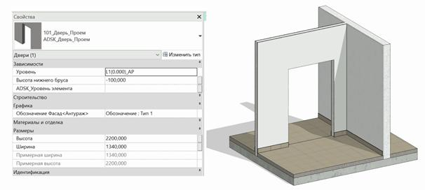

### *Требования к моделированию*

Таблица 68

<table header="row">
  <tr><td colspan="3">Инструмент моделирования</td></tr>
  <tr>
    <td colspan="3">
      Загружаемые семейства категории:

      - «Окна»
      - «Двери»
    </td>
  </tr>
  <tr><td colspan="3">Внешний вид</td></tr>
  <tr>
    <td colspan="3">
      
    </td>
  </tr>
  <tr><td colspan="3">Проектируемый объем</td></tr>
  <tr>
    <td rowspan="4">Этап</td>
    <td>К</td>
    <td>
      Выполняется:

      - Условное графическое представление проёмов в виде упрощённых прямоугольников на фасаде и плане.
      - Приблизительные размеры проёма.
    </td>
  </tr>
  <tr>
    <td>ПД</td>
    <td rowspan="3">
      Выполняется:

      - Точное расположение всех проемов, согласно планировочным решениям во всех помещениях типовых и уникальных этажей, согласно проектным решениям.
      - Заполнение основных параметров, необходимых для идентификации элемента.
    </td>
  </tr>
  <tr><td>ТД</td></tr>
  <tr><td>РД</td></tr>
  <tr><td colspan="3">Примечание</td></tr>
  <tr>
    <td colspan="3">
      - Проемы должны образовывать физическое вырезание объема в стенах или перекрытиях.
    </td>
  </tr>
  <tr><td colspan="3">Запрещенные действия</td></tr>
  <tr>
    <td colspan="3">
      - Разработка элементов модели участвующих в оформлении документации в рабочих наборах начинающихся с «(50)\_»
      - Использование инструмента «Проем по грани»
      - Использование инструмента «Шахта»
      - Использование инструмента «Проем в стене»
      - Использование инструмента «Проем по вертикали»
    </td>
  </tr>
</table>

### *Требования к параметризации*

Таблица 69

<table header="row">
  <tr><td colspan="2" rowspan="2">Атрибут</td><td colspan="4">Этап</td><td rowspan="2">Пример заполнения</td></tr>
  <tr><td>К</td><td>ПД</td><td>ТД</td><td>РД</td></tr>
  <tr><td colspan="7">Уровень геометрической проработки модели</td></tr>
  <tr><td rowspan="5">Геометрия</td><td>Условные габариты</td><td>●</td><td></td><td></td><td></td><td></td></tr>
  <tr><td>Точные габариты</td><td></td><td>●</td><td>●</td><td>●</td><td></td></tr>
  <tr><td>Условное расположение</td><td>●</td><td></td><td></td><td></td><td></td></tr>
  <tr><td>Точное расположение</td><td></td><td>●</td><td>●</td><td>●</td><td></td></tr>
  <tr><td>Внешний образ/вид</td><td>●</td><td>●</td><td>●</td><td>●</td><td></td></tr>
  <tr><td colspan="7">Уровень проработки атрибутивной информации</td></tr>
  <tr><td rowspan="2">Размеры</td><td>ADSK_Размер_Высота</td><td></td><td>●</td><td>●</td><td>●</td><td>2500 мм</td></tr>
  <tr><td>ADSK_Размер_Толщина</td><td></td><td>●</td><td>●</td><td>●</td><td>2300 мм</td></tr>
  <tr><td>Идентификация</td><td>Описание</td><td></td><td></td><td>●</td><td>●</td><td>Проем</td></tr>
  <tr><td>Маркировка</td><td>ADSK_Позиция\*</td><td></td><td></td><td>●</td><td>●</td><td>П-1</td></tr>
  <tr><td rowspan="3">Ресурсы</td><td>ADSK_Количество</td><td></td><td>●</td><td>●</td><td>●</td><td>2</td></tr>
  <tr><td>ADSK_Единица измерения</td><td></td><td>●</td><td>●</td><td>●</td><td>шт.</td></tr>
  <tr><td>ADSK_Завод-изготовитель1</td><td></td><td></td><td></td><td>●</td><td>Россия</td></tr>
  <tr><td rowspan="3">Положение</td><td>ADSK_Номер здания</td><td></td><td>●</td><td>●</td><td>●</td><td>Строение 1</td></tr>
  <tr><td>ADSK_Этаж</td><td></td><td>●</td><td>●</td><td>●</td><td>3</td></tr>
  <tr><td>ADSK_Номер секции</td><td></td><td>●</td><td>●</td><td>●</td><td>К1</td></tr>
  <tr><td>Прочее</td><td>ADSK_Комплект чертежей2</td><td></td><td></td><td></td><td>●</td><td>АР1</td></tr>
</table>

1 - Заполняется только у элементов, для которых явное указание требуется, согласно проектным решениям.

2 - Заполняется если из модели выпускается несколько комплектов документации.
