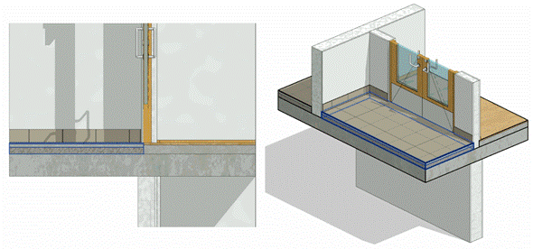
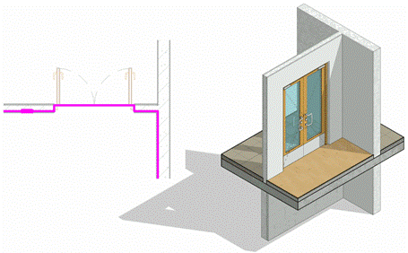

### *Требования к моделированию*

Таблица 70

<table header="row">
  <tr><td colspan="3">Инструмент моделирования</td></tr>
  <tr>
    <td colspan="3">
      - Системное семейство категории «Перекрытия» инструментом «Перекрытие: архитектурное».
      - Уклоны пола должны быть заданы инструментом «Изменить субэлементы».
    </td>
  </tr>
  <tr><td colspan="3">Внешний вид</td></tr>
  <tr>
    <td colspan="3">
      

      Контур пола необходимо моделировать с учетом пространства в дверном проеме.

      
    </td>
  </tr>
  <tr><td colspan="3">Проектируемый объем</td></tr>
  <tr><td rowspan="4">Этап</td><td>К</td><td>Моделируется условной проектной толщиной для формирования корректных высотных отметок на типовых и уникальных этажах. Допускается моделирование одного пола на перекрытие всего этажа.</td></tr>
  <tr>
    <td>ПД</td>
    <td>
      Выполняется:

      - Моделирование отдельными перекрытиями в точном расположении и габаритах каждого помещения типовых и уникальных этажей в объеме всего здания.
      - Заполнение основных параметров, необходимых для идентификации элемента.
    </td>
  </tr>
  <tr>
    <td>ТД</td>
    <td>
      Выполняется:

      - Моделирование отдельными перекрытиями в точном расположении и габаритах каждого помещения типовых и уникальных этажей в объеме всего здания.
      - Заполнение параметров, необходимых для формирования сводной ведомости объемов работ.
    </td>
  </tr>
  <tr>
    <td>РД</td>
    <td>
      Выполняется:

      - Моделирование отдельными перекрытиями в точном расположении и габаритах каждого помещения типовых и уникальных этажей в объеме всего здания.
      - Заполнение всех параметров, необходимых для формирования спецификаций и ведомостей элементов в рабочей документации.
    </td>
  </tr>
  <tr><td colspan="3">Примечание</td></tr>
  <tr>
    <td colspan="3">
      - Полы моделируются отдельно от несущего перекрытия.
      - Всем слоям должна быть назначена корректная функция. Допускается моделирование структуры пола условно при условии заполнения подробной структуры состава пола в параметр.
      - Допускается соединение с несущими конструкциями, с условием дальнейшего размещения конструкции в скрытый рабочий набор (50)\_Имитация.
    </td>
  </tr>
  <tr><td colspan="3">Запрещенные действия</td></tr>
  <tr>
    <td colspan="3">
      - Разработка элементов модели участвующих в оформлении документации в рабочих наборах начинающихся с «(50)\_»
      - Моделирование полов одним контуром в нескольких помещениях на Концепции.
      - Некорректное использование функций слоев.
    </td>
  </tr>
</table>

### *Требования к параметризации*

Таблица 71

<table header="row">
  <tr><td colspan="2" rowspan="2">Атрибут</td><td colspan="4">Этап</td><td rowspan="2">Пример заполнения</td></tr>
  <tr><td>К</td><td>ПД</td><td>ТД</td><td>РД</td></tr>
  <tr><td colspan="7">Уровень геометрической проработки модели</td></tr>
  <tr><td rowspan="9">Геометрия</td><td>Условные габариты</td><td>●</td><td>●</td><td></td><td></td><td></td></tr>
  <tr><td>Точные габариты</td><td></td><td></td><td>●</td><td>●</td><td></td></tr>
  <tr><td>Условное расположение</td><td>●</td><td>●</td><td></td><td></td><td></td></tr>
  <tr><td>Точное расположение</td><td></td><td></td><td>●</td><td>●</td><td></td></tr>
  <tr><td>Внешний образ/вид</td><td></td><td>●</td><td>●</td><td>●</td><td></td></tr>
  <tr><td>Однослойная структура (допускается)</td><td>●</td><td>●</td><td>●</td><td>●</td><td></td></tr>
  <tr><td>Многослойная структура</td><td></td><td></td><td></td><td>●</td><td></td></tr>
  <tr><td>Материалы2</td><td></td><td>●</td><td>●</td><td>●</td><td></td></tr>
  <tr><td>Уклон</td><td></td><td></td><td></td><td>●</td><td></td></tr>
  <tr><td colspan="7">Уровень проработки атрибутивной информации</td></tr>
  <tr><td rowspan="3">Размеры</td><td>Площадь / ADSK_Размер_Площадь</td><td></td><td>●</td><td>●</td><td>●</td><td>20,0 м²</td></tr>
  <tr><td>Толщина / ADSK_Размер_Толщина</td><td></td><td>●</td><td>●</td><td>●</td><td>80 мм</td></tr>
  <tr><td>Объем</td><td></td><td>●</td><td>●</td><td>●</td><td>1,6 м³</td></tr>
  <tr><td rowspan="2">Идентификация</td><td>Описание</td><td></td><td></td><td>●</td><td>●</td><td>Конструкция пола</td></tr>
  <tr>
    <td>G_Состав конструкции</td>
    <td></td>
    <td>●</td>
    <td>●</td>
    <td>●</td>
    <td>
      1\. Ламинат

      2\. Подложка

      3\. Стяжка – 80 мм
    </td>
  </tr>
  <tr><td>Маркировка</td><td>ADSK_Марка</td><td></td><td></td><td></td><td>●</td><td>1 \[тип пола в соответствии с экспликацией полов\]</td></tr>
  <tr><td rowspan="2">Ресурсы</td><td>ADSK_Единица измерения</td><td></td><td>●</td><td>●</td><td>●</td><td>м³</td></tr>
  <tr><td>ADSK_Завод-изготовитель1</td><td></td><td></td><td></td><td>●</td><td>Россия</td></tr>
  <tr><td rowspan="3">Положение</td><td>ADSK_Номер здания</td><td></td><td>●</td><td>●</td><td>●</td><td>Строение 1</td></tr>
  <tr><td>ADSK_Этаж</td><td></td><td>●</td><td>●</td><td>●</td><td>3</td></tr>
  <tr><td>ADSK_Номер секции</td><td></td><td>●</td><td>●</td><td>●</td><td>К1</td></tr>
  <tr><td>Прочее</td><td>ADSK_Комплект чертежей3</td><td></td><td></td><td></td><td>●</td><td>АР1</td></tr>
</table>

1 - Заполняется только у элементов, для которых явное указание требуется, согласно проектным решениям.

2 - Всем элементам (каждому отдельному слою) должен быть назначен конкретный материал из библиотеки материалов

3 - Заполняется если из модели выпускается несколько комплектов документации.
