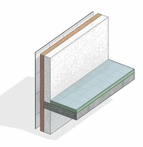

### *Требования к моделированию*

Таблица 40

<table header="row">
  <tr><td colspan="4">Инструмент моделирования</td></tr>
  <tr>
    <td colspan="4">
      - Системный инструмент «Стены» инструментом «Стена: архитектурная».
    </td>
  </tr>
  <tr><td colspan="4">Внешний вид</td></tr>
  <tr>
    <td colspan="4">
      
    </td>
  </tr>
  <tr><td colspan="4">Проектируемый объем</td></tr>
  <tr>
    <td rowspan="4">Этап</td>
    <td>**К**</td>
    <td>
      Выполняется:

      - Условное расположение основных кладочных наружных стен и перегородок, а также стен МОПов. Допустимо моделирование одним элементом с послойным разделением.
    </td>
    <td></td>
  </tr>
  <tr>
    <td>**ПД**</td>
    <td>
      Выполняется:

      - Точное расположение всех наружных и внутренних стен и перегородок из кладочных материалов во всех помещениях типовых и уникальных этажей в объеме всего здания, согласно проектным решениям.
      - Все слои толщиной более 5мм моделируются отдельными стенами без деления по слоям.
      - Заполнение основных параметров, необходимых для идентификации элемента.
    </td>
    <td></td>
  </tr>
  <tr>
    <td>**ТД**</td>
    <td>
      Выполняется:

      - Точное расположение всех наружных и внутренних стен и перегородок из кладочных материалов во всех помещениях типовых и уникальных этажей в объеме всего здания, согласно проектным решениям.
      - Все слои толщиной более 5мм моделируются отдельными стенами без деления по слоям.
      - Заполнение параметров необходимых для формирования сводной ведомости объемов работ.
    </td>
    <td></td>
  </tr>
  <tr>
    <td>**РД**</td>
    <td>
      Выполняется:

      - Точное расположение всех наружных и внутренних стен и перегородок из кладочных материалов во всех помещениях типовых и уникальных этажей в объеме всего здания, согласно проектным решениям.
      - Все слои толщиной более 5мм моделируются отдельными стенами без деления по слоям.
      - Заполнение всех параметров, необходимых для формирования спецификаций и ведомостей элементов в рабочей документации.
    </td>
    <td></td>
  </tr>
  <tr><td colspan="4">Примечание</td></tr>
  <tr>
    <td colspan="4">
      - Всем слоям должна быть назначена корректная функция.
      - Стены должны быть разделены по этажам.
      - Стены должны иметь корректные привязки к уровням.
      - Свободные торцы стен должны быть отсоединены.
      - Несущие стены КР могут присутствовать в архитектурной модели только как имитационные элементы, в точности повторяющие, размещенные в конструктивной модели. Имитация служит для размещения в них дверей и окон, подрезки стен для выреза под балки и должна быть невидимой на виде Navisworks и находится в отдельном Рабочем наборе (Имя такого РН рекомендуется задать: «(50)\_Имитация»). Данные имитационные элементы не участвуют в подсчетах ВОР, а также в экспорте моделей в NWC/IFC.
      - Моделирование основных слоев: основа, отделка – должно выполняться из отдельных элементов, кроме оговоренных на этапе проектирования. Допускается моделирование структуры слоев в составе стены укрупненно с подробным описанием состава стены/перегородки в параметре G_Состав конструкции.
      - В составе многослойной стены допускается включение слоев отделки на этапах в соответствии с таблицей параметризации
    </td>
  </tr>
  <tr><td colspan="4">Запрещенные действия</td></tr>
  <tr>
    <td colspan="4">
      - Использование инструмента «Составная стена».
      - Использование многослойных стен на этапах, когда многослойность не допускается.
      - Использование инструмента «Присоединить верх/основание» (за исключением случаев примыкания к низу лестничных маршей, рамп и кровель сложной формы).
      - Моделирование стен через несколько этажей, в случае если это не обусловлено проектной идеей.
      - Размещение стен со свободным торцом без отсоединения.
      - Некорректное использование функций слоев.
      - Использование инструмента «Редактировать профиль» для создания проема или отверстия.
      - Использование инструмента «Модель в контексте» категории Стены, кроме случаев фасадного декора сложной формы.
      - Разработка элементов модели участвующих в оформлении документации в рабочих наборах начинающихся с «(50)\_»
    </td>
  </tr>
</table>

### *Требования к параметризации*

Таблица 41

<table header="row">
  <tr><td colspan="2" rowspan="2">Атрибут</td><td colspan="4">Этап</td><td rowspan="2">Пример заполнения</td></tr>
  <tr><td>К</td><td>ПД</td><td>ТД</td><td>РД</td></tr>
  <tr><td colspan="7">Уровень геометрической проработки модели</td></tr>
  <tr><td rowspan="8">Геометрия</td><td>Условные габариты</td><td>●</td><td></td><td></td><td></td><td></td></tr>
  <tr><td>Точные габариты</td><td></td><td>●</td><td>●</td><td>●</td><td></td></tr>
  <tr><td>Условное расположение</td><td>●</td><td></td><td></td><td></td><td></td></tr>
  <tr><td>Точное расположение</td><td></td><td>●</td><td>●</td><td>●</td><td></td></tr>
  <tr><td>Внешний образ/вид</td><td>●</td><td>●</td><td>●</td><td>●</td><td></td></tr>
  <tr><td>Многослойная структура4</td><td>●</td><td></td><td></td><td></td><td></td></tr>
  <tr><td>Слои в виде отдельных стен4</td><td></td><td>●</td><td>●</td><td>●</td><td></td></tr>
  <tr><td>Материалы2</td><td></td><td>●</td><td>●</td><td>●</td><td></td></tr>
  <tr><td colspan="7">Уровень проработки атрибутивной информации</td></tr>
  <tr><td rowspan="5">Размеры</td><td>Длина</td><td></td><td>●</td><td>●</td><td>●</td><td>3000 мм</td></tr>
  <tr><td>Толщина</td><td></td><td>●</td><td>●</td><td>●</td><td>250 мм</td></tr>
  <tr><td>Неприсоединенная высота</td><td></td><td>●</td><td>●</td><td>●</td><td>3000 мм</td></tr>
  <tr><td>Площадь</td><td></td><td>●</td><td>●</td><td>●</td><td>9,0 м²</td></tr>
  <tr><td>Объем</td><td></td><td>●</td><td>●</td><td>●</td><td>2,25 м³</td></tr>
  <tr><td rowspan="3">Идентификация</td><td>Описание</td><td></td><td></td><td>●</td><td>●</td><td>Перегородка из газосиликатных блоков D500 100х250х600</td></tr>
  <tr><td>G_Состав конструкции4</td><td></td><td>●</td><td>●</td><td>●</td><td>Блоки газосиликатные D500 − 100 мм</td></tr>
  <tr><td>ADSK_Предел огнестойкости1</td><td></td><td>●</td><td>●</td><td>●</td><td>REI 45; EI 45</td></tr>
  <tr><td>Маркировка</td><td>ADSK_Марка</td><td></td><td></td><td></td><td>●</td><td>СТ-1</td></tr>
  <tr><td rowspan="2">Ресурсы</td><td>ADSK_Единица измерения</td><td></td><td>●</td><td>●</td><td>●</td><td>м2</td></tr>
  <tr><td>ADSK_Завод-изготовитель1</td><td></td><td></td><td></td><td>●</td><td>Россия</td></tr>
  <tr><td rowspan="3">Положение</td><td>ADSK_Номер здания</td><td></td><td>●</td><td>●</td><td>●</td><td>Строение 1</td></tr>
  <tr><td>ADSK_Этаж</td><td></td><td>●</td><td>●</td><td>●</td><td>2</td></tr>
  <tr><td>ADSK_Номер секции</td><td></td><td>●</td><td>●</td><td>●</td><td>3</td></tr>
  <tr><td>Прочее</td><td>ADSK_Комплект чертежей3</td><td></td><td></td><td></td><td>●</td><td>АР1</td></tr>
</table>

1 - Заполняется только у элементов, для которых явное указание требуется, согласно проектным решениям.

2 - Всем элементам (каждому отдельному слою) должен быть назначен конкретный материал из библиотеки материалов.

3 - Заполняется если из модели выпускается несколько комплектов документации.

4 - Многослойное моделирование стен – моделирование одной стеной слоев с различным функциональным назначением: основа, черновая отделка, чистовая отделка и т.д. Моделирование отдельной стеной – экземпляр стены соответствует одному назначению (основа, отделка).
