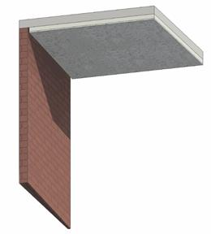

### *Требования к моделированию*

Таблица 78

<table header="row">
  <tr><td colspan="3">Инструмент моделирования</td></tr>
  <tr>
    <td colspan="3">
      - «Перекрытие»
      - Для вертикальных участков «Стены»
    </td>
  </tr>
  <tr><td colspan="3">Внешний вид</td></tr>
  <tr>
    <td colspan="3">
      
    </td>
  </tr>
  <tr><td colspan="3">Проектируемый объем</td></tr>
  <tr><td rowspan="4">Этап</td><td>К</td><td rowspan="2">Не моделируется</td></tr>
  <tr><td>ПД</td></tr>
  <tr>
    <td>ТД</td>
    <td>
      Выполняется:

      - Моделирование отдельными элементами в точном расположении и габаритах каждого помещения типовых и уникальных этажей в объеме всего здания.
      - Заполнение параметров, необходимых для формирования сводной ведомости объемов работ.
    </td>
  </tr>
  <tr>
    <td>РД</td>
    <td>
      Выполняется:

      - Моделирование отдельными элементами в точном расположении и габаритах каждого помещения типовых и уникальных этажей в объеме всего здания.
      - Заполнение всех параметров, необходимых для формирования спецификаций и ведомостей элементов в рабочей документации.
    </td>
  </tr>
  <tr><td colspan="3">Примечание</td></tr>
  <tr>
    <td colspan="3">
      - См. совместно с п. 10.22
      - Допускается моделирование структуры слоев в составе стены укрупненно с подробным описанием состава стены/перегородки в параметре G_Состав конструкции.
    </td>
  </tr>
  <tr><td colspan="3">Запрещенные действия</td></tr>
  <tr>
    <td colspan="3">
      - Разработка элементов модели участвующих в оформлении документации в рабочих наборах начинающихся с «(50)\_»
      - Использование инструмента «Краска» для подсчета площадей.
    </td>
  </tr>
</table>

### *Требования к параметризации*

Таблица 79

<table header="row">
  <tr><td colspan="2" rowspan="2">Атрибут</td><td colspan="4">Этап</td><td rowspan="2">Пример заполнения</td></tr>
  <tr><td>К</td><td>ПД</td><td>ТД</td><td>РД</td></tr>
  <tr><td colspan="7">Уровень геометрической проработки модели</td></tr>
  <tr><td rowspan="4">Геометрия</td><td>Точные габариты</td><td></td><td></td><td>●</td><td>●</td><td></td></tr>
  <tr><td>Точное расположение</td><td></td><td></td><td>●</td><td>●</td><td></td></tr>
  <tr><td>Внешний образ/вид</td><td></td><td></td><td>●</td><td>●</td><td></td></tr>
  <tr><td>Материалы2</td><td></td><td></td><td>●</td><td>●</td><td></td></tr>
  <tr><td colspan="7">Уровень проработки атрибутивной информации</td></tr>
  <tr><td>Размеры</td><td>Площадь</td><td></td><td></td><td>●</td><td>●</td><td>10 м2</td></tr>
  <tr><td rowspan="2">Идентификация</td><td>Описание</td><td></td><td></td><td></td><td>●</td><td>Чистовая отделка потолка</td></tr>
  <tr>
    <td>G_Состав конструкции</td>
    <td></td>
    <td></td>
    <td>●</td>
    <td>●</td>
    <td>
      1\. Штукатурка 10 мм

      2\. Шпатлевка

      3\. Окраска за 2 раза
    </td>
  </tr>
  <tr><td>Маркировка</td><td>ADSK_Марка</td><td></td><td></td><td></td><td>●</td><td>ПТ-1</td></tr>
  <tr><td>Ресурсы</td><td>ADSK_Единица измерения</td><td></td><td></td><td>●</td><td>●</td><td>м2</td></tr>
  <tr><td rowspan="3">Положение</td><td>ADSK_Номер здания</td><td></td><td></td><td>●</td><td>●</td><td>Строение 1</td></tr>
  <tr><td>ADSK_Этаж</td><td></td><td></td><td>●</td><td>●</td><td>3</td></tr>
  <tr><td>ADSK_Номер секции</td><td></td><td></td><td>●</td><td>●</td><td>К1</td></tr>
  <tr><td>Прочее</td><td>ADSK_Комплект чертежей3</td><td></td><td></td><td></td><td>●</td><td>АР1</td></tr>
</table>

1 - Заполняется только у элементов, для которых явное указание требуется, согласно проектным решениям.

2 - Всем элементам (каждому отдельному слою) должен быть назначен конкретный материал из библиотеки материалов

3 - Заполняется если из модели выпускается несколько комплектов документации.
