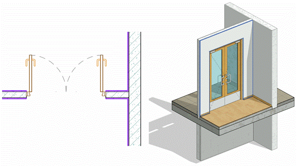

### *Требования к моделированию*

Таблица 76

<table header="row">
  <tr><td colspan="3">Инструмент моделирования</td></tr>
  <tr>
    <td colspan="3">
      - Системное семейство категории «Стены» инструментом «Стена: архитектурная».
      - Для горизонтальных элементов допускается моделирование категорией «Перекрытия»
    </td>
  </tr>
  <tr><td colspan="3">Внешний вид</td></tr>
  <tr>
    <td colspan="3">
      
    </td>
  </tr>
  <tr><td colspan="3">Проектируемый объем</td></tr>
  <tr><td rowspan="4">Этап</td><td>К</td><td>Не моделируется</td></tr>
  <tr>
    <td>ПД</td>
    <td>
      Выполняется:

      - Моделирование в точном расположении и габаритах в точном расположении и габаритах каждого помещения типовых и уникальных этажей.
      - Заполнение основных параметров, необходимых для идентификации элемента.
    </td>
  </tr>
  <tr>
    <td>ТД</td>
    <td>
      Выполняется:

      - Моделирование отдельными элементами в точном расположении и габаритах каждого помещения типовых и уникальных этажей в объеме всего здания.
      - Заполнение параметров, необходимых для формирования сводной ведомости объемов работ.
    </td>
  </tr>
  <tr>
    <td>РД</td>
    <td>
      Выполняется:

      - Моделирование отдельными элементами в точном расположении и габаритах каждого помещения типовых и уникальных этажей в объеме всего здания.
      - Заполнение всех параметров, необходимых для формирования спецификаций и ведомостей элементов в рабочей документации.
    </td>
  </tr>
  <tr><td colspan="3">Примечание</td></tr>
  <tr>
    <td colspan="3">
      - Отделка стен моделируется отдельно от стен-основ.
      - При моделировании отделочных слоев (отдельно от стен-основ), допускается использование многослойных стен с разделением на слои. При этом всем слоям должна быть назначена корректная функция. Допускается моделирование структуры слоев в составе стены укрупненно с подробным описанием состава стены/перегородки в параметре G_Состав конструкции.
      - Моделирование стен отделки должно быть выполнено так, чтобы «Наружная сторона» элемента отделки была ориентирована внутрь помещения, «Внутренняя сторона» - на стену-основу.
      - Отделка стен моделируется отдельно для каждого помещения.
      - Стены отделки должны быть разделены по этажам.
      - Стены отделки должны иметь корректные привязки к уровням.
      - При использовании плагинов необходимо учесть, что построение отделки стен должно происходить после построения полов.
    </td>
  </tr>
  <tr><td colspan="3">Запрещенные действия</td></tr>
  <tr>
    <td colspan="3">
      - Разработка элементов модели участвующих в оформлении документации в рабочих наборах начинающихся с «(50)\_»
      - Использование инструмента «Составная стена».
      - Назначение параметру «Зависимость сверху» значения «Неприсоединенная».
      - Использование инструмента «Присоединить верх/основание».
      - Моделирование стен через несколько этажей, в случае если это не предусматривает технология монтажа.
      - Некорректное использование функций слоев.
      - Моделирование элемента отделки стен, проходящего через несколько помещений.
      - При моделировании отделки в той же модели, что и объемно-планировочные решения запрещено использовать «Редактирование профиля» стен для прорезания проемов в отделке.
      - Использование инструмента «Краска» для подсчета площадей
    </td>
  </tr>
</table>

### *Требования к параметризации*

Таблица 77

<table header="row">
  <tr><td colspan="2" rowspan="2">Атрибут</td><td colspan="4">Этап</td><td rowspan="2">Пример заполнения</td></tr>
  <tr><td>К</td><td>ПД</td><td>ТД</td><td>РД</td></tr>
  <tr><td colspan="7">Уровень геометрической проработки модели</td></tr>
  <tr><td rowspan="8">Геометрия</td><td>Условные габариты</td><td>●</td><td></td><td></td><td></td><td></td></tr>
  <tr><td>Точные габариты</td><td></td><td>●</td><td>●</td><td>●</td><td></td></tr>
  <tr><td>Условное расположение</td><td>●</td><td></td><td></td><td></td><td></td></tr>
  <tr><td>Точное расположение</td><td></td><td>●</td><td>●</td><td>●</td><td></td></tr>
  <tr><td>Внешний образ/вид</td><td>●</td><td>●</td><td>●</td><td>●</td><td></td></tr>
  <tr><td>Многослойная структура (допускается)</td><td>●</td><td>●</td><td>●</td><td>●</td><td></td></tr>
  <tr><td>Слои в виде отдельных стен1</td><td></td><td></td><td>●</td><td>●</td><td></td></tr>
  <tr><td>Материалы1</td><td></td><td>●</td><td>●</td><td>●</td><td></td></tr>
  <tr><td colspan="7">Уровень проработки атрибутивной информации</td></tr>
  <tr><td rowspan="2">Размеры</td><td>Площадь / ADSK_Размер_Площадь</td><td></td><td>●</td><td>●</td><td>●</td><td>8,4 м²</td></tr>
  <tr><td>Толщина / ADSK_Размер_Толщина</td><td></td><td>●</td><td>●</td><td>●</td><td>20 мм</td></tr>
  <tr><td rowspan="2">Идентификация</td><td>Описание</td><td></td><td></td><td>●</td><td>●</td><td>Отделка стен</td></tr>
  <tr>
    <td>G_Состав конструкции</td>
    <td></td>
    <td>●</td>
    <td>●</td>
    <td>●</td>
    <td>
      1\. Штукатурка − 15 мм

      2\. Шпатлевка − 5 мм

      3\. Покраска в 2 слоя
    </td>
  </tr>
  <tr><td rowspan="2">Маркировка</td><td>ADSK_Марка</td><td></td><td></td><td></td><td>●</td><td>ОТ-1</td></tr>
  <tr><td>ADSK_Единица измерения</td><td></td><td>●</td><td>●</td><td>●</td><td>м²</td></tr>
  <tr><td rowspan="3">Положение</td><td>ADSK_Номер здания</td><td></td><td>●</td><td>●</td><td>●</td><td>Строение 1</td></tr>
  <tr><td>ADSK_Этаж</td><td></td><td>●</td><td>●</td><td>●</td><td>3</td></tr>
  <tr><td>ADSK_Номер секции</td><td></td><td>●</td><td>●</td><td>●</td><td>К1</td></tr>
  <tr><td>Прочее</td><td>ADSK_Комплект чертежей2</td><td></td><td></td><td></td><td>●</td><td>АР1</td></tr>
</table>

1 - Всем элементам (каждому отдельному слою) должен быть назначен конкретный материал из библиотеки материалов

2 - Заполняется если из модели выпускается несколько комплектов документации.
