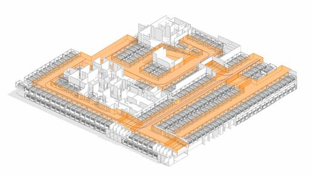

### Требования к моделированию

Таблица 98

<table header="row">
  <tr><td colspan="4">Инструмент моделирования</td></tr>
  <tr>
    <td colspan="4">
      - Проезды автомобилей необходимо моделировать инструментом «Модель в контексте» категории «Парковка».
    </td>
  </tr>
  <tr><td colspan="4">Внешний вид</td></tr>
  <tr>
    <td colspan="4">
      
    </td>
  </tr>
  <tr><td colspan="4">Проектируемый объем</td></tr>
  <tr><td rowspan="4">Этап</td><td>К</td><td>Моделируется в условных габаритах.</td><td></td></tr>
  <tr>
    <td>ПД</td>
    <td>
      Выполняется:

      - Моделирование в условных габаритах и расположении для проездов в объеме всех помещений для машиномест паркинга.
      - Заполнение основных параметров, необходимых для идентификации элемента
    </td>
    <td></td>
  </tr>
  <tr>
    <td>ТД</td>
    <td>
      Выполняется:

      - Моделирование в точных габаритах и точном расположении для проездов в объеме всех помещений для машиномест паркинга.
      - Заполнение основных параметров, необходимых для идентификации элемента
    </td>
    <td></td>
  </tr>
  <tr>
    <td>РД</td>
    <td>
      Выполняется:

      - Моделирование в точных габаритах и точном расположении для проездов в объеме всех помещений для машиномест паркинга.
      - Заполнение основных параметров, необходимых для идентификации элемента
    </td>
    <td></td>
  </tr>
  <tr><td colspan="4">Примечание</td></tr>
  <tr>
    <td colspan="4">
      - \-
    </td>
  </tr>
  <tr><td colspan="4">Запрещенные действия</td></tr>
  <tr>
    <td colspan="4">
      - Разработка элементов модели участвующих в оформлении документации в рабочих наборах начинающихся с «(50)\_»
    </td>
  </tr>
</table>

### *Требования к параметризации*

Таблица 99

<table header="row">
  <tr><td colspan="2" rowspan="2">Атрибут</td><td colspan="4">Этап</td><td rowspan="2">Пример заполнения</td></tr>
  <tr><td>К</td><td>ПД</td><td>ТД</td><td>РД</td></tr>
  <tr><td colspan="7">Уровень геометрической проработки модели</td></tr>
  <tr><td rowspan="5">Геометрия</td><td>Точные габариты</td><td></td><td></td><td>●</td><td>●</td><td></td></tr>
  <tr><td>Условные габариты</td><td>●</td><td>●</td><td></td><td></td><td></td></tr>
  <tr><td>Условное расположение</td><td>●</td><td>●</td><td></td><td></td><td></td></tr>
  <tr><td>Точное расположение</td><td></td><td></td><td>●</td><td>●</td><td></td></tr>
  <tr><td>Внешний образ/вид</td><td>●</td><td>●</td><td>●</td><td>●</td><td></td></tr>
  <tr><td colspan="7">Уровень проработки атрибутивной информации</td></tr>
  <tr><td>Размеры</td><td>ADSK_Размер_Длина</td><td></td><td>●</td><td>●</td><td>●</td><td>12 м.п.</td></tr>
  <tr><td>Идентификация</td><td>Описание</td><td></td><td></td><td>●</td><td>●</td><td>Путь эвакуации</td></tr>
  <tr><td rowspan="2">Положение</td><td>ADSK_Этаж</td><td></td><td>●</td><td>●</td><td>●</td><td>1</td></tr>
  <tr><td>ADSK_Номер секции</td><td></td><td>●</td><td>●</td><td>●</td><td>К1</td></tr>
  <tr><td>Прочее</td><td>ADSK_Комплект чертежей1</td><td></td><td></td><td></td><td>●</td><td>АР1</td></tr>
</table>

1 - Заполняется если из модели выпускается несколько комплектов документации.
