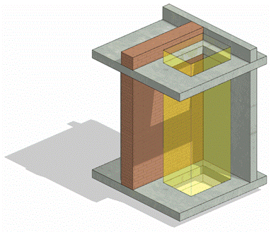

### Требования к моделированию

Таблица 90

<table header="row">
  <tr><td colspan="4">Инструмент моделирования</td></tr>
  <tr><td colspan="4">\-</td></tr>
  <tr><td colspan="4">Внешний вид</td></tr>
  <tr>
    <td colspan="4">
      
    </td>
  </tr>
  <tr><td colspan="4">Проектируемый объем</td></tr>
  <tr><td rowspan="4">Этап</td><td>К</td><td>Моделируются шахты в перекрытиях</td><td></td></tr>
  <tr>
    <td>ПД</td>
    <td>
      Выполняется:

      - Моделирование шахт и отверстий в стенах и перекрытиях в условном расположении и габаритах каждого помещения типовых и уникальных этажей в объеме всего здания.
      - Моделируются отверстия габаритными размерами ≥ 500 мм по одной из сторон или диаметром более ≥ 500 мм.
      - Размер отверстия обязательного к моделированию может быть менее указанного.
      - В ГКЛ не моделируются.
    </td>
    <td></td>
  </tr>
  <tr>
    <td>ТД</td>
    <td>
      Выполняется:

      - Моделирование шахт и отверстий в стенах и перекрытиях в объеме всего здания в точном расположении и габаритах каждого помещения типовых и уникальных этажей в объеме всего здания.
      - Моделируются отверстия габаритными размерами ≥ 200 мм по одной из сторон или диаметром более ≥ 200 мм.
      - В стенах из листовых материалов (ГКЛ и т.п.) не моделируются.
    </td>
    <td></td>
  </tr>
  <tr>
    <td>РД</td>
    <td>
      Выполняется:

      - Моделирование шахт и отверстий в стенах и перекрытиях в объеме всего здания в точном расположении и габаритах каждого помещения типовых и уникальных этажей в объеме всего здания.
      - Моделируются отверстия габаритными размерами ≥ 200 мм по одной из сторон или диаметром более ≥ 200 мм.
      - В ГКЛ не моделируются.
    </td>
    <td></td>
  </tr>
  <tr><td colspan="4">Примечание</td></tr>
  <tr>
    <td colspan="4">
      - Элементы должны быть выполнены загружаемым семейством категории «Окна».
      - Отверстия должны образовывать физическое вырезание объема в стенах или перекрытиях.
    </td>
  </tr>
  <tr><td colspan="4">Запрещенные действия</td></tr>
  <tr>
    <td colspan="4">
      - Разработка элементов модели участвующих в оформлении документации в рабочих наборах начинающихся с «(50)\_».
    </td>
  </tr>
</table>

### *Требования к параметризации*

Таблица 91

<table header="row">
  <tr><td colspan="2" rowspan="2">Атрибут</td><td colspan="4">Этап</td><td rowspan="2">Пример заполнения</td></tr>
  <tr><td>К</td><td>ПД</td><td>ТД</td><td>РД</td></tr>
  <tr><td colspan="7">Уровень геометрической проработки модели</td></tr>
  <tr><td rowspan="5">Геометрия</td><td>Условные габариты</td><td>●</td><td>●</td><td></td><td></td><td></td></tr>
  <tr><td>Точные габариты</td><td></td><td></td><td>●</td><td>●</td><td></td></tr>
  <tr><td>Условное расположение</td><td>●</td><td>●</td><td></td><td></td><td></td></tr>
  <tr><td>Точное расположение</td><td></td><td></td><td>●</td><td>●</td><td></td></tr>
  <tr><td>Внешний образ/вид</td><td>●</td><td>●</td><td>●</td><td>●</td><td></td></tr>
  <tr><td colspan="7">Уровень проработки атрибутивной информации</td></tr>
  <tr><td rowspan="3">Размеры</td><td>ADSK_Размер_Высота</td><td></td><td>●</td><td>●</td><td>●</td><td>2200 мм</td></tr>
  <tr><td>ADSK_Размер_Ширина</td><td></td><td>●</td><td>●</td><td>●</td><td>2500 мм</td></tr>
  <tr><td>ADSK_Размер_Глубина</td><td></td><td>●</td><td>●</td><td>●</td><td>5300 мм</td></tr>
  <tr><td rowspan="3">Положение</td><td>ADSK_Номер здания</td><td></td><td>●</td><td>●</td><td>●</td><td>Строение 1</td></tr>
  <tr><td>ADSK_Этаж</td><td></td><td>●</td><td>●</td><td>●</td><td>3</td></tr>
  <tr><td>ADSK_Номер секции</td><td></td><td>●</td><td>●</td><td>●</td><td>К1</td></tr>
  <tr><td>Прочее</td><td>ADSK_Комплект чертежей1</td><td></td><td></td><td></td><td>●</td><td>АР1</td></tr>
</table>

1 - Заполняется только у элементов, для которых явное указание требуется, согласно проектным решениям.

2 - Всем элементам (каждому отдельному слою) должен быть назначен конкретный материал из библиотеки материалов

3 - Заполняется если из модели выпускается несколько комплектов документации.
