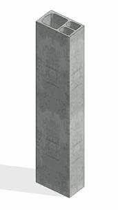

### *Требования к моделированию*

Таблица 44

<table header="row">
  <tr><td colspan="4">Инструмент моделирования</td></tr>
  <tr>
    <td colspan="4">
      - «Обобщённая модель»
      - «Специальное оборудование»
      - «Колонна»
    </td>
  </tr>
  <tr><td colspan="4">Внешний вид</td></tr>
  <tr>
    <td colspan="4">
      
    </td>
  </tr>
  <tr><td colspan="4">Проектируемый объем</td></tr>
  <tr><td rowspan="4">Этап</td><td>К</td><td>Не моделируется.</td><td></td></tr>
  <tr>
    <td>ПД</td>
    <td>
      Выполняется:

      - Расстановка в точных габаритах и с точным расположением на типовых и уникальных этажах в объеме всего здания, согласно проектным решениям.
      - Заполнение основных параметров, необходимых для идентификации элемента.
    </td>
    <td></td>
  </tr>
  <tr>
    <td>ТД</td>
    <td>
      Выполняется:

      - Расстановка в точных габаритах и с точным расположением на типовых и уникальных этажах в объеме всего здания, согласно проектным решениям.
      - Заполнение параметров необходимых для формирования сводной ведомости объемов работ.
    </td>
    <td></td>
  </tr>
  <tr>
    <td>РД</td>
    <td>
      Выполняется:

      - Расстановка в точных габаритах и с точным расположением на типовых и уникальных этажах в объеме всего здания, согласно проектным решениям.
      - Заполнение всех параметров, необходимых для формирования спецификаций и ведомостей элементов в рабочей документации.
    </td>
    <td></td>
  </tr>
  <tr><td colspan="4">Примечание</td></tr>
  <tr>
    <td colspan="4">
      - \-
    </td>
  </tr>
  <tr><td colspan="4">Запрещенные действия</td></tr>
  <tr>
    <td colspan="4">
      - Разработка элементов модели участвующих в оформлении документации в рабочих наборах начинающихся с «(50)\_»
    </td>
  </tr>
</table>

### *Требования к параметризации*

Таблица 45

<table header="row">
  <tr><td colspan="2" rowspan="2">Атрибут</td><td colspan="4">Этап</td><td rowspan="2">Пример заполнения</td></tr>
  <tr><td>К</td><td>ПД</td><td>ТД</td><td>РД</td></tr>
  <tr><td colspan="7">Уровень геометрической проработки модели</td></tr>
  <tr><td rowspan="4">Геометрия</td><td>Точные габариты</td><td></td><td>●</td><td>●</td><td>●</td><td></td></tr>
  <tr><td>Точное расположение</td><td></td><td>●</td><td>●</td><td>●</td><td></td></tr>
  <tr><td>Внешний образ/вид</td><td></td><td>●</td><td>●</td><td>●</td><td></td></tr>
  <tr><td>Материалы2</td><td></td><td>●</td><td>●</td><td>●</td><td></td></tr>
  <tr><td colspan="7">Уровень проработки атрибутивной информации</td></tr>
  <tr><td rowspan="4">Размеры</td><td>ADSK_Размер_Высота</td><td></td><td>●</td><td>●</td><td>●</td><td>3000 мм</td></tr>
  <tr><td>ADSK_Размер_Ширина</td><td></td><td>●</td><td>●</td><td>●</td><td>800 мм</td></tr>
  <tr><td>ADSK_Размер_Глубина</td><td></td><td>●</td><td>●</td><td>●</td><td>400 мм</td></tr>
  <tr><td>Объем</td><td></td><td></td><td>●</td><td>●</td><td>0,96 м³</td></tr>
  <tr><td rowspan="2">Идентификация</td><td>Описание</td><td></td><td></td><td>●</td><td>●</td><td>Вентблок</td></tr>
  <tr><td>ADSK_Предел огнестойкости1</td><td></td><td>●</td><td>●</td><td>●</td><td>EI 30</td></tr>
  <tr><td>Маркировка</td><td>ADSK_Марка</td><td></td><td></td><td></td><td>●</td><td>ВБ-11</td></tr>
  <tr><td rowspan="2">Ресурсы</td><td>ADSK_Единица измерения1</td><td></td><td>●</td><td>●</td><td>●</td><td>Шт.</td></tr>
  <tr><td>ADSK_Завод-изготовитель1</td><td></td><td></td><td></td><td>●</td><td>Россия</td></tr>
  <tr><td rowspan="3">Положение</td><td>ADSK_Номер здания</td><td></td><td>●</td><td>●</td><td>●</td><td>Строение 1</td></tr>
  <tr><td>ADSK_Этаж</td><td></td><td>●</td><td>●</td><td>●</td><td>2</td></tr>
  <tr><td>ADSK_Номер секции</td><td></td><td>●</td><td>●</td><td>●</td><td>3</td></tr>
  <tr><td>Прочее</td><td>ADSK_Комплект чертежей3</td><td></td><td></td><td></td><td>●</td><td>АР1</td></tr>
</table>

1 - Заполняется только у элементов, для которых явное указание требуется, согласно проектным решениям.

2 - Всем элементам (каждому отдельному слою) должен быть назначен конкретный материал из библиотеки материалов.

3 - Заполняется если из модели выпускается несколько комплектов документации.
