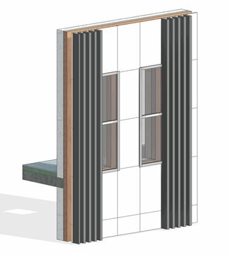

### *Требования к моделированию*

Таблица 46

<table header="row">
  <tr><td colspan="4">Инструмент моделирования</td></tr>
  <tr>
    <td colspan="4">
      Вертикальные элементы:

      - Cистемный инструмент «Стена: архитектурная»
      - Cистемный инструмент «Стена: Витраж»

      Горизонтальные элементы:

      - Системный инструмент «Перекрытие: архитектурное»
      - Cистемный инструмент «Кровля»
    </td>
  </tr>
  <tr><td colspan="4">Внешний вид</td></tr>
  <tr>
    <td colspan="4">
      
    </td>
  </tr>
  <tr><td colspan="4">Проектируемый объем</td></tr>
  <tr><td rowspan="4">Этап</td><td>К</td><td>Проработка основной идеи фасада, согласно архитектурной задумке.</td><td></td></tr>
  <tr>
    <td>ПД</td>
    <td>
      Выполняется:

      - Моделирование фасада, согласно архитектурной задумке по всем типовым и уникальным этажам.
      - Навесной фасад моделируется отдельным элементом.
      - Заполнение основных параметров, необходимых для идентификации элемента.
    </td>
    <td></td>
  </tr>
  <tr>
    <td>ТД</td>
    <td>
      Выполняется:

      - Моделирование фасада, согласно архитектурной задумке по всем типовым и уникальным этажам.
      - Навесной фасад моделируется отдельным элементом.
      - Заполнение параметров, необходимых для формирования сводной ведомости объемов работ.
    </td>
    <td></td>
  </tr>
  <tr>
    <td>РД</td>
    <td>
      Выполняется:

      - Моделирование фасада, согласно архитектурной задумке по всем типовым и уникальным этажам.
      - Навесной фасад моделируется отдельным элементом.
      - Заполнение всех параметров, необходимых для формирования спецификаций и ведомостей элементов в рабочей документации.
    </td>
    <td></td>
  </tr>
  <tr><td colspan="4">Примечание</td></tr>
  <tr>
    <td colspan="4">
      - Всем слоям должна быть назначена корректная функция.
      - Моделирование основных слоев: основа, утеплитель, финишная отделка – должно выполняться из отдельных элементов. Допускается моделирование финишного покрытия в составе фасадной стены совместно с утеплителем на стадии 3D-концепции, стена-основа должна моделироваться отдельной стеной.
      - Допускается укрупненное моделирование слоев в структуре стены при условии заполнения подробного состава структуры в параметр G_Состав конструкции.
      - Система каркаса: кронштейны, направляющие, металлический каркас не моделируется
    </td>
  </tr>
  <tr><td colspan="4">Запрещенные действия</td></tr>
  <tr>
    <td colspan="4">
      - Использование инструмента «Составная стена».
      - Использование многослойных стен на этапах, когда многослойность не допускается.
      - Использование инструмента «Присоединить верх/основание» (за исключением случаев примыкания к низу лестничных маршей, рамп и кровель сложной формы).
      - Моделирование стен через несколько этажей, в случае если это не обусловлено проектной идеей.
      - Размещение стен со свободным торцом без отсоединения.
      - Некорректное использование функций слоев.
      - Использование инструмента «Редактировать профиль» для создания проема или отверстия.
      - Использование инструмента «Модель в контексте» категории Стены, кроме случаев фасадного декора сложной формы.
      - Разработка элементов модели участвующих в оформлении документации в рабочих наборах начинающихся с «(50)\_»
    </td>
  </tr>
</table>

### *Требования к параметризации*

Таблица 47

<table header="row">
  <tr><td colspan="2" rowspan="2">Атрибут</td><td colspan="4">Этап</td><td rowspan="2">Пример заполнения</td></tr>
  <tr><td>К</td><td>ПД</td><td>ТД</td><td>РД</td></tr>
  <tr><td colspan="7">Уровень геометрической проработки модели</td></tr>
  <tr><td rowspan="7">Геометрия</td><td>Условные габариты</td><td>●</td><td>●</td><td></td><td></td><td></td></tr>
  <tr><td>Точные габариты</td><td></td><td></td><td>●</td><td>●</td><td></td></tr>
  <tr><td>Условное расположение</td><td>●</td><td>●</td><td></td><td></td><td></td></tr>
  <tr><td>Точное расположение</td><td></td><td></td><td>●</td><td>●</td><td></td></tr>
  <tr><td>Внешний образ/вид4</td><td>●</td><td>●</td><td>●</td><td>●</td><td></td></tr>
  <tr><td>Материалы2</td><td></td><td>●</td><td>●</td><td>●</td><td></td></tr>
  <tr><td>Система каркаса5</td><td></td><td></td><td></td><td></td><td></td></tr>
  <tr><td colspan="7">Уровень проработки атрибутивной информации</td></tr>
  <tr><td rowspan="5">Размеры</td><td>Площадь / ADSK_Размер_Площадь</td><td></td><td>●</td><td>●</td><td>●</td><td>120,0 м²</td></tr>
  <tr><td>Длина / ADSK_Размер_Длина</td><td></td><td>●</td><td>●</td><td>●</td><td>2000 мм</td></tr>
  <tr><td>Высота / ADSK_Размер_Высота</td><td></td><td>●</td><td>●</td><td>●</td><td>3500 мм</td></tr>
  <tr><td>Толщина / ADSK_Размер_Толщина</td><td></td><td>●</td><td>●</td><td>●</td><td>120 мм</td></tr>
  <tr><td>Объем</td><td></td><td>●</td><td>●</td><td>●</td><td>1,01 м³</td></tr>
  <tr><td rowspan="3">Идентификация</td><td>Описание</td><td></td><td></td><td>●</td><td>●</td><td>Фасадный кирпич</td></tr>
  <tr><td>G_Состав конструкции4</td><td></td><td>●</td><td>●</td><td>●</td><td></td></tr>
  <tr><td>ADSK_Предел огнестойкости1</td><td></td><td>●</td><td>●</td><td>●</td><td>REI 45; EI 45</td></tr>
  <tr><td>Маркировка</td><td>ADSK_Марка</td><td></td><td></td><td></td><td>●</td><td>ПД-1</td></tr>
  <tr><td rowspan="2">Ресурсы</td><td>ADSK_Единица измерения1</td><td></td><td>●</td><td>●</td><td>●</td><td>м²</td></tr>
  <tr><td>ADSK_Завод-изготовитель1</td><td></td><td></td><td></td><td>●</td><td>Россия</td></tr>
  <tr><td rowspan="3">Положение</td><td>ADSK_Номер здания</td><td></td><td>●</td><td>●</td><td>●</td><td>Строение 1</td></tr>
  <tr><td>ADSK_Этаж</td><td></td><td>●</td><td>●</td><td>●</td><td>2</td></tr>
  <tr><td>ADSK_Номер секции</td><td></td><td>●</td><td>●</td><td>●</td><td>3</td></tr>
  <tr><td>Прочее</td><td>ADSK_Комплект чертежей3</td><td></td><td></td><td></td><td>●</td><td>АР1</td></tr>
</table>

1 - Заполняется только у элементов, для которых явное указание требуется, согласно проектным решениям.

2 - Всем элементам (каждому отдельному слою) должен быть назначен конкретный материал из библиотеки материалов.

3 - Заполняется если из модели выпускается несколько комплектов документации.

4 - Многослойная стена приемлема только для штукатурных фасадов.

5 – Система каркаса: кронштейны, направляющие, металлический каркас не моделируется.
