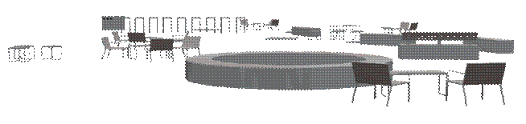

### Требования к моделированию

Таблица 196

<table header="row">
  <tr><td colspan="3">**Инструмент моделирования**</td></tr>
  <tr>
    <td colspan="3">
      При моделировании в Civil 3D, стандартный инструмент «Вставить блок»

      При моделировании к Revit, стандартный инструмент «Загрузить семейство»
    </td>
  </tr>
  <tr><td colspan="3">**Внешний вид**</td></tr>
  <tr>
    <td colspan="3">
      
    </td>
  </tr>
  <tr><td colspan="3">**Проектируемый объем**</td></tr>
  <tr><td rowspan="4">**Этап**</td><td>К</td><td rowspan="2">Не моделируется.</td></tr>
  <tr><td>ПД</td></tr>
  <tr><td>ТД</td><td>Моделируются типовые МАФ1.</td></tr>
  <tr><td>РД</td><td>Моделируются типовые МАФ1.</td></tr>
  <tr><td colspan="3">**Примечание**</td></tr>
  <tr>
    <td colspan="3">
      - Модель МАФ выполнять в Autodesk Civil 3D/Autodesk Revit в отдельном файле модели.
      - Элементы МАФ должны быть «подняты» на отметку ЦМР (проектную или существующую).
      - Модель должна иметь единую систему координат с проектируемым объектом и привязку к московской системе координат;
      - Элементы МАФ должны быть увязаны с элементами смежников.
    </td>
  </tr>
</table>

1В случае необходимости допускается пониженный уровень детализации для элементов модели на этапе ТД и РД, утверждаемый в Плане выполнения ЦИМ.

### Требования к параметризации

Уровень проработки атрибутивной информации может быть изменен в случае необходимости, изменения утверждаются в Плане выполнения ЦИМ.

Таблица 197

<table header="row">
  <tr><td colspan="2" rowspan="2">Атрибут</td><td colspan="4">Этап</td><td rowspan="2">Тип данных</td><td rowspan="2">Пример заполнения</td><td rowspan="2">Возможные значения</td></tr>
  <tr><td>К</td><td>ПД</td><td>ТД</td><td>РД</td></tr>
  <tr><td colspan="9">Уровень проработки атрибутивной информации</td></tr>
  <tr><td rowspan="2">Идентификация</td><td>Наименование</td><td></td><td>●</td><td>●</td><td>●</td><td>Текст</td><td>Урна для мусора 3 л</td><td>Указывается наименование МАФ</td></tr>
  <tr><td>Артикул</td><td></td><td></td><td></td><td>●</td><td>Текст</td><td>1748577-3L</td><td>Указывается артикул МАФ</td></tr>
  <tr>
    <td>Размеры</td>
    <td>
      Длина

      Ширина

      Высота
    </td>
    <td></td>
    <td>●</td>
    <td>●</td>
    <td>●</td>
    <td>Длина</td>
    <td>500 мм</td>
    <td>
      Указываются размеры:

      Длина

      Ширина

      Высота
    </td>
  </tr>
  <tr><td rowspan="2">Ресурсы</td><td>Единица измерения</td><td></td><td>●</td><td>●</td><td>●</td><td>Текст</td><td>шт.</td><td>Указывается единица измерения</td></tr>
  <tr><td>Завод изготовитель</td><td></td><td></td><td>●</td><td>●</td><td>Текст</td><td>Россия</td><td>Указывается завод изготовитель элемента</td></tr>
</table>
