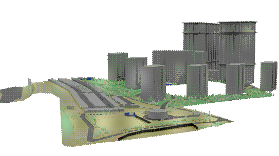

### Требования к моделированию

Таблица 199

<table header="row">
  <tr><td colspan="3">**Инструмент моделирования**</td></tr>
  <tr>
    <td colspan="3">
      - Моделирование существующих зданий и сооружений выполнять в Autodesk Civil 3D или в Autodesk Revit.
    </td>
  </tr>
  <tr><td colspan="3">**Внешний вид**</td></tr>
  <tr>
    <td colspan="3">
      
    </td>
  </tr>
  <tr><td colspan="3">**Проектируемый объем1**</td></tr>
  <tr>
    <td rowspan="4">**Этап**</td>
    <td>К</td>
    <td rowspan="4">
      Существующие здания и сооружения моделируются условными объемными элементами (боксами) в объеме необходимом для увязки проектных решений существующими в границах проектируемого объекта.

      Существующие здания и сооружения моделируются условными объемными элементами (боксами) в объеме необходимом для увязки проектных решений существующими в границах проектируемого объекта.
    </td>
  </tr>
  <tr><td>ПД</td></tr>
  <tr><td>ТД</td></tr>
  <tr><td>РД</td></tr>
  <tr><td colspan="3">**Примечание**</td></tr>
  <tr>
    <td colspan="3">
      - В качестве основного уровня детализации принимается моделирование условными объемными элементами.
      - Детализация существующих зданий может быть увеличена при решении специфических задач на объектах уникального строительства.
      - Повышение уровня детализации фиксируется в Плане выполнения ЦИМ (ПИМ).
    </td>
  </tr>
</table>

1В случае необходимости допускается пониженный уровень детализации для элементов модели на этапе ТД и РД, утверждаемый в Плане выполнения ЦИМ.

### Требования к параметризации

Параметризация элементов индивидуальна для каждого проекта, подробно описывается в Плане выполнения ЦИМ (ПИМ).
