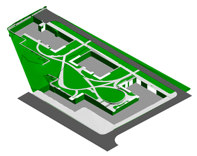

### Требования к моделированию

Таблица 192

<table header="row">
  <tr><td colspan="3">**Инструмент моделирования**</td></tr>
  <tr><td colspan="3">При моделировании в Civil 3D, стандартный инструмент «Поверхность» (Формируется TIN-поверхность).</td></tr>
  <tr><td colspan="3">При моделировании в Revit, стандартный инструмент «Топоповерхность/Топотело».</td></tr>
  <tr>
    <td colspan="3">
      
    </td>
  </tr>
  <tr><td colspan="3">**Проектируемый объем1**</td></tr>
  <tr><td rowspan="4">**Этап**</td><td>К</td><td>Не моделируется.</td></tr>
  <tr><td>ПД</td><td>Набор проектируемых поверхностей, разбитых по внешним характеристикам покрытий.</td></tr>
  <tr><td>ТД</td><td>Набор проектируемых поверхностей, разбитых по внешним характеристикам покрытий.</td></tr>
  <tr><td>РД</td><td>Набор проектируемых поверхностей, разбитых по внешним характеристикам покрытий.</td></tr>
  <tr><td colspan="3">**Примечание**</td></tr>
  <tr>
    <td colspan="3">
      - Модель должна иметь единую систему координат с проектируемым объектом и привязку к московской системе координат;
      - Выполняется разбиение поверхности на участки, являющиеся отдельными поверхностями;
      - Выполняется заполнение параметров согласно проектным решениям и требованиям экспертиз.
      - Рельеф моделируется с учетом выхода на существующий неизменяемый рельеф (проезжие части, не затрагиваемые проектом)
      - Необходимо выполнить следующее зонирование территории: озеленение, покрытия и поверхности функциональных зон: газон, твёрдые покрытия, детские площадки, площадки для отдыха взрослых и т.д.
      - Пожарные проезды;
      - Цветники и клумбы моделируются в виде поверхностей, повторяющих проектный рельеф в своих границах.
    </td>
  </tr>
</table>

1 - В случае необходимости допускается пониженный уровень детализации для элементов модели на этапе ТД и РД, утверждаемый в Плане выполнения ЦИМ.

### Требования к параметризации

Уровень проработки атрибутивной информации может быть изменен в случае необходимости, изменения утверждаются в Плане выполнения ЦИМ.

Таблица 193

<table header="row">
  <tr><td colspan="2" rowspan="2">Атрибут</td><td colspan="4">Этап</td><td rowspan="2">Тип данных</td><td rowspan="2">Пример заполнения</td><td rowspan="2">Возможные значения</td></tr>
  <tr><td>К</td><td>ПД</td><td>ТД</td><td>РД</td></tr>
  <tr><td colspan="9">Уровень проработки атрибутивной информации</td></tr>
  <tr>
    <td rowspan="3">Идентификация</td>
    <td>Наименование</td>
    <td></td>
    <td>●</td>
    <td>●</td>
    <td>●</td>
    <td>Текст</td>
    <td>Тротуар</td>
    <td>
      Указывается вид покрытия.

      Пример:

      Газон, тротуар, проезд, детские площадки и т.д.
    </td>
  </tr>
  <tr><td>Материал</td><td></td><td>●</td><td>●</td><td>●</td><td>Текст</td><td>Гранитная тротуарная брусчатка (тротуары и площадки) (над стилобатом)</td><td>Указывается материал элемента</td></tr>
  <tr><td>Код по классификатору</td><td></td><td>●</td><td>●</td><td>●</td><td>Текст</td><td>СТ 20 21 30 02</td><td>Указывается классификатор элемента согласно МССК</td></tr>
  <tr><td>Размеры</td><td>Площадь</td><td></td><td>●</td><td>●</td><td>●</td><td>Вещественный</td><td>135,00</td><td>Указывается площадь поверхности. (Площадь 3D объекта)</td></tr>
  <tr><td rowspan="2">Ресурсы</td><td>Единица измерения</td><td></td><td>●</td><td>●</td><td>●</td><td>Текст</td><td>м2</td><td>Указывается единица измерения</td></tr>
  <tr><td>Завод изготовитель</td><td></td><td></td><td></td><td>●</td><td>Текст</td><td>Россия</td><td>Указывается завод изготовитель элемента</td></tr>
</table>
