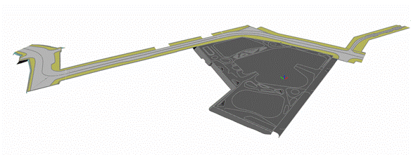

### Требования к моделированию

Таблица 198

<table header="row">
  <tr><td colspan="3">**Инструмент моделирования**</td></tr>
  <tr><td colspan="3">При моделировании в Civil 3D, стандартный инструмент «Поверхность» (Формируется TIN-поверхность).</td></tr>
  <tr><td colspan="3">При моделировании в Autodesk Revit, стандартный инструмент «Топоповерхность/топотело».</td></tr>
  <tr><td colspan="3">**Внешний вид**</td></tr>
  <tr>
    <td colspan="3">
      
    </td>
  </tr>
  <tr><td colspan="3">**Проектируемый объем1**</td></tr>
  <tr><td rowspan="4">**Этап**</td><td>К</td><td>Не моделируется.</td></tr>
  <tr><td>ПД</td><td rowspan="3">Моделирование существующего рельефа выполнять в Autodesk Revit или Autodesk Civil 3D в объеме необходимом для увязки проектных решений с существующими в границах проектируемого объекта.</td></tr>
  <tr><td>ТД</td></tr>
  <tr><td>РД</td></tr>
  <tr><td colspan="3">**Примечание**</td></tr>
  <tr>
    <td>**Общее**</td>
    <td colspan="2">
      - При проектировании, модель рельефа должна выполняться в отдельном файле модели.

      Модель должна иметь единую систему координат с проектируемым объектом и привязку к московской системе координат;
    </td>
  </tr>
  <tr>
    <td>**Autodesk Civil 3D**</td>
    <td colspan="2">
      - Тип объекта Civil 3D: 3D-поверхность, Структурные линии (Характерные линии, полилинии, фигуры).
      - Необходимо наличие следующих свойств: слой, имя поверхности и отметки поверхности.
      - Существующий рельеф отображается как 3D-поверхность со всеми сложными элементами рельефа, в детализации достаточной для дальнейшей работы.
      - Результатом обработки данных топографо-геодезических изысканий должна являться цифровая модель рельефа (ЦМР).
      - ЦМР формируется объектом Поверхность TIN. ЦМР следует формировать по 3D-граням, при отсутствии 3D-граней в файлах геодезических изысканий необходимо преобразовывать объекты AutoCAD в точки COGO, которые затем следует присоединять к поверхности.
      - Не допускается формирование ЦМР путем переноса текстовых подписей на их отметку и присоединения текстов к поверхности.
    </td>
  </tr>
  <tr>
    <td>**Autodesk Revit**</td>
    <td colspan="2">
      - Выполняется заполнение параметров согласно проектным решениям и требованиям экспертиз.
      - Рельеф моделируется с учетом высот
    </td>
  </tr>
  <tr><td colspan="3">**Запрещенные действия**</td></tr>
  <tr><td colspan="3">Изменение отметок поверхности, полученных в исходном файле от изыскателей.</td></tr>
</table>

1В случае необходимости допускается пониженный уровень детализации для элементов модели на этапе ТД и РД, утверждаемый в Плане выполнения ЦИМ.

### Требования к параметризации

Параметризация элементов индивидуальна для каждого проекта, подробно описывается в Плане выполнения ЦИМ (ПИМ).
