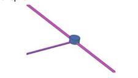

### Требования к моделированию

Таблица 200

<table header="row">
  <tr><td colspan="3">**Инструмент моделирования**</td></tr>
  <tr><td colspan="3">Моделирование существующих наружных инженерных сетей выполнять в AutoCAD Civil 3D/ Autocad.</td></tr>
  <tr><td colspan="3">**Внешний вид**</td></tr>
  <tr>
    <td colspan="3">
      
    </td>
  </tr>
  <tr><td colspan="3">**Проектируемый объем1**</td></tr>
  <tr><td rowspan="4">**Этап**</td><td>К</td><td>Не моделируется.</td></tr>
  <tr><td>ПД</td><td rowspan="3">Моделирование существующих наружных инженерных сетей производится в объеме необходимом для увязки проектных решений с существующими в границах проектируемого объекта.</td></tr>
  <tr><td>ТД</td></tr>
  <tr><td>РД</td></tr>
  <tr><td colspan="3">**Примечание**</td></tr>
  <tr>
    <td colspan="3">
      - На проектируемом участке необходимо выполнить моделирование существующих и проектных инженерных сетей: труб и колодцев.
      - Уровень графической детализации − условный.
      - Не допускается наличие в структуре вкладки «Навигатор» трубопроводных сетей, геометрия которых отсутствует в модели.

      Существующие инженерные сети

      - Тип объекта Civil 3D: трубопроводные сети (без арматуры).
      - Необходимо наличие следующих свойств: слой, количество, глубина, диаметр, уклон, тип, материал.
      - Имена и отметки должны соответствовать именам и отметкам существующих инженерных сетей.
      - Отметки отсутствующих глубин принять по нормативам.
      - Не допускается пересечение существующих инженерных сетей.

      Проектные инженерные сети

      - Тип объекта Civil 3D: трубопроводные сети (без арматуры).
      - Необходимо наличие следующих свойств: слой, количество, глубина, диаметр, уклон, тип, материал.
    </td>
  </tr>
  <tr><td colspan="3">**Запрещенные действия**</td></tr>
  <tr>
    <td colspan="3">
      - Изменение положения и (или) отметок наружных коммуникаций, полученных в исходном файле от изыскателей или отчета ИГДИ.
    </td>
  </tr>
</table>

1В случае необходимости допускается пониженный уровень детализации для элементов модели на этапе ТД и РД, утверждаемый в Плане выполнения ЦИМ.

### Требования к параметризации

Параметризация элементов индивидуальна для каждого проекта, подробно описывается в Плане выполнения ЦИМ (ПИМ).
