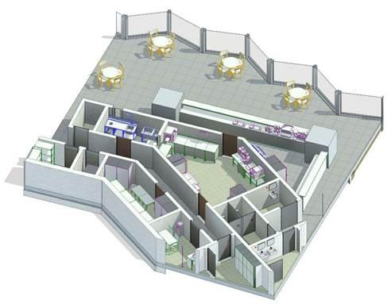

### *Требования к моделированию*

- При размещении технологического оборудования необходимо использовать семейства Гарды.

### *Требования к графическому отображению*

Описание уровня информационного наполнения LOI приведены в Таблица 191.

### *Требования к параметризации*

Таблица 191

<table header="row">
  <tr><td colspan="2" rowspan="2">**Атрибут**</td><td colspan="4">**Этап**</td><td rowspan="2">**Пример заполнения**</td></tr>
  <tr><td>**К**</td><td>**ПД**</td><td>**ТД**</td><td>**РД**</td></tr>
  <tr><td colspan="7">**Уровень геометрической проработки модели**</td></tr>
  <tr><td rowspan="5">**Геометрия**</td><td>Условные габариты</td><td></td><td>●</td><td>●</td><td></td><td></td></tr>
  <tr><td>Точные габариты</td><td></td><td></td><td></td><td>●</td><td></td></tr>
  <tr><td>Условное расположение</td><td></td><td>●</td><td>●</td><td></td><td></td></tr>
  <tr><td>Точное расположение</td><td></td><td></td><td></td><td>●</td><td></td></tr>
  <tr><td>Внешний образ/вид</td><td></td><td></td><td></td><td>●</td><td></td></tr>
  <tr><td colspan="7">**Уровень проработки атрибутивной информации**</td></tr>
  <tr><td rowspan="2">**Идентификация**</td><td>ADSK_Наименование</td><td></td><td></td><td>●</td><td>●</td><td>Туннельная (конвейерная) посудомоечная машина</td></tr>
  <tr><td>ADSK_Наименование краткое</td><td></td><td></td><td>●</td><td>●</td><td>ABAT МПТ‑1700‑01</td></tr>
  <tr><td rowspan="2">**Маркировка**</td><td>ADSK_Позиция1</td><td></td><td></td><td>●</td><td>●</td><td></td></tr>
  <tr><td>ADSK_Марка</td><td></td><td></td><td>●</td><td>●</td><td>107К</td></tr>
  <tr><td rowspan="4">**Ресурсы**</td><td>ADSK_Количество</td><td></td><td></td><td>●</td><td>●</td><td>3</td></tr>
  <tr><td>ADSK_Единица измерения</td><td></td><td></td><td>●</td><td>●</td><td>шт.</td></tr>
  <tr><td>ADSK_Завод-изготовитель1</td><td></td><td></td><td>●</td><td>●</td><td>Россия</td></tr>
  <tr><td>ADSK_Код изделия1</td><td></td><td></td><td>●</td><td>●</td><td>123456</td></tr>
  <tr><td rowspan="3">**Положение**</td><td>ADSK_Номер здания3</td><td></td><td></td><td>●</td><td>●</td><td>Строение 1</td></tr>
  <tr><td>ADSK_Этаж</td><td></td><td></td><td>●</td><td>●</td><td>2</td></tr>
  <tr><td>ADSK_Номер секции3</td><td></td><td></td><td>●</td><td>●</td><td>3</td></tr>
  <tr><td>**Прочее**</td><td>ADSK_Комплект чертежей2</td><td></td><td></td><td>●</td><td>●</td><td>ТХ1</td></tr>
</table>

1 - Заполняется только у элементов, для которых явное указание требуется согласно проектным решениям.

2 - Заполняется если из модели выпускается несколько комплектов документации.

3 - Заполняется, если здание разделено на несколько секций или есть требование согласно проектным решениям.
