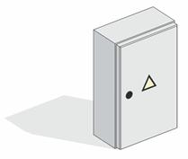

### Требования к моделированию

Таблица 183

<table header="row">
  <tr><td colspan="3">**Инструмент моделирования**</td></tr>
  <tr><td colspan="3">Стандартный инструмент «Электрооборудование»</td></tr>
  <tr><td colspan="3">**Внешний вид**</td></tr>
  <tr>
    <td colspan="3">
      
    </td>
  </tr>
  <tr><td colspan="3">**Проектируемый объем**</td></tr>
  <tr><td rowspan="4">**Этап**</td><td>К</td><td>Не моделируется.</td></tr>
  <tr>
    <td>ПД</td>
    <td>
      Выполняется:

      СС, АК:

      - моделирование шкафов с условными габаритами и условным расположением;

      ЭОМ:

      - моделирование э/щитов и шкафов с точным расположением и точными габаритами
    </td>
  </tr>
  <tr>
    <td>ТД</td>
    <td>
      Выполняется:

      СС, АК:

      - моделирование шкафов с условными габаритами и условным расположением;

      ЭОМ:

      - моделирование э/щитов и шкафов с точным расположением и точными габаритами
    </td>
  </tr>
  <tr>
    <td>РД</td>
    <td>
      Выполняется:

      - моделирование э/щитов и шкафов с точным расположением и точными габаритами;
      - заполнение параметров необходимых для формирования рабочих спецификаций;
    </td>
  </tr>
  <tr><td colspan="3">**Примечание**</td></tr>
  <tr>
    <td colspan="3">
      - \-
    </td>
  </tr>
  <tr><td colspan="3">**Запрещенные действия**</td></tr>
  <tr>
    <td colspan="3">
      - Разработка элементов модели участвующих в оформлении документации в рабочих наборах начинающихся с «(50)\_»
    </td>
  </tr>
</table>

### Требования к параметризации

Таблица 184

<table header="row">
  <tr><td colspan="2" rowspan="2">**Атрибут**</td><td colspan="6">**Этап**</td><td colspan="2" rowspan="2">**Пример заполнения**</td></tr>
  <tr><td>**К**</td><td>**ПД**</td><td colspan="2">**ТД**</td><td colspan="2">**РД**</td></tr>
  <tr><td colspan="10">**Уровень геометрической проработки модели**</td></tr>
  <tr>
    <td rowspan="5">**Геометрия**</td>
    <td>Условные габариты</td>
    <td></td>
    <td>
      ●

      (CC, АК)
    </td>
    <td>
      ●

      (CC, АК)
    </td>
    <td colspan="2"></td>
    <td colspan="2"></td>
    <td></td>
  </tr>
  <tr>
    <td>Точные габариты</td>
    <td></td>
    <td>
      ●

      (ЭОМ)
    </td>
    <td>
      ●

      (ЭОМ)
    </td>
    <td colspan="2">●</td>
    <td colspan="2"></td>
    <td></td>
  </tr>
  <tr>
    <td>Условное расположение</td>
    <td></td>
    <td>
      ●

      (CC, АК)
    </td>
    <td>
      ●

      (CC, АК)
    </td>
    <td colspan="2"></td>
    <td colspan="2"></td>
    <td></td>
  </tr>
  <tr>
    <td>Точное расположение</td>
    <td></td>
    <td>
      ●

      (ЭОМ)
    </td>
    <td>
      ●

      (ЭОМ)
    </td>
    <td colspan="2">●</td>
    <td colspan="2"></td>
    <td></td>
  </tr>
  <tr><td>Внешний образ/вид</td><td></td><td></td><td colspan="2">●</td><td colspan="2">●</td><td colspan="2"></td></tr>
  <tr><td colspan="10">**Уровень проработки атрибутивной информации**</td></tr>
  <tr>
    <td rowspan="3">**Размеры**</td>
    <td>ADSK_Размер_Глубина</td>
    <td></td>
    <td>
      ●

      (ЭОМ)
    </td>
    <td colspan="2">●</td>
    <td colspan="2">●</td>
    <td colspan="2">600 мм</td>
  </tr>
  <tr>
    <td>ADSK_Размер_Ширина</td>
    <td></td>
    <td>
      ●

      (ЭОМ)
    </td>
    <td colspan="2">●</td>
    <td colspan="2">●</td>
    <td colspan="2">600 мм</td>
  </tr>
  <tr>
    <td>ADSK_Размер_Высота</td>
    <td></td>
    <td>
      ●

      (ЭОМ)
    </td>
    <td colspan="2">●</td>
    <td colspan="2">●</td>
    <td colspan="2">1200 мм</td>
  </tr>
  <tr><td>**Идентификация**</td><td>ADSK_Наименование</td><td></td><td></td><td colspan="2">●</td><td colspan="2">●</td><td colspan="2">Шкаф сетевой 19", 42U 600х800 мм, серый</td></tr>
  <tr><td rowspan="2">**Маркировка**</td><td>ADSK_Позиция1</td><td></td><td></td><td colspan="2">●</td><td colspan="2">●</td><td colspan="2"></td></tr>
  <tr><td>ADSK_Марка</td><td></td><td></td><td colspan="2">●</td><td colspan="2">●</td><td colspan="2"></td></tr>
  <tr><td rowspan="4">**Ресурсы**</td><td>ADSK_Количество</td><td></td><td></td><td colspan="2">●</td><td colspan="2">●</td><td colspan="2">3</td></tr>
  <tr><td>ADSK_Единица измерения</td><td></td><td></td><td colspan="2">●</td><td colspan="2">●</td><td colspan="2">шт.</td></tr>
  <tr><td>ADSK_Завод-изготовитель1</td><td></td><td></td><td colspan="2">●</td><td colspan="2">●</td><td colspan="2">Россия</td></tr>
  <tr><td>ADSK_Код изделия1</td><td></td><td></td><td colspan="2">●</td><td colspan="2">●</td><td colspan="2">123456</td></tr>
  <tr><td rowspan="3">**Положение**</td><td>ADSK_Номер здания3</td><td></td><td></td><td colspan="2">●</td><td colspan="2">●</td><td colspan="2">Строение 1</td></tr>
  <tr><td>ADSK_Этаж</td><td></td><td></td><td colspan="2">●</td><td colspan="2">●</td><td colspan="2">2</td></tr>
  <tr><td>ADSK_Номер секции3</td><td></td><td></td><td colspan="2">●</td><td colspan="2">●</td><td colspan="2">3</td></tr>
  <tr><td>**Прочее**</td><td>ADSK_Комплект чертежей2</td><td></td><td></td><td colspan="2"></td><td colspan="2">●</td><td colspan="2">ИОС1</td></tr>
</table>

1 - Заполняется только у элементов, для которых явное указание требуется согласно проектным решениям.

2 - Заполняется если из модели выпускается несколько комплектов документации.

3 - Заполняется, если здание разделено на несколько секций или есть требование согласно проектным решениям.
