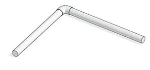

### Требования к моделированию

Таблица 173

<table header="row">
  <tr><td colspan="3">**Инструмент моделирования**</td></tr>
  <tr><td colspan="3">Стандартный инструмент «Короба»</td></tr>
  <tr><td colspan="3">**Внешний вид**</td></tr>
  <tr>
    <td colspan="3">
      
    </td>
  </tr>
  <tr><td colspan="3">**Проектируемый объем**</td></tr>
  <tr><td rowspan="4">**Этап**</td><td>К</td><td rowspan="3">Не моделируется.</td></tr>
  <tr><td>ПД</td></tr>
  <tr><td>ТД</td></tr>
  <tr>
    <td>РД</td>
    <td>
      Выполняется:

      - моделирование при необходимости только для закладных. Прокладка до оконечных устройств в трубах не моделируется. Необходимость определяется техническим заданием;
      - заполнение параметров необходимых для формирования рабочих спецификаций;
    </td>
  </tr>
  <tr><td colspan="3">**Примечание**</td></tr>
  <tr>
    <td colspan="3">
      - \-
    </td>
  </tr>
  <tr><td colspan="3">**Запрещенные действия**</td></tr>
  <tr>
    <td colspan="3">
      - Разработка элементов модели участвующих в оформлении документации в рабочих наборах начинающихся с «(50)\_»
    </td>
  </tr>
</table>

### Требования к параметризации

Таблица 174

<table header="row">
  <tr><td colspan="2" rowspan="2">**Атрибут**</td><td colspan="4">**Этап**</td><td rowspan="2">**Пример заполнения**</td></tr>
  <tr><td>**К**</td><td>**ПД**</td><td>**ТД**</td><td>**РД**</td></tr>
  <tr><td colspan="7">**Уровень геометрической проработки модели**</td></tr>
  <tr><td rowspan="5">**Геометрия**</td><td>Условные габариты</td><td></td><td></td><td></td><td></td><td></td></tr>
  <tr><td>Точные габариты</td><td></td><td></td><td></td><td>●</td><td></td></tr>
  <tr><td>Условное расположение</td><td></td><td></td><td></td><td></td><td></td></tr>
  <tr><td>Точное расположение</td><td></td><td></td><td></td><td>●</td><td></td></tr>
  <tr><td>Внешний образ/вид</td><td></td><td></td><td></td><td>●</td><td></td></tr>
  <tr><td colspan="7">**Уровень проработки атрибутивной информации**</td></tr>
  <tr><td rowspan="3">**Размеры**</td><td>Высота / ADSK_Размер_Высота</td><td></td><td></td><td>●</td><td>●</td><td>100 мм</td></tr>
  <tr><td>Ширина / ADSK_Размер_Ширина</td><td></td><td></td><td>●</td><td>●</td><td>100 мм</td></tr>
  <tr><td>Длина / ADSK_Размер_Длина</td><td></td><td></td><td>●</td><td>●</td><td>1000 мм</td></tr>
  <tr><td>**Идентификация**</td><td>ADSK_Наименование</td><td></td><td></td><td>●</td><td>●</td><td>Огнезащитный кабельный короб</td></tr>
  <tr><td rowspan="2">**Маркировка**</td><td>ADSK_Позиция1</td><td></td><td></td><td>●</td><td>●</td><td></td></tr>
  <tr><td>ADSK_Марка</td><td></td><td></td><td>●</td><td>●</td><td></td></tr>
  <tr><td rowspan="4">**Ресурсы**</td><td>ADSK_Количество</td><td></td><td></td><td>●</td><td>●</td><td>5</td></tr>
  <tr><td>ADSK_Единица измерения</td><td></td><td></td><td>●</td><td>●</td><td>м2</td></tr>
  <tr><td>ADSK_Завод-изготовитель1</td><td></td><td></td><td>●</td><td>●</td><td>DKC</td></tr>
  <tr><td>ADSK_Код изделия1</td><td></td><td></td><td>●</td><td>●</td><td>123456</td></tr>
  <tr><td rowspan="3">**Положение**</td><td>ADSK_Номер здания3</td><td></td><td></td><td>●</td><td>●</td><td>Строение 1</td></tr>
  <tr><td>ADSK_Этаж</td><td></td><td></td><td>●</td><td>●</td><td>2</td></tr>
  <tr><td>ADSK_Номер секции3</td><td></td><td></td><td>●</td><td>●</td><td>3</td></tr>
  <tr><td>**Прочее**</td><td>ADSK_Комплект чертежей2</td><td></td><td></td><td>●</td><td>●</td><td>ИОС1</td></tr>
</table>

1 - Заполняется только у элементов, для которых явное указание требуется согласно проектным решениям.

2 - Заполняется если из модели выпускается несколько комплектов документации.

3 - Заполняется, если здание разделено на несколько секций или есть требование согласно проектным решениям.
