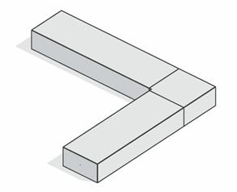

### Требования к моделированию

Таблица 169

<table header="row">
  <tr><td colspan="3">**Инструмент моделирования**</td></tr>
  <tr>
    <td colspan="3">
      Стандартный инструмент «Воздуховоды» прямоугольного сечения

      Стандартный инструмент «Обобщенная модель» или «Механическое оборудование»
    </td>
  </tr>
  <tr><td colspan="3">**Внешний вид**</td></tr>
  <tr>
    <td colspan="3">
      
    </td>
  </tr>
  <tr><td colspan="3">**Проектируемый объем**</td></tr>
  <tr><td rowspan="4">**Этап**</td><td>К</td><td>Не моделируется</td></tr>
  <tr>
    <td>ПД</td>
    <td>
      Выполняется:

      ЭОМ:

      - моделирование с точными габаритами, условным расположением;

      СС, АК:

      - не моделируется
    </td>
  </tr>
  <tr>
    <td>ТД</td>
    <td>
      Выполняется:

      ЭОМ:

      - моделирование с точными габаритами, условным расположением;
      - заполнение параметров необходимых для формирования сводной ведомости объемов работ и оборудования;

      СС, АК:

      - не моделируется
    </td>
  </tr>
  <tr>
    <td>РД</td>
    <td>
      Выполняется:

      ЭОМ:

      - моделирование в точных габаритах с точным расположением;
      - заполнение параметров необходимых для формирования рабочих спецификаций;

      СС, АК:

      - не моделируется
    </td>
  </tr>
  <tr><td colspan="3">**Примечание**</td></tr>
  <tr>
    <td colspan="3">
      - \-
    </td>
  </tr>
  <tr><td colspan="3">**Запрещенные действия**</td></tr>
  <tr>
    <td colspan="3">
      - Разработка элементов модели участвующих в оформлении документации в рабочих наборах начинающихся с «(50)\_»
    </td>
  </tr>
</table>

### Требования к параметризации

Таблица 170

<table header="row">
  <tr><td colspan="2" rowspan="2">**Атрибут**</td><td colspan="4">**Этап**</td><td rowspan="2">**Пример заполнения**</td></tr>
  <tr><td>**К**</td><td>**ПД**</td><td>**ТД**</td><td>**РД**</td></tr>
  <tr><td colspan="7">**Уровень геометрической проработки модели**</td></tr>
  <tr><td rowspan="5">**Геометрия**</td><td>Условные габариты</td><td></td><td></td><td></td><td></td><td></td></tr>
  <tr><td>Точные габариты</td><td></td><td>●</td><td>●</td><td>●</td><td></td></tr>
  <tr><td>Условное расположение</td><td></td><td>●</td><td>●</td><td></td><td></td></tr>
  <tr><td>Точное расположение</td><td></td><td></td><td></td><td>●</td><td></td></tr>
  <tr><td>Внешний образ/вид</td><td></td><td></td><td>●</td><td>●</td><td></td></tr>
  <tr><td colspan="7">**Уровень проработки атрибутивной информации**</td></tr>
  <tr><td rowspan="2">**Размеры**</td><td>Ширина / ADSK_Размер_Ширина</td><td></td><td></td><td>●</td><td>●</td><td>300 мм</td></tr>
  <tr><td>Высота / ADSK_Размер_Высота</td><td></td><td></td><td>●</td><td>●</td><td>50 мм</td></tr>
  <tr><td></td><td>Высота / ADSK_Размер_Длина</td><td></td><td></td><td>●</td><td>●</td><td>50 мм</td></tr>
  <tr><td>**Идентификация**</td><td>ADSK_Наименование</td><td></td><td></td><td>●</td><td>●</td><td>[Шинопровод магистральный 630-6300A медный](https://yabs.yandex.ru/count/WduejI_zOoVX2Las0eKJ06DZYIMSm0cOlM42UbDlpv92m7i10HtwV2vtzco_S-SDTxv-n-iDTxXLenf6I4T6HK8pakeGRXGDKP6KaeHaK8b8B26Dk243oLfahPEiHM3A9eeg7soZhVGFZEL7QXp1eEDe0f6FZu-FJmcCHBu2j30IanIWXP6uLu0MHg9U0LeOYU42j30IaHIWXP6OLu0MHX1j0LeOGQeAqC88GbM05aOG7WLeOGIPAa0Bu_4lvsk2oWOpHS9gICZfNfduSCAYnwUUsdPD7QgHGwDtrCxl_CQTqQaDZU9s_PpUKEWqYa_j-ub7fJOB76m7BEGiabI-SOyttX5uBEQPTH6YCTxiOGnamCEbvNo-ON82k04Sm0RkyWxA5qOsFIsTLiFUrDFIQJLiCUW2U4iyMGd0vT1bTPRuwFHbfE4sQROq1sou00MN0fAquJ1y8As6X02-O2I60zWweDNk1_H1SHBaGMIARc5hmloX6K00R8GMTj1X5SeMuFxCCUGOA6QCJesIeWgLwGDZ1m0P0l65vgZJuhFJ3rD00yTzi7-Sg_fVhmHAwtkz4YYjp_MGEhv_XocoL_QrpJ4ZJZ_R73FYn3JN79bYbckEJ377pANNJsdopTjrNTTfipzi4xFHZJGznj4Yf97USRG8QQIt_aghZyxIWBxSx8lQXiN4U7PH-FnNnX6x7sz7x7wyUQqNKcO6uiLdcNTMwgvePgvKAfL21yZ8sCkeyhDbEQkWMYGj1HVyjuAEYMlAcWyVEr5boU2F00FLU-E9Ya4Id1YUUf-jnbhD9JhyK3lA0fXht0cEvfQ7xsrf8aZcq-XCLrf4GgkAShkj4cschW00~2?etext=2202.d2MxLEz1xwxVeFXYYUZwRdkzMFQp3J_r8VCaWiPupP88zm2RgMBsV_UgOA7EqhUyDUdcfcLh7PD1-UfJIEinOhchzkJggRQBcuJLS13fvNV3cXFvbWZuZ2dmemdhbWll.855a7b2f371c106be525cd5adcdeca6e2a22e1af&from=yandex.ru%3Bsearch%26%23x2F%3B%3Bweb%3B%3B0%3B&q=%D1%88%D0%B8%D0%BD%D0%BE%D0%BF%D1%80%D0%BE%D0%B2%D0%BE%D0%B4+%D0%BC%D0%B0%D0%B3%D0%B8%D1%81%D1%82%D1%80%D0%B0%D0%BB%D1%8C%D0%BD%D1%8B%D0%B9+%D0%B0%D0%BB%D1%8E%D0%BC%D0%B8%D0%BD%D0%B8%D0%B5%D0%B2%D1%8B%D0%B9&baobab_event_id=mih65gefb0)</td></tr>
  <tr><td rowspan="2">**Маркировка**</td><td>ADSK_Позиция1</td><td></td><td></td><td>●</td><td>●</td><td></td></tr>
  <tr><td>ADSK_Марка</td><td></td><td></td><td></td><td></td><td></td></tr>
  <tr><td rowspan="4">**Ресурсы**</td><td>ADSK_Количество</td><td></td><td></td><td>●</td><td>●</td><td>5</td></tr>
  <tr><td>ADSK_Единица измерения</td><td></td><td></td><td>●</td><td>●</td><td>шт.</td></tr>
  <tr><td>ADSK_Завод-изготовитель1</td><td></td><td></td><td>●</td><td>●</td><td>DKC</td></tr>
  <tr><td>ADSK_Код изделия1</td><td></td><td></td><td></td><td>●</td><td>123456</td></tr>
  <tr><td rowspan="3">**Положение**</td><td>ADSK_Номер здания3</td><td></td><td></td><td>●</td><td>●</td><td>Строение 1</td></tr>
  <tr><td>ADSK_Этаж</td><td></td><td></td><td>●</td><td>●</td><td>2</td></tr>
  <tr><td>ADSK_Номер секции3</td><td></td><td></td><td>●</td><td>●</td><td>3</td></tr>
  <tr><td>**Прочее**</td><td>ADSK_Комплект чертежей2</td><td></td><td></td><td>●</td><td>●</td><td>ИОС1</td></tr>
</table>

1 - Заполняется только у элементов, для которых явное указание требуется согласно проектным решениям.

2 - Заполняется, если информационная модель выдается итерационно, параллельно с передачей комплектов рабочей документации, до завершения общего процесса проектирования.

3 - Заполняется, если здание разделено на несколько секций или есть требование согласно проектным решениям.
