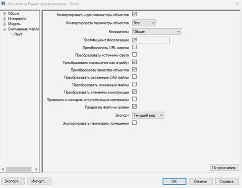

На протяжении всего проекта необходимо отслеживать и исправлять коллизии в BIM-моделях.

Требования к виду Navisworks:

- имя вида - “Navisworks”;
- На виде скрыты все временные элементы, связи, аннотации, импортированные категории, линии.
- На виде корректно настроены фильтр по стадиям, если это необходимо.

Экспорт файлов формата NWC должен осуществляться со следующими настройками.

Допускается наличие в моделях «фиктивных» коллизий, возникающих в результате условностей при моделировании, а также особенностей прорисовки геометрии в Navisworks. Примеры «фиктивных» коллизий:

● Место стыка линейных элементов системы (труб, воздуховодов и т. п.) с оборудованием (сантехника и т. п.). Коллизия может возникать из-за особенностей моделирования семейств.

● Пересечения фитингов и арматуры с линейными элементами систем, в случае гипертрофированного представления указанных элементов в Navisworks. В отдельных случаях Navisworks может некорректно обрабатывать геометрию элементов, увеличивая их в модели, что приводит к коллизиям, при проверке на пересечения.

Список фиктивных коллизий согласовывается отдельно.

Список проверок и поисковых наборов см. Приложение 2.
