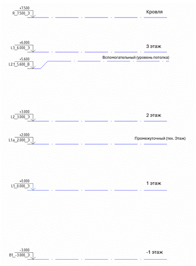
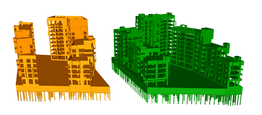
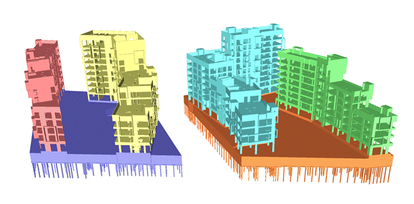
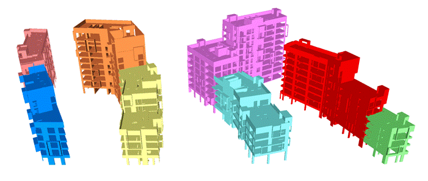
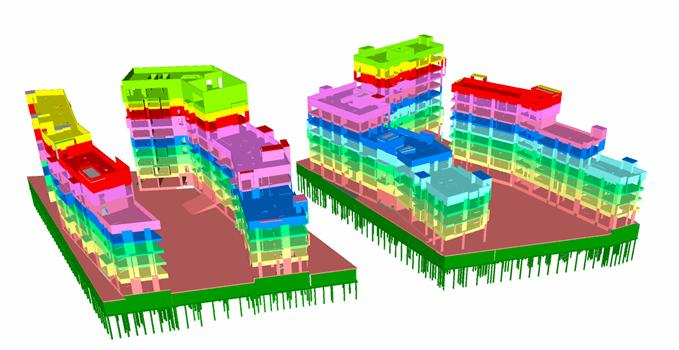
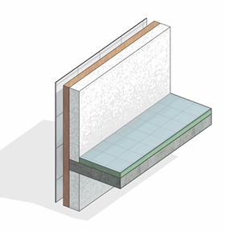
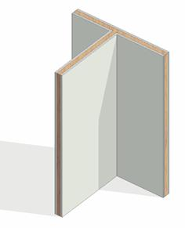

## 1\.    Область применения

1\.1. Назначение документа

Документ распространяется на все цифровые информационные модели (далее – ЦИМ), используемые в рамках процесса проектирования. Устанавливает требования к структуре и содержанию информационной модели объекта строительства, предназначенной для получения проектной, рабочей и тендерной документации, и альбомов концепции, а также дальнейшего ее использования при строительстве объекта.

Документ распространяется на все структурные подразделения участников проекта.

Процесс утверждения и согласования проектных решений в модели не должен противоречить настоящему стандарту. Информационная модель является отображением проектных решений Исполнителя в момент их принятия.

1\.2. Термины и определения

Таблица 3. Термины и определения

<table header="row">
  <tr><td>**Термины**</td><td>**Определения**</td></tr>
  <tr><td>2D</td><td>Отображение геометрии объектов и их местоположения на плоскости (в координатах X и Y)</td></tr>
  <tr><td>3D</td><td>Отображение геометрии объектов и их местоположения в пространстве (в координатах X, Y и Z).</td></tr>
  <tr><td>Цифровая информационная модель (ЦИМ)</td><td>Совокупность представленных в электронном виде документов, графических и неграфических данных по объекту строительства, размещаемая в соответствии с установленными правилами в среде общих данных, представляющая собой единый достоверный источник информации по объекту на всех или отдельных Этапх его жизненного цикла. ЦИМ может состоять из нескольких взаимосвязанных файлов различных форматов, которые обеспечивают требуемую полноту предоставления информации.</td></tr>
  <tr><td>План выполнения ЦИМ</td><td>Технический документ, который описывает регламент разработки проекта и отражает требования заказчика к информационной модели, задачи применения информационного моделирования, требуемые уровни проработки информационной модели, роли и функциональные обязанности участников процесса информационного моделирования.</td></tr>
  <tr>
    <td>
      Информационные требования заказчика

      (EIR, Employer's Information Requirements)
    </td>
    <td>Требования заказчика, определяющие информацию, предоставляемую заказчику в процессе реализации инвестиционно-строительного проекта с применением информационного моделирования, цели применения информационного моделирования, а также требования к взаимодействию между заказчиком и исполнителем.</td>
  </tr>
  <tr><td>BIM менеджер</td><td>Сотрудник, ответственный за организацию и управление технологиями информационного моделирования на уровне компании, подразделения компании, также он ответственен за разработку и утверждение регламентирующих документов</td></tr>
  <tr><td>BIM координатор</td><td>Сотрудник, ответственный за методологическое и технологическое обеспечение процесса информационного моделирования в рамках проекта</td></tr>
  <tr><td>Объем проработки</td><td>Объем проектных решений, которые обязательно должны быть смоделированы в Информационной модели</td></tr>
  <tr><td>Проектные этапы</td><td>Участки работ по Информационному моделированию, определяющие объем проработки проектных решений в ЦИМ, детализацию геометрической проработки и наполнение информацией. Согласуются для каждого проекта</td></tr>
  <tr><td>RVT</td><td>Основной формат файла для хранения данных о проекте Autodesk Revit.</td></tr>
  <tr><td>IFC</td><td>Отраслевой стандарт открытого и универсального формата для обмена BIM-данными.</td></tr>
  <tr><td>DWG</td><td>Формат файла, используемый для хранения двухмерных (2D) и трехмерных (3D) проектных данных и метаданных. Является основным форматом для системы автоматизированного проектирования Autodesk AutoCAD.</td></tr>
  <tr><td>NWС</td><td>Формат файла Autodesk Navisworks, через который осуществляется связь со сторонними форматами, такими как RVT, DWG, IFC и др. Формат NWC является ретранслятором информации из других форматов, в читаемом Autodesk Navisworks виде.</td></tr>
  <tr><td>NWD</td><td>Формат файла Autodesk Navisworks Document. Предназначен для пакетного сохранения данных всей модели в единый файл и передачи третьим лицам, с настраиваемыми параметрами передачи.</td></tr>
  <tr><td>NWF</td><td>Основной рабочий формат файла Autodesk Navisworks, состоящий из ссылок на подгруженные файлы моделей по разделам, может содержать все точки обзора, анимации и симуляции строительства, проверки на коллизии и окружение информационной модели.</td></tr>
  <tr><td>PDF</td><td>Межплатформенный формат электронных документов, разработанный компанией Adobe Systems.</td></tr>
  <tr>
    <td>Категория</td>
    <td>
      Группа элементов, используемых для моделирования объекта строительства: окна, двери, стены, перекрытия, трубы, воздуховоды и др.

      Категории делятся на:

      • категории моделей;

      • категории видов;

      • категории аннотаций.

      Обладают индивидуальным набором свойств и параметров, а также правил поведения и взаимодействия. Категории не могут создаваться и редактироваться пользователями
    </td>
  </tr>
  <tr><td>Семейство</td><td>Группа схожих элементов, которая характеризуется общим набором свойств и связанных с ними графических представлений</td></tr>
  <tr><td>Экземпляр типоразмера (загружаемое семейство Autodesk Revit)</td><td>Отдельный элемент объекта строительства, пригодный для многократного использования: двери, мебель, детали фасада, оборудование, арматура и т.д.</td></tr>
  <tr><td>Графические данные</td><td>Часть проектной документации, отображающая принятые технические и иные решения, выполняемые в виде различных видов изображений.</td></tr>
  <tr><td>Коллизия</td><td>Ошибка в проекте, возникшая в результате нарушения допустимых параметров при совмещении в пространстве различных элементов информационной модели.</td></tr>
  <tr><td>Артефакт</td><td>Ситуация, когда программа принимает за коллизию отсутствующие в модели пересечение или допустимые существующие пересечения в модели между элементами.</td></tr>
  <tr><td>Атрибутивные данные</td><td>Данные, представленные с помощью алфавитно-цифровых символов.</td></tr>
  <tr><td>Ведомости объемов работ</td><td>Данные, выполненные на основе спецификаций (материалов, оборудования и изделий) проектной документации.</td></tr>
  <tr><td>Общий параметр</td><td>Параметр, который может быть отображен в спецификациях и марках, его можно использовать в разных проектах. Для создания общего параметра необходимо указать файл общих параметров (ФОП см. далее), в котором он будет храниться. Если такого файла нет, он должен быть создан в процессе разработки проекта.</td></tr>
  <tr><td>ФОП</td><td>Файл общих параметров. Это файл в формате TXT, который содержит общие параметры, подгружаемые в проекты и шаблоны.</td></tr>
  <tr><td>Файл-маппинг IFC</td><td>Файл формата .TXT, содержащий настройки экспорта параметров в формат IFC, с возможностью группировки параметров в пользовательские вкладки, а также маппинга параметров исходного приложения с пользовательскими параметр IFC с возможностью объединения нескольких схожих по смыслу параметров, но с разным названием, в один.</td></tr>
  <tr><td>Поисковый запрос</td><td>Представляет собой динамическую группу элементов найденных в модели на основе определенного набора критериев и условий поиска. Служит для сохранения выбора элементов по определенным условиям, в среде Navisworks</td></tr>
  <tr><td>Рабочий набор</td><td>Объединение группы объектов модели Autodesk Revit, используемое для распределения прав редактирования модели, а также для управления видимостью объектов в рамках информационной модели.</td></tr>
  <tr><td>Координационный файл</td><td>Файл, содержащий координаты информационной модели, единые на проект оси и уровни</td></tr>
  <tr><td>Сводная информационная модель (Federated Model)</td><td>Информационная модель объекта, состоящая из отдельных информационных моделей (например, по различным дисциплинам или частям объекта строительства), соединенных между собой в едином файле, c целью проверки согласованности моделей, отсутствия коллизий между элементами моделей и комплексного анализа проектируемого объекта, в том числе получения объемов материалов, и выполнения календарно-сетевого планирования</td></tr>
  <tr><td>Среда общих данных (CDE)</td><td>Комплекс программно-технических средств, представляющих единый источник данных, обеспечивающий совместное использование информации всеми участниками инвестиционно-строительного проекта. Среда общих данных основана на процедурах и регламентах, обеспечивающих эффективное управление итеративным процессом разработки и использования информационной модели, сбора, выпуска и распространения документации между участниками инвестиционно-строительного проекта.</td></tr>
</table>

## 2\.    Организация процесса информационного моделирования

## 2\.1. Требования к программному обеспечению

Проект выполняется с использованием программного обеспечения, представленного в таблице.

Таблица 4

<table header="row">
  <tr><td>**Раздел проекта**</td><td>**Программное обеспечение**</td><td>**Форматы файлов**</td><td>**Функции**</td></tr>
  <tr><td>Архитектурные решения (АР, АИ)</td><td rowspan="3">Revit</td><td rowspan="3">RVT</td><td rowspan="3">Создание и редактирование ЦИМ оформление документации</td></tr>
  <tr><td>Конструкции (КР, КЖ, КМ)</td></tr>
  <tr><td>Инженерное оборудование и системы (ИОС)</td></tr>
  <tr><td>Конструкции (КМ)</td><td>Tekla</td><td>IFC</td><td>Создание и редактирование ЦИМ оформление документации</td></tr>
  <tr>
    <td>Геоподоснова</td>
    <td>
      Civil 3D

      Топоматик Robur
    </td>
    <td>
      DWG

      SFCX

      PNSX
    </td>
    <td rowspan="3">Создание и редактирование ЦИМ, оформление документации</td>
  </tr>
  <tr><td>Наружные инженерные сети (НИС)</td><td>Топоматик Robur</td><td>PNSX</td></tr>
  <tr><td>Генплан и благоустройство (ГП, БиО, МАФ)</td><td>Civil 3D</td><td>DWG</td></tr>
  <tr><td>Сводная модель</td><td>Navisworks</td><td>NWF, NWD</td><td>Просмотр моделей, проверка на коллизии</td></tr>
</table>

## 2\.2. Перечень разделов, выполняемых с применением технологий информационного моделирования.

Список разделов проекта, выполняемых по технологии информационного моделирования, представлен в Таблица 5

Таблица 5

<table header="row">
  <tr><td colspan="2">**Раздел проекта3**</td><td>**Наименование раздела**</td><td colspan="2">**Шифр2**</td></tr>
  <tr><td rowspan="2">БФ</td><td>КФ</td><td>Координационный файл</td><td colspan="2">COORD</td></tr>
  <tr><td>РФ</td><td>Разбивочный файл</td><td colspan="2">RF</td></tr>
  <tr><td rowspan="2">АР</td><td>АР</td><td>Архитектурные решения</td><td colspan="2">AR</td></tr>
  <tr><td>АИ</td><td>Архитектурные интерьеры (Дизайн-проект)</td><td colspan="2">AI</td></tr>
  <tr><td rowspan="2">ГП</td><td rowspan="2">ГП</td><td>Генплан (геоподоснова)</td><td rowspan="2">GP1</td><td>GPO</td></tr>
  <tr><td>Генплан и благоустройство</td><td>GPB</td></tr>
  <tr><td rowspan="3">КР</td><td>КР</td><td>Конструктивные решения</td><td rowspan="3">KR1</td><td>KR</td></tr>
  <tr><td>КЖ</td><td>Конструкции железобетонные</td><td>KG</td></tr>
  <tr><td>КМ</td><td>Конструкции металлические</td><td>KM</td></tr>
  <tr><td rowspan="6">ОВК</td><td>ТС</td><td>Теплоснабжение</td><td rowspan="2">OV1</td><td>TS</td></tr>
  <tr><td>ОТ</td><td>Отопление</td><td>OT</td></tr>
  <tr><td>ОВВ</td><td>Вентиляция общеобменная</td><td rowspan="2">OV2</td><td>OV</td></tr>
  <tr><td>ОВД</td><td>Вентиляция противодымная</td><td>DV</td></tr>
  <tr><td>ОВК</td><td>Кондиционирование воздуха</td><td rowspan="2">OV3</td><td>OC</td></tr>
  <tr><td>ХС</td><td>Холодоснабжение</td><td>HS</td></tr>
  <tr><td>ХЦ</td><td>ХЦ</td><td>Холодильный центр</td><td>OV4</td><td>HC</td></tr>
  <tr><td>ИТП</td><td>ИТП</td><td>Индивидуальный тепловой пункт</td><td colspan="2">ITP</td></tr>
  <tr><td rowspan="2">ВК</td><td>ВКВ</td><td>Внутренние системы водоснабжения</td><td rowspan="2">VK1</td><td>VK1</td></tr>
  <tr><td>ВКК</td><td>Внутренние системы канализации</td><td>VK2</td></tr>
  <tr><td rowspan="2">ПТ</td><td>ПТ</td><td>Пожаротушение</td><td rowspan="2">PT1</td><td>PT</td></tr>
  <tr><td>АУПТ</td><td>Автоматическая установка пожаротушения</td><td>AUPT</td></tr>
  <tr><td rowspan="3">ЭОМ</td><td>ЭО</td><td>Внутреннее электроосвещение</td><td rowspan="3">EOM1</td><td>EO</td></tr>
  <tr><td>ЭМ</td><td>Внутреннее электроснабжение</td><td>EM</td></tr>
  <tr><td>МЗ</td><td>Молниезащита и заземление</td><td>MZ</td></tr>
  <tr><td rowspan="10">CC</td><td>СКУД</td><td>Системы контроля и управления доступом</td><td rowspan="10">SS1</td><td rowspan="4">SB</td></tr>
  <tr><td>СОТ</td><td>Системы охранного телевидения</td></tr>
  <tr><td>СОТС</td><td>Системы тревожной сигнализации</td></tr>
  <tr><td>СОВ</td><td>Системы охранного видеонаблюдения</td></tr>
  <tr><td>СКС</td><td>Системы телефонии, телевидения, доступ в интернет</td><td rowspan="4">SV</td></tr>
  <tr><td>МГН</td><td>Оборудование для с/у МГН</td></tr>
  <tr><td>РФ</td><td>Системы радиофикации, ГОиЧС, РСПИ</td></tr>
  <tr><td>СВ</td><td>Системы Wi-Fi и часофикации</td></tr>
  <tr><td>СПС</td><td>Системы противопожарной сигнализации и автоматики</td><td rowspan="2">SPZ</td></tr>
  <tr><td>СОУЭ</td><td>Системы оповещения и управления эвакуацией</td></tr>
  <tr><td>АК</td><td>АК</td><td>Автоматизация</td><td></td><td>AK</td></tr>
  <tr><td>ТХ</td><td>ТХ</td><td>Технологические решения</td><td></td><td>TH</td></tr>
</table>

1Перечень разделов проекта может дополняться. При введении новых разделов шифр необходимо согласовать в плане выполнения ЦИМ.

2Применяется в именах файлов модели.

3При использовании кириллицы в именах файлов, следует использовать русские названия разделов.

В Таблица 6 приведен перечень этапов проекта с описанием целей и задач.

Таблица 6

<table header="row">
  <tr><td>**Проектный этап**</td><td>**Описание**</td></tr>
  <tr>
    <td>Концепция (К)</td>
    <td>
      - Разработка концептуальных решений в среде информационного моделирования.
      - Разработка основных объемно планировочных решений.
      - Формирование и выпуск альбомов альбомов концепции.
    </td>
  </tr>
  <tr>
    <td>Проектная документация (ПД)</td>
    <td>
      - Детализация ЦИМ проектного этапа «Концепция»
      - Формирование проектной документации на основе ЦИМ.
    </td>
  </tr>
  <tr>
    <td>Тендерная документация (ТД)</td>
    <td>
      - Корректировка ЦИМ проектного этапа «Проектная документация».
      - Заполнение количественных показателей, создание ведомостей для формирования сводной ведомости объемов работ и оборудования (СВОР).
    </td>
  </tr>
  <tr>
    <td>Рабочая документация (РД)</td>
    <td>
      - Корректировка, детализация и параметризация ЦИМ
      - Формирование рабочей документации на основе ЦИМ
    </td>
  </tr>
</table>

## 3\.    Общие требования к ЦИМ

## 3\.1. Требования к единицам

- Моделирование производится в масштабе 1:1, в метрической системе измерений.
- Точность моделирования - в миллиметрах, с округлением до трех знаков после запятой (0,000 мм)
- Линейные размеры – в миллиметрах, с округлением до целых значений (0 мм);
- Высотные отметки – в метрах, с округлением до трех знаков после запятой (0,000м);
- Значения площади – в квадратных метрах, с округлением до двух знаков после запятой (0,00 м2)
- Значения объема материалов – кубические метры, с округлением до двух знаков после запятой (0,00 м3);
- Угловые размеры – градусы (0.00⁰’).
- Расход – литры в секунду (0.0 л/с);
- Скорость – метры в секунду (0.0 м/с);
- Температура – градусы Цельсия (0.0°С);
- Давление – Паскаль (0.0 Па);
- Воздушный поток – кубические метры в час (0.0 м3/ч);
- Массовая плотность, плотность – килограмм на кубический метр (0.00 кг/м3 );

### Требования к единицам измерения ГП

- Моделирование производится в масштабе 1:1, в метрической системе измерений;
- Линейные размеры – в метрах, с округлением до двух знаков после запятой (0,0 м);
- Высотные отметки – в метрах, с округлением до двух знаков после запятой (0,00 м);
- Значения площади – в квадратных метрах, с округлением до двух знаков после запятой (0,00 м2);
- Значения объема материалов – кубические метры, с округлением до двух знаков после запятой (0,00 м3);
- Угловые размеры – градус/минута/секунда (0⁰0’0”);
- Радиус – в метрах, с округлением до двух знаков после запятой (0,00 м);
- Радиус - в миллиметрах, с округлением до целого числа (0 мм);
- Диаметр – в метрах, с округлением до двух знаков после запятой (0,00 м);
- Диаметр – в миллиметрах, с округлением до целого числа (0 мм);

## 3\.2. Требования к системе общих координат

- Во всех моделях должны быть настроены общие координаты, которые предусматривают относительные и абсолютные высотные отметки, привязку к фактической посадке здания на геоподоснове в московской системе координат, а также направление истинного севера.
- Для передачи координат должна использоваться координационная модель.
- Во всех моделях должно быть настроено наименование площадки.
- Во всех моделях должны использоваться уровни, соответствующие высотным отметкам чистых полов архитектурных моделей. Допускается использовать вспомогательные уровни для привязки уникальных элементов.
- Начало единой системы координат должно быть согласовано для всех файлов проекта. Источником единой системы координат является файл геодезической подосновы или источник данных, определяющий местоположение участка и его координаты. Значения точки съемки должны оставаться нулевыми.
- Базовая точка модели размещается в левом нижнем углу, в точке пересечения оси А с осью 1 или эквивалентных осях для конкретной модели.

- В координационной модели базовая точка располагается в геодезическом кресте, ближайшем к левому нижнему углу здания.

## 3\.3. Общие требования

- Все основные элементы и объекты ЦИМ должны иметь габаритные размеры, соответствующие фактическим строительным элементам.
- Элементы модели необходимо создавать с разбивкой по этажам, за исключением элементов, деление которых поэтажно невозможно из-за конструктивных особенностей.
- Элементы модели должны быть привязаны к уровням, на которых они расположены.
- Элементы модели должны быть скоординированы и расположены в проектном положении.

**Не допускается:**

- Наличие некорректных зазоров/пересечений, примыкания/опирания строительных элементов, необоснованных проектным решением.
- Неточное построение элементов с последующим округлением размерных значений до целых чисел.
- Дублирование элементов ЦИМ, за исключением особенностей моделирования объектов, которые представлены ниже в регламенте.
- Использование линий модели для отображения 3D-элементов модели.
- Привязка элемента к некорректному уровню. Некорректным уровнем считается уровень этажа, который не соответствует этажу, на котором расположен элемент.
- Наличие нескоординированных элементов, которые находятся за пределами области моделирования.

## 3\.4. Схема разделения моделей

- На проектных этапах П ТД РД необходимо разделять ЦИМ по разделам проекта.
- Дальнейшее деление выполнять по функциональному признаку − Здания, Корпуса, Секции, Этажи и т.д.
- Фасады рекомендуется выполнять в отдельном файле. В случае не большого объекта допускается моделировать фасады в файле основной модели АР.
- На этапе рабочей документации при формировании схемы разделения моделей необходимо также учесть деление документации на комплекты/альбомы.
- Схему деления и список моделей для конкретного проекта необходимо согласовать с Заказчиком и зафиксировать в документе «План выполнения ЦИМ»

## 3\.5. Общие рабочие наборы

- В каждой модели должны быть созданы общие рабочие наборы. Данные рабочие наборы служат для настройки видимости общих элементов, таких как *оси, уровни и отверстия*. При отключении видимости рабочего набора в модели данный рабочий набор скрывается и в связанном файле, за счет одинакового наименования. Список общих рабочих наборов и их глобальные настройки видимости представлены в Таблице 7.

Таблица 7 - Список общих рабочих наборов

<table header="row">
  <tr><td>**Шифр модели**</td><td>**Оси и уровни**</td><td>**Геометрия**</td><td>**Отверстия**</td><td>**Скрытый**</td><td>**Связи1**</td></tr>
  <tr>
    <td>РФ</td>
    <td>(99)\_РФ_Оси и уровни</td>
    <td>\-</td>
    <td>\-</td>
    <td rowspan="38">(50)\_Temp</td>
    <td rowspan="38">
      (95)\_NWC_Имя файла

      (96)\_RVT_Имя файла

      (97)\_DWG

      (98)\_IFC_Имя файла
    </td>
  </tr>
  <tr>
    <td>АР</td>
    <td>(99)\_АР_Оси и уровни</td>
    <td>(10)\_АР</td>
    <td rowspan="35">
      (30)\_Отверстия АР

      (30)\_Отверстия КР

      (30)\_Отверстия ИОС
    </td>
  </tr>
  <tr><td>АИ</td><td>(99)\_АИ_Оси и уровни</td><td>(60)\_АИ</td></tr>
  <tr><td>КР</td><td>(99)\_КР_Оси и уровни</td><td>(20)\_ КР</td></tr>
  <tr><td>КЖ</td><td>(99)\_КЖ_Оси и уровни</td><td>(20)\_КЖ</td></tr>
  <tr><td>КМ</td><td>(99)\_КМ_Оси и уровни</td><td>(20)\_КМ</td></tr>
  <tr><td>ТС</td><td>(99)\_ТС_Оси и уровни</td><td>(30)\_ТС</td></tr>
  <tr><td>ОТ</td><td>(99)\_ОТ_Оси и уровни</td><td>(30)\_ОТ</td></tr>
  <tr><td>ОВВ</td><td>(99)\_ОВВ_Оси и уровни</td><td>(30)\_ОВВ</td></tr>
  <tr><td>ОВД</td><td>(99)\_ОВД_Оси и уровни</td><td>(30)\_ОВД</td></tr>
  <tr><td>ОВК</td><td>(99)\_ОВК_Оси и уровни</td><td>(30)\_ОВК</td></tr>
  <tr><td>ХС</td><td>(99)\_ХС_Оси и уровни</td><td>(30)\_ХС</td></tr>
  <tr><td>ХЦ</td><td>(99)\_ХЦ_Оси и уровни</td><td>(30)\_ХЦ</td></tr>
  <tr><td>ИТП</td><td>(99)\_ИТП_Оси и уровни</td><td>(30)\_ИТП</td></tr>
  <tr><td>ВК</td><td>(99)\_ВК_Оси и уровни</td><td>(30)\_ВК</td></tr>
  <tr><td>ВКВ</td><td>(99)\_ВКВ_Оси и уровни</td><td>(30)\_ВКВ</td></tr>
  <tr><td>ВКК</td><td>(99)\_ВКК_Оси и уровни</td><td>(30)\_ВКК</td></tr>
  <tr><td>ПТ</td><td>(99)\_ПТ_Оси и уровни</td><td>(30)\_ПТ</td></tr>
  <tr><td>АУПТ</td><td>(99)\_АУПТ_Оси и уровни</td><td>(30)\_АУПТ</td></tr>
  <tr><td>НС</td><td>(99)\_НС_Оси и уровни</td><td>(30)\_НС</td></tr>
  <tr><td>ЭОМ</td><td>(99)\_ЭОМ_Оси и уровни</td><td>(30)\_ЭОМ</td></tr>
  <tr><td>ЭО</td><td>(99)\_ЭО_Оси и уровни</td><td>(30)\_ЭО</td></tr>
  <tr><td>ЭМ</td><td>(99)\_ЭМ_Оси и уровни</td><td>(30)\_ЭМ</td></tr>
  <tr><td>МЗ</td><td>(99)\_МЗ_Оси и уровни</td><td>(30)\_МЗ</td></tr>
  <tr><td>СС</td><td>(99)\_СС_Оси и уровни</td><td>(30)\_СС</td></tr>
  <tr><td>СКУД</td><td>(99)\_СКУД_Оси и уровни</td><td>(30)\_СКУД</td></tr>
  <tr><td>СОТ</td><td>(99)\_СОТ_Оси и уровни</td><td>(30)\_СОТ</td></tr>
  <tr><td>СОТС</td><td>(99)\_СОТС_Оси и уровни</td><td>(30)\_СОТС</td></tr>
  <tr><td>СОВ</td><td>(99)\_СОВ_Оси и уровни</td><td>(30)\_СОВ</td></tr>
  <tr><td>СКС</td><td>(99)\_СКС_Оси и уровни</td><td>(30)\_СКС</td></tr>
  <tr><td>МГН</td><td>(99)\_МГН_Оси и уровни</td><td>(30)\_МГН</td></tr>
  <tr><td>РФ</td><td>(99)\_РФ_Оси и уровни</td><td>(30)\_РФ</td></tr>
  <tr><td>СВ</td><td>(99)\_СВ_Оси и уровни</td><td>(30)\_СВ</td></tr>
  <tr><td>СПС</td><td>(99)\_СПС_Оси и уровни</td><td>(30)\_СПС</td></tr>
  <tr><td>СОЭ</td><td>(99)\_СОЭ_Оси и уровни</td><td>(30)\_СОЭ</td></tr>
  <tr><td>АК</td><td>(99)\_АК_Оси и уровни</td><td>(30)\_АК</td></tr>
  <tr><td>ТХ</td><td>(99)\_ТХ_Оси и уровни</td><td>(40)\_ТХ</td><td>\-</td></tr>
  <tr><td>ГП</td><td>\-</td><td>\-</td><td>\-</td></tr>
</table>

1Каждая связь формата NWC, RVT, IFC, DWG (при загрузке в 3D режиме), помещается в отдельный рабочий набор, что позволяет отключить ее при загрузке файла.

## 4\. Уровни проработки ЦИМ. Геометрическая детализация и информационное наполнение.

Уровень проработки элементов ЦИМ зависит проектного этапа и приведен в разделах 10-13.

В Таблице 8 приведено описание характеристик геометрической детализации модели, а в Таблице 9 – информационных параметров в модели.

Файл «общих параметров», содержащий требуемые параметры, предоставляется отдельно.

## 5\.1. Характеристики геометрической детализации модели

Таблица 8 - Описание характеристик детализации модели

<table header="row">
  <tr><td>**Характеристика**</td><td>**Описание**</td></tr>
  <tr><td>Условные габариты</td><td>Элемент модели имеет примерные габариты, по причине отсутствия возможности их точного определения на текущем этапе проекта</td></tr>
  <tr><td>Точные габариты</td><td>Габарит соответствует проектным размерам компонента для данного этапа проектирования</td></tr>
  <tr><td>Условное расположение</td><td>Элемент модели расположен примерно, но при этом точно определен этаж, помещение и/или элемент модели, на котором он размещен</td></tr>
  <tr><td>Точное расположение</td><td>Расположение элемента в модели точно соответствует проектному положению для данного этапа проектирования</td></tr>
  <tr><td>Внешний образ/вид</td><td>Внешнее представление элемента позволяет визуально идентифицировать тип компонента и его функциональное назначение</td></tr>
  <tr><td>Однослойная структура</td><td>Многослойный элемент моделировать одним слоем условной толщины равной общей толщине элемента</td></tr>
  <tr><td>Многослойная структура</td><td>Элемент необходимо моделировать многослойным</td></tr>
  <tr><td>Разделение по слоям</td><td>Элемент необходимо моделировать с разделением на отдельным слои</td></tr>
  <tr>
    <td>Материалы</td>
    <td>
      Элементу назначен или задан дополнительным атрибутом материал в соответствии с документацией.

      Если на определенном этапе проекта материал не может быть точно определен, то назначается более обобщенный материал. Например, на этапе 3D-концепции неизвестен класс бетона ж/б конструкций, соответственно необходимо назначить материал бетона без указания класса и марок.

      Материалы должны быть созданы на основании подходящих для данного типа материала наборов характеристик (Assets), и обладать корректными свойствами на вкладке «Представление» (Appearance).
    </td>
  </tr>
  <tr><td>Уклон</td><td>Элементу модели заданы уклоны</td></tr>
</table>

## 4\.1. Требования к документации

Способы формирования различных типов чертежей приведены в Таблица 9.

Можно выделить следующие методики оформления документации:

- на основе ЦИМ;
- чертежный 2D вид в модели или связь DWG.

Таблица 9

<table header="row">
  <tr><td>**Тип чертежа**</td><td>**Способ выполнения**</td></tr>
  <tr><td colspan="2">**Раздел АР**</td></tr>
  <tr><td>Планы этажей, кровли</td><td rowspan="3">На основе ЦИМ</td></tr>
  <tr><td>Разрезы, сечения</td></tr>
  <tr><td>Фасады</td></tr>
  <tr><td>Типовые узлы</td><td>Чертежный 2D-вид в модели (или в связанной модели) или DWG импортированный на чертежный вид</td></tr>
  <tr><td>Спецификации</td><td>Автоматический расчет спецификаций на основе ЦИМ в рамках возможностей ПО</td></tr>
  <tr><td colspan="2">**Раздел АР (альбом ПСО)**</td></tr>
  <tr><td>Планы этажей, кровли</td><td rowspan="3">На основе ЦИМ</td></tr>
  <tr><td>Разрезы, сечения</td></tr>
  <tr><td>Фасады</td></tr>
  <tr><td>Экспликации помещений</td><td>Автоматический расчет спецификаций на основе ЦИМ</td></tr>
  <tr><td colspan="2">**Раздел АИ (Дизайн-проект)**</td></tr>
  <tr><td>Планы этажей/помещений</td><td rowspan="7">На основе ЦИМ</td></tr>
  <tr><td>Планы отделки стен</td></tr>
  <tr><td>Планы напольных покрытий</td></tr>
  <tr><td>Планы потолков</td></tr>
  <tr><td>Планы электрики</td></tr>
  <tr><td>Развертки по стенам</td></tr>
  <tr><td>Разрезы, сечения</td></tr>
  <tr><td>Типовые узлы</td><td>Чертежный 2D-вид в модели (или в связанной модели) или DWG импортированный на чертежный вид</td></tr>
  <tr><td>Спецификации</td><td>Автоматический расчет спецификаций на основе ЦИМ в рамках возможностей ПО</td></tr>
  <tr><td colspan="2">**Разделы КР, КЖ, КМ**</td></tr>
  <tr><td>Планы котлована</td><td rowspan="2">Разработка в AutoCAD 2D чертеж DWG</td></tr>
  <tr><td>Планы ограждения котлована</td></tr>
  <tr><td>Планы фундаментов и свайного поля</td><td rowspan="5">На основе ЦИМ</td></tr>
  <tr><td>Опалубочные планы</td></tr>
  <tr><td>Монтажные схемы сборных ж/б изделий</td></tr>
  <tr><td>Схемы расположения металлических конструкций</td></tr>
  <tr><td>Разрезы, сечения</td></tr>
  <tr><td>Чертежи армирования</td><td>В случае выполнения чертежей армирования в AutoCAD, необходимо обеспечить их полное соответствие опалубочным чертежам ж/б конструкций, выполняемым в Revit</td></tr>
  <tr><td>Типовые узлы</td><td>Чертежный 2D-вид в модели (или в связанной модели)</td></tr>
  <tr><td>Спецификации</td><td>Автоматический расчет спецификаций на основе ЦИМ в рамках возможностей ПО</td></tr>
  <tr><td colspan="2">**Разделы ОВ, ВК, ПТ**</td></tr>
  <tr><td>Планы инженерных систем</td><td rowspan="2">На основе ЦИМ</td></tr>
  <tr><td>Разрезы, сечения</td></tr>
  <tr>
    <td>3D-виды инженерных систем</td>
    <td>
      На основе ЦИМ

      Примечание: 3D-виды выполнять стандартным изометрическим видом в Autodesk Revit
    </td>
  </tr>
  <tr>
    <td>Типовые узлы</td>
    <td rowspan="2">
      Чертежный 2D-вид в модели (или в связи DWG);

      Легенды
    </td>
  </tr>
  <tr><td>Структурные, принципиальные схемы</td></tr>
  <tr>
    <td>Спецификации, ведомости оборудования и материалов</td>
    <td>
      Автоматический расчет спецификаций на основе моделируемых элементов ЦИМ

      Допускается оформление спецификаций в DWG, Excel
    </td>
  </tr>
  <tr><td>Планы расположения оборудования, щитов, шкафов</td><td>На основе ЦИМ</td></tr>
  <tr><td>Планы трассировок инженерных коммуникаций, схемы расположения шахт</td><td>На основе ЦИМ</td></tr>
  <tr><td>Планы трасс инженерных сетей</td><td>2D-немоделируемые</td></tr>
  <tr><td colspan="2">**Разделы ЭОМ, СС, АВТ**</td></tr>
  <tr><td>Планы</td><td rowspan="2">На основе ЦИМ</td></tr>
  <tr><td>Разрезы, сечения</td></tr>
  <tr>
    <td>Типовые узлы</td>
    <td rowspan="4">
      Чертежный 2D-вид в модели (или в связи DWG);

      Легенды
    </td>
  </tr>
  <tr><td>Структурные, принципиальные схемы</td></tr>
  <tr><td>Однолинейные схемы</td></tr>
  <tr><td>Схемы ВРУ</td></tr>
  <tr>
    <td>Спецификации, ведомости оборудования и материалов</td>
    <td>
      Автоматический расчет спецификаций на основе ЦИМ в рамках возможностей ПО

      Допускается оформление спецификаций в DWG, Excel
    </td>
  </tr>
</table>

## 5\. Требования к заполнению параметров проекта

Обязательные к заполнению параметры проекта:

- Статус проекта;
- Заказчик;
- Адрес проекта;
- Наименование проекта;
- Номер проекта.

## 6\. Правила именования

## 6\.1. Требования к именованию файлов модели

Таблица 10

<table header="row">
  <tr><td>1</td><td>2</td><td>3</td><td>4</td><td>5</td><td>6</td><td>7</td><td></td></tr>
  <tr>
    <td>Шифр проекта</td>
    <td>Шифр раздела</td>
    <td>Компания разработчик</td>
    <td>Этап проекта1</td>
    <td>Тип файла1</td>
    <td>
      Корпус/

      секция/

      этап строительства
    </td>
    <td>Часть модели2</td>
    <td></td>
  </tr>
  <tr><td>APU</td><td>AR</td><td>ME</td><td>RD</td><td>R21</td><td>K1</td><td>PRK</td><td>.rvt</td></tr>
</table>

*\<1>\_\<2>\_\<3>\_\<41>\_\<51>\_\<6>\_\<72>*

Пример: *APU_AR_ME_RD_R21_K1_PRK.rvt*

1. **Шифр проекта** – сокращенное наименование проекта (согласовывается с Заказчиком).
2. **Шифр раздела** – принимается по Таблице 5.

- **FM** для сводной модели всех разделов;
- **COORD** для координационного файла.

1. **Компания разработчик** – наименование участника проекта, используемое в наименовании файлов ЦИМ.
2. **Этап проекта1** указывается для моделей в формате RVT или NWD:

- **CONCP** для моделей Концепции;
- **PD** для моделей Проектной документации;
- **RD** для моделей Рабочей документации;
- **TD** для моделей Тендерной документации.

1. **Тип файла1**:

- **R20, R21** и т.п. Для файлов Autodesk Revit, где цифры номер версии программы, принятый для разработки проекта;
- **N20, N21** и т.п. Для файлов Autodesk Navisworks, где цифры номер версии программы, принятый для разработки проекта;
- **A20, A21** и т.п. Для файлов Autodesk Civil 3D, где цифры номер версии программы, принятый для разработки проекта.

**6\. Корпус/секция/этап строительства** – заполняется согласно схеме разделения моделей проекта. Может включать несколько значений, разделенных символом нижнего подчеркивания.

**7\. Часть модели2** – описывает части здания если в файле содержится только часть объекта

- **FSD** для моделей фасадов;
- **PRK** для моделей паркинга;
- **CTL** для моделей котлована;
- **ZONES** для моделей, содержащих зоны и т.д.

1 – Указывается при необходимости.

2 - Заполняется в случае, если в файле представлена только часть модели.

## 6\.2. Требования к именованию уровней

### 6\.2.1. Схема именования уровней

Таблица 11

| 1 | 2 | 3 | 4 | 5 | 6 |
|---|---|---|---|---|---|
| Префикс | Этаж | Суффикс1 | Корпус/Секция/Блок1 | Отметка | Назначение уровня |
| L | 2 | a | K1 | (Отм.) | В |

*\<1>\<2>\<31>\_\<41>(\<5>)\_\<6>*

Пример: *L2а_К1(3.620)\_В*

1. **Префикс** - определяет, является этаж подземным или надземным.

- «R» - для уровня кровли,
- «L» - для надземных уровней,
- «B» - для подземных,
- «G» - для уровня земли,
- «M» - для уровня головки рельса.

1. **Этаж** - определяет номер этажа, к которому относится данный уровень.

Нумерация этажей выполняется в направлении от поверхности земли:

- для надземных этажей – снизу вверх,
- для подземных - сверху вниз.

В случае, если требуется создание дополнительных промежуточных уровней – после номера этажа должен быть добавлен порядковый номер через точку, если уровень промежуточный: «*L1.1*».

1. **Суффикс1** - Задается латинская буква для обозначения вспомогательного уровня: «*L1a*», «*L1b*», «*L1c*» и т.д.
2. **Корпус/Секция/Блок1** - В случае, если необходимо для каждой секции/корпуса/блока создать свой набор уровней, вводится дополнительное кодирование номера в наименование уровня. Например, «К1», «*B2*», «*С5*».
3. **Отметка** - высотная отметка данного уровня от уровня проектного нуля здания. Указывается в метрах, с точностью до трех знаков. В качестве разделителя использовать точку. Знак "+" для положительных значений не указывается.
4. **Назначение уровня** - пометка, которая отличает проектные уровни (основные и промежуточные) от вспомогательных.

- «*Э*» – основной (уровни, по которым считается этажность здания и по которым формируются планы);
- «*Э*» – промежуточный (уровни, по которым не считается этажность, но формируются планы (антресоли, террасы и т.п.));
- «*В*» – вспомогательный (уровень для дополнительных построений и привязки объектов модели).

1 – Указывается при необходимости.

*Важно!* Именем уровня является *весь набор символов*, состоящий из 4-6 блоков по схеме, включающий в себя: префикс, номер этажа, суффикс2, закодированный номер корпуса/секции2, отметку уровня и постфикс (назначение уровня).

1 – Указывается при необходимости.

2 - Уровень земли для жилых и общественных зданий или уровень головки рельса для объектов метро.

Рисунок 1 - Пример

## 6\.3. Требования к именованию видов и шаблонов

### 6\.3.1. Правила именования видов

Таблица 12

<table header="row">
  <tr><td>1</td><td>2</td><td>3</td><td>4</td><td>5</td><td>6</td><td>7</td></tr>
  <tr>
    <td>Код вида</td>
    <td>Раздел проекта/Шифр альбома1</td>
    <td>
      Блок/подъезд

      /секция1
    </td>
    <td>Уровень вида</td>
    <td>Семейство вида</td>
    <td>Описание вида</td>
    <td>Частное расположение вида1</td>
  </tr>
  <tr><td></td><td>ОВ.В1.1</td><td>Блок</td><td>L01(0.000)</td><td>ПЭ</td><td>Имя</td><td>оси</td></tr>
</table>

*(\<1>)\_\<21>\_\<31>\_\<4>\_\<5>\_(\<6>)\_\<71>*

Пример: *(РД)\_* *ОВ.В1.1_Блок_L01(0.000)\_ПЭ\_(Имя)\_оси*

1 – Указывается при необходимости.

1. Коды вида:

Таблица 13

| Код вида | Назначение вида |
|---|---|
| В | Вспомогательный |
| К | Концепция |
| ПД | Проектная документация |
| ТД | Тендорная документация |
| РД | Рабочая документация |
| Э | Экспорт |
| ЗВ | Задание входящее |
| ЗИ | Задание исходящее |
| BIM | Для BIM координатора |

1. Семейство вида:

Таблица 14

|  | Тип вида |
|---|---|
| 3D | 3D виды |
| ГП | Генплан |
| ПЭ | Планы этажей |
| ПП | Планы потолков |
| ПЗ | Планы зонирования |
| Р | Разрезы |
| С | Сечения |
| У | Узлы |
| Ф | Фасады |
| ФР | Фрагмент вида |
| СП | Спецификации |
| Ч | Чертежный вид |

### 6\.3.2.     Правила именования шаблонов вида

Таблица 15

| 1 | 2 | 3 | 4 |
|---|---|---|---|
| Код вида | Раздел проекта1 | Семейство вида | Имя вида |
| ПД | АР | ПЭ | Имя |

*(\<1>)\_\<21>\_\<3>\_(\<4>)*

Пример: *(ПД)\_АР_ПЭ\_(Кладочный)*

1 – Указывается при необходимости.

## 6\.4. Требования к именованию рабочих наборов

**Рабочий набор** – это набор любых элементов проекта, позволяющий выполнять коллективную работу над проектом, но обеспечивающий редактирование конкретных элементов только одним участником. Рабочие наборы позволяют нескольким пользователям одновременно работать над файлом модели посредством использования центрального хранилища и синхронизированных локальных копий.

### 6\.4.1. Правила именования рабочих наборов

Таблица 16

<table header="row">
  <tr><td>1</td><td>2</td><td>3</td><td>4</td></tr>
  <tr>
    <td>Кодировка рабочего набора</td>
    <td>
      Блок/подъезд/секция/

      уровень/расположение

      в модели1
    </td>
    <td>
      Блок/подъезд/секция/

      уровень/расположение

      в модели1
    </td>
    <td>Комментарии к названию1</td>
  </tr>
  <tr><td>99</td><td>Блок</td><td>Раздел/Элемент</td><td>Ком.</td></tr>
</table>

*(\<1>)\_\<21>\_\<31>\_\<41>*

Пример: *(99)\_Общие уровни и сетки*

1 – Указывается при необходимости.

### 6\.4.2. Рекомендации по именованию рабочих наборов

При использовании рабочих наборов рекомендуется учесть следующее:

- При создании рабочих наборов каждый элемент модели получает новое свойство-параметр – принадлежность рабочему набору. Элемент может одновременно принадлежать только одному рабочему набору.
- Рабочие наборы необходимо именовать согласно правилам.
- Список рабочих наборов создается индивидуально к проекту.
- Дополнительные рабочие наборы могут создаваться при необходимости. Наличие кода в наименовании рабочего набора является обязательным.

Таблица 17 - Примеры рабочих наборов

<table header="row">
  <tr><td>Код</td><td>Группа</td><td>Пример</td><td>Описание</td><td></td></tr>
  <tr><td colspan="5">Рабочие наборы АР</td></tr>
  <tr>
    <td rowspan="8">(10)</td>
    <td rowspan="8">
      Пользовательские рабочие наборы.

      Раздел АР
    </td>
    <td>(10)\_АР</td>
    <td>Общий рабочий набор АР</td>
    <td></td>
  </tr>
  <tr><td>(10)\_Cтены</td><td>Рабочий набор, включающий стены АР.</td><td></td></tr>
  <tr><td>(10)\_Витраж</td><td>Рабочий набор, включающий витражные конструкции.</td><td></td></tr>
  <tr><td>(10)\_Кровля</td><td>Рабочий набор, включающий кровли, покрытия.</td><td></td></tr>
  <tr><td>(10)\_Полы</td><td>Рабочий набор, включающий полы, фальшполы, топпинги.</td><td></td></tr>
  <tr><td>(10)\_Ограждения</td><td>Рабочий набор, включающий ограждения.</td><td></td></tr>
  <tr><td>(10)\_Окна</td><td>Рабочий набор, включающий окна.</td><td></td></tr>
  <tr><td>(10)\_Двери</td><td>Рабочий набор, включающий двери, люки.</td><td></td></tr>
  <tr><td colspan="5">Рабочие наборы КР</td></tr>
  <tr>
    <td rowspan="4">(20)</td>
    <td rowspan="4">
      Пользовательские рабочие наборы.

      Раздел КР
    </td>
    <td>(20)\_КР</td>
    <td>Общий рабочий набор КР</td>
    <td></td>
  </tr>
  <tr><td>(20)\_Cтены</td><td>Рабочий набор, включающий стены КЖ.</td><td></td></tr>
  <tr><td>(20)\_Перекрытия</td><td>Рабочий набор, включающий перекрытия КЖ.</td><td></td></tr>
  <tr><td>(20)\_Лестницы</td><td>Рабочий набор, включающий лестницы КЖ.</td><td></td></tr>
  <tr><td colspan="5">Рабочие наборы ИОС</td></tr>
  <tr>
    <td rowspan="3">(30)</td>
    <td rowspan="3">
      Пользовательские рабочие наборы.

      Раздел ИОС
    </td>
    <td>(30)\_\<раздел></td>
    <td>Общий рабочий набор по разделу, например: (30)\_ОВ, (30)\_ВК, (30)\_ПТ и тд.</td>
    <td></td>
  </tr>
  <tr><td>(30)\_Сантехприборы</td><td>Рабочий набор, включающий сантехприборы.</td><td></td></tr>
  <tr><td>(30)\_Оборудование</td><td>Рабочий набор, включающий оборудование.</td><td></td></tr>
  <tr><td colspan="5">Рабочие наборы ТХ</td></tr>
  <tr>
    <td rowspan="3">(40)</td>
    <td rowspan="3">
      Пользовательские рабочие наборы.

      Раздел ТХ
    </td>
    <td>(40)\_ТХ</td>
    <td>Общий рабочий набор ТХ</td>
    <td></td>
  </tr>
  <tr><td>(40)\_Технология</td><td>Рабочий набор, включающий элементы технологии.</td><td></td></tr>
  <tr><td>(40)\_Оборудование</td><td>Рабочий набор, включающий оборудование.</td><td></td></tr>
  <tr><td colspan="5">Рабочие наборы. Прочее</td></tr>
  <tr><td rowspan="2">(50)</td><td rowspan="2">Пользовательские рабочие наборы. Прочее</td><td>(50)\_Temp</td><td>Рабочий набор для элементов не отображаемых на видах.</td><td></td></tr>
  <tr><td>(50)\_Имитация</td><td>Рабочий набор для имитационных элементов КЖ, ВИС и тд</td><td></td></tr>
  <tr><td colspan="5">Рабочие наборы АИ</td></tr>
  <tr><td rowspan="10">(60)</td><td rowspan="10">Пользовательские рабочие наборы. Раздел АИ</td><td>(60)\_АИ</td><td>Общий рабочий набор АИ</td><td></td></tr>
  <tr><td>(60)\_Отделка стен</td><td>Рабочий набор для отделки стен, декоративных элементов стен</td><td></td></tr>
  <tr><td>(60)\_Отделка полов</td><td>Рабочий набор для полов, декоративных элементов полов, плинтусов</td><td></td></tr>
  <tr><td>(60)\_Отделка потолков</td><td>Рабочий набор для потолков, декоративных элементов потолков</td><td></td></tr>
  <tr><td>(60)\_Осветительные приборы</td><td>Рабочий набор для элементов освещения</td><td></td></tr>
  <tr><td>(60)\_Сантехника</td><td>Рабочий набор для сантехники и оборудования санузлов</td><td></td></tr>
  <tr><td>(60)\_Оборудование</td><td>Рабочий набор для покупной мебели, мебели для индивидуального изготовления, электрооборудования, устройств вызова и оповещения, пожарной сигнализации</td><td></td></tr>
  <tr><td>(60)\_Розетки и выключатели</td><td>Рабочий набор для розеток, выключателей, электрических выводов</td><td></td></tr>
  <tr><td>(60)\_Перегородки</td><td>Рабочий набор для перегородок АИ</td><td></td></tr>
  <tr><td>(60)\_Двери</td><td>Рабочий набор для дверей и лючков АИ</td><td></td></tr>
  <tr><td colspan="5">Общие рабочие наборы</td></tr>
  <tr><td>(96)</td><td>Рабочие наборы связей формата RVT</td><td>(96)\_RVT_Имя файла</td><td>Рабочий набор для внешних ссылок Revit - файлов</td><td></td></tr>
  <tr><td>(97)</td><td>Рабочие наборы связей формата DWG</td><td>(97)\_DWG_Имя/Раздел_Комментарий</td><td>Рабочий набор для подгруженных DWG файлов</td><td></td></tr>
  <tr><td>(98)</td><td>Рабочие наборы связей формата IFC</td><td>(98)\_IFC_Имя/Раздел_Комментарий</td><td>Рабочий набор для подгруженных IFC файлов</td><td></td></tr>
  <tr><td rowspan="4">(99)</td><td rowspan="4">Базовые рабочие наборы</td><td>(99)\_Уровни \<раздел></td><td>Рабочий набор, включающий в себя уровни, например: (99)\_Уровни АР, (99)\_Уровни КР, (99)\_Уровни ОВВ и т.д</td><td></td></tr>
  <tr><td>(99)\_Оси \<раздел></td><td>Рабочий набор, включающий в себя оси, например: (99)\_Оси АР, (99)\_Оси КР, (99)\_Оси ОВВ и т.д.</td><td></td></tr>
  <tr><td>(99)\_Области видимости</td><td>Рабочий набор, включающий в себя области видимости</td><td></td></tr>
  <tr><td>(99)\_Рабочий набор</td><td>Для элементов с неопределенной категорией</td><td></td></tr>
</table>

## 6\.5. Требования к именованию семейств и типов

### 6\.5.1. Стены, перекрытия, крыши

Таблица 18

| 1 | 2 | 3 | 4 | 5 | 6 |
|---|---|---|---|---|---|
| Функция | Тип | Общая толщина | Материал 1[\[1\]](#_msocom_1) 1 | Материал 21 | Комментарий2 |
| ОТД | 1 | 21 | ШТК | КРСК |  |

*(\<1>.\<2>)\_\<3>\_(\<41>-\<51>)\_\<62>*

Примеры:

*(ОТД.1)\_21\_(ШТК_КРСК)\_Влагостойкая*

*(ВН.2)\_125\_(МТЛ+УТПмв_ГКЛ_ФБЦ)\_Кнауф С382.2*

*(П.3)\_150\_(ГКЛ_КРМ_ИЗЛ_ЦПС_ГРЛ_УСЛ_КПТ)\_Теплый пол*

*(П.4)\_235\_(КРМ_ЦПС_ГРЛ_КПТ)\_С разуклонкой*

*(ПТ.5)\_400\_(ВЗ_ШПН)\_Подвесной*

*(ПТ.6)\_400\_(ВЗ_ГКЛ_КРСК)\_Подвесной*

*(ПТ.7)\_600\_(КРСК_ВЗ_УСЛ)\_Грильято 100х100*

1 - Количество полей \<4> и \<5> должно совпадать с количеством слоев конструкции. Шифры материалов см. Таблица 20.

2 – Указывается при необходимости.

Таблица 19

| Шифр | Функция конструкции |
|---|---|
| НР | Наружная стена |
| ВН | Внутренняя стена |
| ФД | Фундамент |
| КРВ | Кровля |
| КР | Конструктив |
| ОТД | Отделочная стена |
| ПП | Плита перекрытия |
| П | Пол |
| ПТ | Потолок |
| ПЛ | Плинтус |
| ЛС | Лестница |
| ОГ | Ограждение |
| ФСД | Вент.фасад |

Таблица 20

<table header="row">
  <tr><td>Имя класса</td><td>Индекс</td><td>Имя материала</td></tr>
  <tr><td rowspan="5">01\.Бетоны</td><td>**БЕТ**</td><td>Бетон</td></tr>
  <tr><td>**ЖБ**</td><td>Железобетон</td></tr>
  <tr><td>**СЖБ**</td><td>Сборный железобетон</td></tr>
  <tr><td>**МБТ**</td><td>Бетон монолитный</td></tr>
  <tr><td>**ЦПС**</td><td>Цементно-песчаная стяжка</td></tr>
  <tr><td rowspan="6">02\.Кладка</td><td>**КЛД**</td><td>Кладка</td></tr>
  <tr><td>**КРП**</td><td>Кирпич</td></tr>
  <tr><td>**ББЛ**</td><td>Бетонный блок</td></tr>
  <tr><td>**КБЛ**</td><td>Керамический блок</td></tr>
  <tr><td>**ПГБ**</td><td>Пазогребень</td></tr>
  <tr><td>**ПГБвст**</td><td>Пазогребень (водостойкий)</td></tr>
  <tr><td rowspan="7">03\.Изоляция</td><td>**ИЗЛ**</td><td>Изоляция</td></tr>
  <tr><td>**ГОБ**</td><td>Гидроизоляция обмазочная</td></tr>
  <tr><td>**ГТК**</td><td>Геотекстиль</td></tr>
  <tr><td>**УТПмв**</td><td>Утеплитель минераловатный</td></tr>
  <tr><td>**УТПпп**</td><td>Утеплитель пенополистирол</td></tr>
  <tr><td>**ГРЛ**</td><td>Гидроизоляция рулонная</td></tr>
  <tr><td>**ПРЗ**</td><td>Пароизоляция</td></tr>
  <tr><td rowspan="17">04\.Отделка</td><td>**ПЛТ**</td><td>Плитка</td></tr>
  <tr><td>**КПТ**</td><td>Керамическая плитка</td></tr>
  <tr><td>**ТПТ**</td><td>Тротуарная плитка</td></tr>
  <tr><td>**ФБЦ**</td><td>Фиброцемент</td></tr>
  <tr><td>**ГКЛ**</td><td>Гипсокартонный лист</td></tr>
  <tr><td>**ШТК**</td><td>Штукатурка</td></tr>
  <tr><td>**ГРТ**</td><td>Грунтовка</td></tr>
  <tr><td>**КРВ**</td><td>Кровля</td></tr>
  <tr><td>**ДСК**</td><td>Доска</td></tr>
  <tr><td>**ПРК**</td><td>Паркет</td></tr>
  <tr><td>**КРСК**</td><td>Краска</td></tr>
  <tr><td>**ОБОИ**</td><td>Обои</td></tr>
  <tr><td></td><td></td></tr>
  <tr><td>**ШПК**</td><td>Шпаклевка</td></tr>
  <tr><td>**ПЛТ КЛ**</td><td>Плиточный клей</td></tr>
  <tr><td>**ЛИН**</td><td>Линолеум</td></tr>
  <tr><td>**КМН**</td><td>Облицовочный камень</td></tr>
  <tr><td rowspan="4">05\.Металл</td><td>**МТЛ**</td><td>Металл</td></tr>
  <tr><td>**СТЛ**</td><td>Сталь</td></tr>
  <tr><td>**МЕД**</td><td>Медь</td></tr>
  <tr><td>**АЛМ**</td><td>Алюминий</td></tr>
  <tr><td rowspan="2">06\.Древесина</td><td>**ДРВ**</td><td>Древесина</td></tr>
  <tr><td>**ШПН**</td><td>Шпон</td></tr>
  <tr><td rowspan="2">07\.Стекло</td><td>**СТК**</td><td>Стекло</td></tr>
  <tr><td>**СТМЛ**</td><td>Стемалит</td></tr>
  <tr><td rowspan="5">08\.Прочее</td><td>**ВЗ**</td><td>Воздушный зазор</td></tr>
  <tr><td>**ПСТ**</td><td>Пластик</td></tr>
  <tr><td>**ВД**</td><td>Вода</td></tr>
  <tr><td>**ЦВТ**</td><td>Цвет</td></tr>
  <tr><td>**СПЛ**</td><td>Сплошная</td></tr>
  <tr><td rowspan="5">09\.Геометрия</td><td>**ВРТ**</td><td>Штриховка вертикальная</td></tr>
  <tr><td>**ДГН**</td><td>Штриховка диагональная</td></tr>
  <tr><td>**ГРЗ**</td><td>Штриховка горизонтальная</td></tr>
  <tr><td>**КНК**</td><td>Штриховка крест-накрест</td></tr>
  <tr><td>**ФРМ**</td><td>Форма</td></tr>
  <tr><td rowspan="8">10\.Грунт</td><td>**ГНТ**</td><td>Грунт</td></tr>
  <tr><td>**ГРВ**</td><td>Гравий</td></tr>
  <tr><td>**ПСК**</td><td>Песок</td></tr>
  <tr><td>**ПЧВ**</td><td>Почва</td></tr>
  <tr><td>**ТРВ**</td><td>Трава</td></tr>
  <tr><td>**КМН**</td><td>Камень</td></tr>
  <tr><td>**ГЛН**</td><td>Глина</td></tr>
  <tr><td>**КРМ**</td><td>Керамзит</td></tr>
  <tr><td rowspan="2">11\.Дорога</td><td>**АСФ**</td><td>Асфальт</td></tr>
  <tr><td>**ТПТ**</td><td>Тротуарная плитка</td></tr>
  <tr><td>12\.Условный</td><td>**УСЛ**</td><td>Условная</td></tr>
</table>

### 6\.5.2. Ограждения

Таблица 21

| 1 | 2 | 3 | 4 | 5 |
|---|---|---|---|---|
| Функция | Тип | Основа1 | Высота | Комментарий2 |
| ОГ | 1 | Мрш | 900 | Боковое |

*(\<1>.\<2>)\_\<3***2**\*>\_\<4>\_\<5***2***\>\_\*

Пример: *(ОГ.1)\_Мрш_900_Диаметр поручня 60*

1 - Основа размещения ограждения (Лестничный марш, пандус, парапет и тд.).

2 – Указывается при необходимости.

### 6\.5.3. Лестницы

Таблица 22

| 1 | 2 | 3 | 4 | 5 | 6 | 7 |
|---|---|---|---|---|---|---|
| Функция | Тип | Материал1 | Отделка2 | Ширина проступи | Высота подступенка | Комментарий3 |
| ЛС | 1 | ЖБ | ПЛТ | 150 | 300 |  |

*(\<1>.\<2>)\_\<31>\_\<42>\_\<5>/\<6>\_\<73>*

Пример: *(ЛС.1)\_ЖБ_Плт_150/300_Парадная*

1 – Шифры материалов см. Таблица 31.

2 - Шифры материалов отделки см. Таблица 31. Указывается при необходимости.

3 – Указывается при необходимости.

### 6\.5.4. Витражи

Таблица 23

<table header="row">
  <tr><td>1</td><td>2</td><td>3</td><td>4</td><td>5</td><td>6</td><td>7</td></tr>
  <tr>
    <td>Функция1</td>
    <td>Тип</td>
    <td>Материал панелей2</td>
    <td>Тип импоста</td>
    <td>
      Габариты импоста

      (ШхГ)
    </td>
    <td>
      Габариты разрезки витража

      (ШхВ)
    </td>
    <td>Комментарий3</td>
  </tr>
  <tr><td>ВН</td><td>1</td><td>СТК</td><td>П</td><td>50х100</td><td>Шаг1000х1500</td><td></td></tr>
</table>

*(\<11>.\<22>)\_\<3>\_\<4>-\<5>\_\<6>\_\<73>*

Пример: *(НР.1)\_СТК_П-50х100_Шаг1000х1500*

1 – Шифры функций см. Таблица 19.

2 - Шифры материалов см. Таблица 31.

3 – Указывается при необходимости.

### 6\.5.5. Загружаемые семейства

Таблица 24

| 1 | 2 | 3 | 4 | 5 |  |
|---|---|---|---|---|---|
| Префикс | Категория элемента | Описание*1* | Производитель | Комментарий*1* |  |
| ADSK | Щит | Навестной | У |  |  |

*\<1>\_\<2>\_\<31>\_(\<4>)\_\<51>*

Пример: *ADSK_Щит_Навестной\_(У)*

*Датчик_Света\_(У)*

1. **Префикс** – указывается только в семействах ADSK.
2. **Категория элемента – указание на принадлежность, см. таблица 27.**
3. **Описание1, дополнительная информация для более точного понимания принадлежности элемента.**
4. **Производитель** – производитель, модель по каталогу производителя (при наличии), для универсального указываем «У», допускается не заполнятся для аннационных семейств.
5. **Комментарий1** – Вспомогательная информация.

1 – Указывается при необходимости.

Таблица 25

<table header="row">
  <tr><td>Категория элемента</td><td>Описание</td></tr>
  <tr><td colspan="2">Анатационные обозначения</td></tr>
  <tr><td>Начальный вид</td><td>Стартовое семейство</td></tr>
  <tr><td>Лист</td><td>Семейства, связанные с оформление листов</td></tr>
  <tr><td>Подпись</td><td>Подписи сотрудников для штампа</td></tr>
  <tr><td>Фиктивное</td><td>Семейства без геометрии для розмещение на видах</td></tr>
  <tr><td>Обозначение</td><td>Уровней, Осей и отметок</td></tr>
  <tr><td colspan="2">Архитектура</td></tr>
  <tr><td>Дверь</td><td>Двери</td></tr>
  <tr><td>Люк</td><td>Люки</td></tr>
  <tr><td>Ворота</td><td>Ворота</td></tr>
  <tr><td>Лифт</td><td>Лифтовые кабины</td></tr>
  <tr><td>Эскалатор</td><td>Эскалаторы</td></tr>
  <tr><td>Окно</td><td>Окна стандартные, штучные блоки</td></tr>
  <tr><td>Окно мансардное</td><td>Окна для скатных кровель</td></tr>
  <tr><td>Колонна арх</td><td>Архитектурные декоративные колонны, пилястры, базы, капители</td></tr>
  <tr><td>Карниз</td><td>Фасадные и интерьерные карнизы, молдинги, межэтажные тяги</td></tr>
  <tr><td>Козырек</td><td>Входные козырьки, навесы над дверями</td></tr>
  <tr><td>Наличник</td><td>Декоративное обрамление оконных и дверных проемов вне состава двери</td></tr>
  <tr><td>Отлив</td><td>Наружные оконные отливы</td></tr>
  <tr><td>Панель декоративная</td><td>Стеновые панели, рейки, объемные панели отделки с узорами</td></tr>
  <tr><td>Решетка</td><td>Вентиляционные, декоративные решетки, экраны радиаторов</td></tr>
  <tr><td>Мебель</td><td>Корпусная и мягкая мебель, столы, стулья, шкафы</td></tr>
  <tr><td>Оборудование быт.</td><td>Кухонная техника, бытовые приборы</td></tr>
  <tr><td>Сантехника</td><td>Ванны, раковины, унитазы итд</td></tr>
  <tr><td>МАФ</td><td>Малые архитектурные формы: скамьи, урны, велопарковки, навесы</td></tr>
  <tr><td>Озеленение</td><td>Деревья, кустарники, цветы в кашпо</td></tr>
  <tr><td>Лестница</td><td>Вертикальные, кровельные, итп лестницы</td></tr>
  <tr><td colspan="2">Конструктив</td></tr>
  <tr><td>Фундамент несущих конструкций</td><td>Фундаменты отдельные</td></tr>
  <tr><td>Фундамент несущих конструкций</td><td>Фундаменты под стены</td></tr>
  <tr><td>Перекрытия</td><td>Перекрытия</td></tr>
  <tr><td>Лестницы</td><td>Лестницы</td></tr>
  <tr><td>Несущие колонны</td><td>Колонны жб</td></tr>
  <tr><td colspan="2">Водоснабжение и канализация</td></tr>
  <tr><td>Насос</td><td>Насосы</td></tr>
  <tr><td>Резервуар</td><td>Аккумуляторы холода, емкости, баки</td></tr>
  <tr><td>РасшБак</td><td>Расширительный бак</td></tr>
  <tr><td>Узел регулирования</td><td>Узел регулирования</td></tr>
  <tr><td>Фильтр</td><td>Фильтр водяной</td></tr>
  <tr><td>Кран шаровой</td><td>Кран шаровой</td></tr>
  <tr><td>Клапан обратный</td><td>Клапан обратный</td></tr>
  <tr><td>Клапан балансировочный</td><td>Клапан балансировочный</td></tr>
  <tr><td>Клапан регулятор</td><td>Клапаны-регуляторы (давления, температуры прямого действия, под эл.приводы)</td></tr>
  <tr><td>Затвор</td><td>Дисковый затвор</td></tr>
  <tr><td>Коллектор</td><td>Коллекторы</td></tr>
  <tr><td>Компенсатор</td><td>Компенсаторы</td></tr>
  <tr><td>Воздухоотводчик</td><td>Воздухоотводчики</td></tr>
  <tr><td>Клапан предохранительный</td><td>Клапаны предохранительные</td></tr>
  <tr><td>Гибкая вставка</td><td>Гибкие вставки для трубопроводов</td></tr>
  <tr><td>Манометры</td><td>Манометры</td></tr>
  <tr><td>Термометры</td><td>Термометры</td></tr>
  <tr><td>Термоманометры</td><td>Термоманометры</td></tr>
  <tr><td>Шкафы</td><td>Шкафы противопожарные</td></tr>
  <tr><td></td><td>Детали трубопроводов:</td></tr>
  <tr><td>Отвод</td><td>Отводы</td></tr>
  <tr><td>Тройник</td><td>Тройники</td></tr>
  <tr><td>Переход</td><td>Переход</td></tr>
  <tr><td>Врезка</td><td>Врезки</td></tr>
  <tr><td>Заглушка</td><td>Заглушка</td></tr>
  <tr><td colspan="2">Вентиляция</td></tr>
  <tr><td>Вентустановка</td><td>Вентиляционные установки</td></tr>
  <tr><td>Вентустановка ПВ</td><td>Приточно-вытяжные установки</td></tr>
  <tr><td></td><td>Вентиляторы:</td></tr>
  <tr><td>Вентилятор Канальный</td><td>Канальные вентиляторы</td></tr>
  <tr><td>Вентилятор Радиальный</td><td>Радиальные вентиляторы</td></tr>
  <tr><td>Вентилятор Осевой</td><td>Осевые вентиляторы</td></tr>
  <tr><td>Вентилятор Крышный</td><td>Крышные вентиляторы</td></tr>
  <tr><td>Воздухонагреватель</td><td>Воздухонагреватели канальные</td></tr>
  <tr><td>Воздухоохладитель</td><td>Воздухоохладители канальные</td></tr>
  <tr><td>Увлажнитель</td><td>Увлажнители канальные</td></tr>
  <tr><td>Рекуператор</td><td>Рекуператоры</td></tr>
  <tr><td>Фильтр</td><td>Воздушные фильтры</td></tr>
  <tr><td>Шумоглушитель</td><td>Шумоглушители</td></tr>
  <tr><td>Дефлектор</td><td>Дефлекторы</td></tr>
  <tr><td>Диффузор Вытяжной</td><td>Диффузор вытяжной</td></tr>
  <tr><td>Диффузор Приточный</td><td>Диффузор приточный</td></tr>
  <tr><td>Решетка Вытяжная</td><td>Решетка вытяжная</td></tr>
  <tr><td>Решетка Приточная</td><td>Решетка приточная</td></tr>
  <tr><td>Лючок Круглый</td><td>Лючки для воздуховодов</td></tr>
  <tr><td>Лючок Прямоугольный</td><td>Лючки для воздуховодов</td></tr>
  <tr><td>Гибкая вставка</td><td>Гибкие вставки для воздуховодов</td></tr>
  <tr><td>Хомут</td><td>Хомуты для воздуховодов</td></tr>
  <tr><td></td><td>Клапаны для воздуховодов:</td></tr>
  <tr><td>Клапан</td><td>Воздушный клапан</td></tr>
  <tr><td>Клапан обратный</td><td>Обратный клапан</td></tr>
  <tr><td>Клапан ППК</td><td>Противопожарный клапан</td></tr>
  <tr><td></td><td>Детали воздуховодов:</td></tr>
  <tr><td>Врезка</td><td>Врезки</td></tr>
  <tr><td>Отвод</td><td>Отводы</td></tr>
  <tr><td>Тройник</td><td>Тройники</td></tr>
  <tr><td>Заглушка</td><td>Торцевые заглушки</td></tr>
  <tr><td>Соединение</td><td>Соединители</td></tr>
  <tr><td>Теплообменник</td><td>Теплообменники</td></tr>
  <tr><td>Радиатор</td><td>Отопительный прибор</td></tr>
  <tr><td>Конвектор</td><td>Отопительный прибор</td></tr>
  <tr><td>Завеса</td><td>Тепловая завеса</td></tr>
  <tr><td>Чиллер</td><td>Чиллеры</td></tr>
  <tr><td>Градирня</td><td>Градирни</td></tr>
  <tr><td>Гидромодуль</td><td>Гидромодуль</td></tr>
  <tr><td>УстПоддДавления</td><td>Установка поддержания давления</td></tr>
  <tr><td>Фанкойлы</td><td>Фанкойлы</td></tr>
  <tr><td>Внутренний блок</td><td>Кондиционеры -- внутренний блок</td></tr>
  <tr><td>Наружный блок</td><td>Кондиционеры -- наружный блок</td></tr>
  <tr><td>ККБ</td><td>Компрессорно-конденсаторный блок</td></tr>
  <tr><td>Клапан радиаторный</td><td>Клапан радиаторный</td></tr>
  <tr><td colspan="2">Электроснабжение</td></tr>
  <tr><td>Детали коробов</td><td>Детали коробов</td></tr>
  <tr><td>Детали кабельных лотков</td><td>Детали кабельных лотков</td></tr>
  <tr><td>Детали воздуховодов</td><td>Детали воздуховодов</td></tr>
  <tr><td>Щит</td><td>Щиты навесные, накладные</td></tr>
  <tr><td>Шкаф</td><td>Шкафы навесные, накладные, напольные</td></tr>
  <tr><td>Электрооборудование</td><td>Электрооборудование</td></tr>
  <tr><td>Электрические приборы</td><td>Электрические приборы</td></tr>
  <tr><td>Осветительные приборы</td><td>Осветительные приборы</td></tr>
  <tr><td>ONT-модем</td><td>Охранная сигнализация</td></tr>
  <tr>
    <td>АРМ</td>
    <td>
      АРМ

      ЦПИУ
    </td>
  </tr>
  <tr><td>Антенна</td><td>Антенна</td></tr>
  <tr>
    <td>Блок</td>
    <td>
      Блок:

      \-индикации

      \- контрольно-пусковой

      \-разветвительно-изолирующий

      \-сигнально пусковой
    </td>
  </tr>
  <tr>
    <td>Видеокамера</td>
    <td>
      \-купольная

      \-цилиндрическая
    </td>
  </tr>
  <tr><td>Видеостена</td><td>Видеостена</td></tr>
  <tr><td>Грозозащита</td><td>Грозозащита</td></tr>
  <tr>
    <td>Громкоговоритель</td>
    <td>
      Громкоговоритель:

      \-настенный

      \-колонный
    </td>
  </tr>
  <tr><td>Доводчик</td><td>Доводчик</td></tr>
  <tr><td>Замок</td><td>Замок</td></tr>
  <tr>
    <td>Извещатель</td>
    <td>
      Извещатель:

      \-акустический

      \-емкостной

      \-ИК

      \-комбинированный

      \-магнитоконтактный

      \-ножной

      \-ручной электроконтактный

      \-пожарный автономный

      \-пожарный дымовой

      \-пожарный аспирационный

      \-пожарный дымовой взрывозащищенный

      \-пожарный комбинированный

      \-пожарный оптикоэлектронный

      \-пожарный пламени

      \-пожарный ручной

      \-пожарный тепловой

      \-пьезоэлектрический

      \-радиоволновой

      \-ударно-контактный

      \-ультразвуковой
    </td>
  </tr>
  <tr><td>Фотоэлемент</td><td>Фотоэлемент</td></tr>
  <tr><td>Изолятор шлейфа</td><td>Изолятор шлейфа</td></tr>
  <tr><td>Инжектор удлинитель</td><td></td></tr>
  <tr>
    <td>Источник питания</td>
    <td>
      Источник:

      \-вторичного питания

      \-бесперебойного питания
    </td>
  </tr>
  <tr><td>Картоприемник</td><td>Картоприемник</td></tr>
  <tr>
    <td>Кнопка</td>
    <td>
      Кнопка:

      \-выхода

      \-вызова
    </td>
  </tr>
  <tr>
    <td>Контроллер</td>
    <td>
      Контроллер

      Контроллер 19”
    </td>
  </tr>
  <tr>
    <td>Коробка</td>
    <td>
      Коробка:

      \-клеммная

      \-ограничительная абонентская

      \-оптическая распределительная
    </td>
  </tr>
  <tr><td>Лампа сигнальная</td><td>Лампа сигнальная</td></tr>
  <tr><td>Метка адресная</td><td>Метка адресная</td></tr>
  <tr>
    <td>Модуль</td>
    <td>
      Модуль:

      \-дымоудаления

      \-доступа

      \-интерфейсный пожарный

      \-пожаротушения

      \-релейный

      \-сопряжения
    </td>
  </tr>
  <tr>
    <td>Оповещатель</td>
    <td>
      Оповещатель:

      \-звуковой

      \-речевой

      \-свето-звуковой

      \-световой

      \-стробоскопический
    </td>
  </tr>
  <tr><td>Панель 19''</td><td>Панель 19''</td></tr>
  <tr><td>Панель</td><td>Панель</td></tr>
  <tr><td>Преобразователь интерфейса</td><td>Преобразователь интерфейса</td></tr>
  <tr><td>Прибор приемно-контрольный</td><td>Прибор приемно-контрольный</td></tr>
  <tr>
    <td>Пульт</td>
    <td>
      Пульт:

      \-диспетчера

      \-селекторной связи
    </td>
  </tr>
  <tr><td>Расширитель адресный</td><td>Расширитель адресный</td></tr>
  <tr>
    <td>Розетка</td>
    <td>
      Розетка:

      \-RJ45

      \-оптическая

      \-радиовещания
    </td>
  </tr>
  <tr><td>Светофор</td><td>Светофор</td></tr>
  <tr><td>Станция объектовая</td><td>Станция объектовая</td></tr>
  <tr>
    <td>Стойка</td>
    <td>
      Стойка:

      \-под считыватель

      \-речевого оповещения
    </td>
  </tr>
  <tr><td>Считыватель</td><td>Считыватель</td></tr>
  <tr><td>Точка доступа</td><td>Точка доступа</td></tr>
  <tr><td>Турникет</td><td>Турникет</td></tr>
  <tr>
    <td>Устройство дистанционного пуска</td>
    <td>
      Устройство дистанционного пуска:

      \-дымоудаления

      \-насосов
    </td>
  </tr>
  <tr>
    <td>Устройство</td>
    <td>
      Устройство:

      \-пульт управления поворотной видеокамерой

      \-пульт управления пожаротушением

      \-ЭДУ-ПТ

      \-коммутационное
    </td>
  </tr>
  <tr><td>Фильтр оконечный</td><td>Фильтр оконечный</td></tr>
  <tr>
    <td>Часы</td>
    <td>
      Часы:

      \-вторичные

      \-первичные
    </td>
  </tr>
  <tr>
    <td>Шкаф</td>
    <td>
      Шкаф:

      \-ШКП

      \-навесной

      \-ШПС

      \-телекоммуникационный
    </td>
  </tr>
  <tr><td>Шлагбаум</td><td>Шлагбаум</td></tr>
  <tr><td>Шлюз беспроводных электронных замков</td><td>Шлюз беспроводных электронных замков</td></tr>
  <tr><td colspan="2">Автоматизация</td></tr>
  <tr><td>Детали воздуховодов</td><td>Детали воздуховодов</td></tr>
  <tr><td>Детали коробов</td><td>Детали коробов</td></tr>
  <tr><td>Детали кабельных лотков</td><td>Детали кабельных лотков</td></tr>
  <tr><td>Щиты</td><td>Щиты</td></tr>
  <tr><td>Шкафы</td><td>Шкафы</td></tr>
  <tr><td>Контроллер</td><td>Контроллер</td></tr>
  <tr><td>Датчик</td><td>Датчик</td></tr>
  <tr><td>Прибор</td><td>Прибор</td></tr>
</table>

### 6\.5.6. Загружаемые марки семейства

Таблица 26

<table header="row">
  <tr><td></td><td>2</td><td>3</td><td>4</td></tr>
  <tr>
    <td>Символ «М»</td>
    <td>Категория элемента в Revit</td>
    <td>
      Имя марки/

      Имена параметров1
    </td>
    <td>Комментарий1</td>
  </tr>
  <tr><td>М</td><td>Электрооборудование</td><td>Имя щита_Комментарий</td><td></td></tr>
</table>

*М\_\<1>\_(\<21>)\_\<3>\_ (\<41>)*

Примеры:

*М_ЭОМ (Помещение)Номера помещение Гарда\_(Для экспликации)*

*М_ЭОМ\_(Помещение)\_Имя помещения-G_Номер корпуса-G_Этаж-G_Номер помещения\_(5 типов марок)*

1. **Направление проекта** – цифровой индекс, см. Таблица 26.
2. **Имя марки** – Общее название марки, заполняется при условии возможности описать предназначение марки без указания списка параметров. При заполнении «Имя марки» необходимо поместить текст в «подчеркивание».

1) **Имена параметров** – Список параметров, которые будут выведены в марку. Для разделения параметров в записи использовать «-».
2) **Комментарий1** – Вспомогательная информация.

1 – Заполняется «Имя марки» или «Имена параметров».

1. **Направление проекта** – цифровой индекс, см. Таблица 26.
2. **Имя марки** – Общее название марки, заполняется при условии возможности описать предназначение марки без указания списка параметров. При заполнении «Имя марки» необходимо поместить текст в «подчеркивание».

1) **Имена параметров** – Список параметров, которые будут выведены в марку. Для разделения параметров в записи использовать «-».
2) **Комментарий1** – Вспомогательная информация.

1 – Заполняется «Имя марки» или «Имена параметров».

## 6\.6. Требования к именованию параметров

### 6\.6.1. Требования к именованию общих параметров

По умолчанию используются общие параметры из ФОПа, уже существующие параметры не изменяются и под правила, описанные ниже, не попадают.

В имени запрещено использовать следующие символы:

, . ! « £ \$ % ^ & \* ( ) \{ }\[ \] + = \< > ? | \\ / @ ’ \~ # ¬ \` ‘Т

В качестве знака-разделителя между полями необходимо использовать знак «подчеркивание» («\_»).

Таблица 27

| 1 | 2 | 3 |
|---|---|---|
| Код автора | Группа1 | Описание |
| G | Размеры | Площадь |

*\<1>\_\<21>\_\<3>*

Пример: *ADSK_Размер_Площадь*

1 – Указать при необходимости.

### 6\.6.2. Требования к именованию параметров проекта

Таблица 28

| 1 | 2 | 3 |
|---|---|---|
| Код автора | Группа1 | Описание |
| G | Проем в свету | Высота |

*\<1>\_\<21>\_\<3>*

Пример: G\*\_Дверные откосы\*

1 – Указать при необходимости.

## 6\.7. Требования к именованию материалов

Таблица 29

| 1 | 2 | 3 |
|---|---|---|
| Имя класса1 | Индекс1 | Имя материала или штриховки2 |
| 01\.Бетон | ЖБ | В30 |

*\<1>\_(\<21>)\_\<32>*

Пример: *01\.Бетон\_(ЖБ)\_В30*

1 – Имя класса материала и индекс материала см. Таблица 31.

2 – Комментарий, название, особенности. Указывается при необходимости.

## 6\.8. Требования к именованию штриховок и текстовых, размерных стилей

### 6\.8.1. Правило именования штриховок

Таблица 30

<table header="row">
  <tr><td>1</td><td>2</td><td>3</td><td>4</td><td>5</td><td>6</td></tr>
  <tr><td>Имя класса1</td><td>Индекс1</td><td>Разрез/ Поверхность2</td><td>Угол2</td><td>Комментарий2</td><td>Условная/ Моделирующая</td></tr>
  <tr>
    <td>04\.Отделка</td>
    <td>ПЛТ</td>
    <td>Поверхность</td>
    <td>45</td>
    <td>
      600х600

      1\.5 (мм)
    </td>
    <td>
      М

      У
    </td>
  </tr>
</table>

*\<11>\_(\<21>)\_\<32>\_\<42>\_\<52>\_\<6>*

Пример: *01\.Бетоны\_(ЖБ)\_Разрез_45_1.5_У*, *04\.Отделка\_(ПЛТ)\_Поверхность_600х600_М*

1 – Имя класса материала и индекс материала см. Таблица 31.

2 – Указывается при необходимости.

Таблица 31

<table header="row">
  <tr><td>Имя класса</td><td>Индекс</td><td>Имя материала</td></tr>
  <tr><td rowspan="5">01\.Бетоны</td><td>**БЕТ**</td><td>Бетон</td></tr>
  <tr><td>**ЖБ**</td><td>Железобетон</td></tr>
  <tr><td>**СЖБ**</td><td>Сборный железобетон</td></tr>
  <tr><td>**МБТ**</td><td>Бетон монолитный</td></tr>
  <tr><td>**ЦПС**</td><td>Цементно-песчаная стяжка</td></tr>
  <tr><td rowspan="6">02\.Кладка</td><td>**КЛД**</td><td>Кладка</td></tr>
  <tr><td>**КРП**</td><td>Кирпич</td></tr>
  <tr><td>**ББЛ**</td><td>Бетонный блок</td></tr>
  <tr><td>**КБЛ**</td><td>Керамический блок</td></tr>
  <tr><td>**ПГБ**</td><td>Пазогребень</td></tr>
  <tr><td>**ПГБвст**</td><td>Пазогребень (водостойкий)</td></tr>
  <tr><td rowspan="7">03\.Изоляция</td><td>**ИЗЛ**</td><td>Изоляция</td></tr>
  <tr><td>**ГОБ**</td><td>Гидроизоляция обмазочная</td></tr>
  <tr><td>**ГТК**</td><td>Геотекстиль</td></tr>
  <tr><td>**УТПмв**</td><td>Утеплитель минераловатный</td></tr>
  <tr><td>**УТПпп**</td><td>Утеплитель пенополистирол</td></tr>
  <tr><td>**ГРЛ**</td><td>Гидроизоляция рулонная</td></tr>
  <tr><td>**ПРЗ**</td><td>Пароизоляция</td></tr>
  <tr><td rowspan="17">04\.Отделка</td><td>**ПЛТ**</td><td>Плитка</td></tr>
  <tr><td>**КПТ**</td><td>Керамическая плитка</td></tr>
  <tr><td>**ТПТ**</td><td>Тротуарная плитка</td></tr>
  <tr><td>**ФБЦ**</td><td>Фиброцемент</td></tr>
  <tr><td>**ГКЛ**</td><td>Гипсокартонный лист</td></tr>
  <tr><td>**ШТК**</td><td>Штукатурка</td></tr>
  <tr><td>**ГРТ**</td><td>Грунтовка</td></tr>
  <tr><td>**КРВ**</td><td>Кровля</td></tr>
  <tr><td>**ДСК**</td><td>Доска</td></tr>
  <tr><td>**ПРК**</td><td>Паркет</td></tr>
  <tr><td>**КРСК**</td><td>Краска</td></tr>
  <tr><td>**ОБОИ**</td><td>Обои</td></tr>
  <tr><td></td><td></td></tr>
  <tr><td>**ШПК**</td><td>Шпаклевка</td></tr>
  <tr><td>**ПЛТ КЛ**</td><td>Плиточный клей</td></tr>
  <tr><td>**ЛИН**</td><td>Линолеум</td></tr>
  <tr><td>**КМН**</td><td>Облицовочный камень</td></tr>
  <tr><td rowspan="4">05\.Металл</td><td>**МТЛ**</td><td>Металл</td></tr>
  <tr><td>**СТЛ**</td><td>Сталь</td></tr>
  <tr><td>**МЕД**</td><td>Медь</td></tr>
  <tr><td>**АЛМ**</td><td>Алюминий</td></tr>
  <tr><td rowspan="2">06\.Древесина</td><td>**ДРВ**</td><td>Древесина</td></tr>
  <tr><td>**ШПН**</td><td>Шпон</td></tr>
  <tr><td rowspan="2">07\.Стекло</td><td>**СТК**</td><td>Стекло</td></tr>
  <tr><td>**СТМЛ**</td><td>Стемалит</td></tr>
  <tr><td rowspan="5">08\.Прочее</td><td>**ВЗ**</td><td>Воздушный зазор</td></tr>
  <tr><td>**ПСТ**</td><td>Пластик</td></tr>
  <tr><td>**ВД**</td><td>Вода</td></tr>
  <tr><td>**ЦВТ**</td><td>Цвет</td></tr>
  <tr><td>**СПЛ**</td><td>Сплошная</td></tr>
  <tr><td rowspan="5">09\.Геометрия</td><td>**ВРТ**</td><td>Штриховка вертикальная</td></tr>
  <tr><td>**ДГН**</td><td>Штриховка диагональная</td></tr>
  <tr><td>**ГРЗ**</td><td>Штриховка горизонтальная</td></tr>
  <tr><td>**КНК**</td><td>Штриховка крест-накрест</td></tr>
  <tr><td>**ФРМ**</td><td>Форма</td></tr>
  <tr><td rowspan="8">10\.Грунт</td><td>**ГНТ**</td><td>Грунт</td></tr>
  <tr><td>**ГРВ**</td><td>Гравий</td></tr>
  <tr><td>**ПСК**</td><td>Песок</td></tr>
  <tr><td>**ПЧВ**</td><td>Почва</td></tr>
  <tr><td>**ТРВ**</td><td>Трава</td></tr>
  <tr><td>**КМН**</td><td>Камень</td></tr>
  <tr><td>**ГЛН**</td><td>Глина</td></tr>
  <tr><td>**КРМ**</td><td>Керамзит</td></tr>
  <tr><td rowspan="2">11\.Дорога</td><td>**АСФ**</td><td>Асфальт</td></tr>
  <tr><td>**ТПТ**</td><td>Тротуарная плитка</td></tr>
  <tr><td>12\.Условный</td><td>**УСЛ**</td><td>Условная</td></tr>
</table>

### 6\.8.2. Правила именования текстовых стилей

Таблица 32

| 1 | 2 | 3 | 41 |
|---|---|---|---|
| Имя шрифта | Размер | Характеристики | Комментарий |
| GOST | 2\.5 мм | К |  |

*\<1>\_\<2>\_\<3>\_(\<41>)*

Таблица 33

| Характеристика | Описание |
|---|---|
| ПЧ | Подчеркнутый |
| П | Текст с прозрачным фоном |
| Н | Текст с непрозрачным фоном |
| Ж | Жирный |
| К | Курсив |
| Р | Рамка |
| Сж0.8 | Текст с коэффициентом сжатия 0,8 |
| ОКР | Округление значения (для размеров) |

### 6\.8.3. Правила именования размерных стилей

Таблица 34

| 1 | 2 | 3 |
|---|---|---|
| Размер | Округление2 | Комментарий2 |
| 2\.5 мм | 1 знак | Красный |

*\<1>\_\<21>\_(\<32>)*

1 – Указать при необходимости. Округление по умолчанию – 3 знака.

2 – Указывает при необходимости

### 6\.8.4. Правила именования стилей линий

Таблица 35

| 1 | 2 | 3 | 4 | 5 |
|---|---|---|---|---|
| Тип | Размер | Цвет | Вес | Комментарий |
| ШТП | 5х2(2) | Красная | 3 |  |

*\<(1)>\_\<2>\_(\<3>)*

Пример: *ШТРП-5х2(2)*\*\*\_\*\*Красная_3

1. **Тип** – цифровой индекс, см. Таблица 26.

1) **Размер** – Заполняется только для ШТР и ШТРП. Указывается значения штрих, пунктира и пространства -1х1(1).

1. **Цвет** –Цвет линии
2. **Вес** – Вес линии
3. **Комментарий** – Вспомогательная информация.

Таблица 36

| Тип | Описание |
|---|---|
| СПЛ | Сплошная линия |
| ШТР | Штриховая линия |
| ШТРП | Штрихпунктирная линия |

### 6\.8.5. Правила именования фильтров

Таблица 37

| 1 | 2 | 3 | 4 |
|---|---|---|---|
| Категория элемента в Revit | Имя параметра | Метод фильтрации | Значение параметра |
| Щит | Высота | БОЛ | 3000 |

*\<1>\_\<2>\_(\<3>)\_\<4>*

Пример: *Щит_Высота\_(БОЛ)\_3000*

*Оси и Уровени_Имя типа\_(ННАЧ)\_ВК*

*Воздуховод_Рабочий набор\_(РАВ)\_00 Дубликаты*

*\*Пожарные системы*

1. Категория элемента в Revit – Указывается категория элемента для когорого будет выполненна фильтрация. При наличии 2х категорий заполняются через «и», более 2х записывется «Мульти». При необходимости допускаются сокращения.
2. **Имя параметра** – Параметр для фильтрации

1) **Метод фильтрации** –См. таблицу
2) **Значение параметра** – Значение параметра для фильтрации

*При наличии более одного параметра для фильтрации или других усложененний в фильтре допускается отхождения от стандарта путем свободного заполненения имени фильтра с добавление «*» в начале его.

Таблица 38

| Тип | Описание |
|---|---|
| СУЩ | Параметр существует |
| РАВ | Равно |
| НРАВ | Не равно |
| БОЛ | Больше |
| БОЛиРАВ | Больше или равно |
| МЕН | Меньше |
| МЕНиРАВ | Меньше или равно |
| СОД | Содержит |
| НСОД | Не содержит |
| НАЧ | Начинается |
| ННАЧ | Не начинается |
| ЗАК | Заканчивается |
| НЗАК | Не заканчивается |
| ЗНАЧ | Имеет значение |
| БЕЗ | Без значения |

## 7\. Параметры расположения

Параметры расположения позволяют проводить более точную идентицикацию места элементов в пространстве информационной модели. К таким параметрам относятся «*ADSK_Номер здания*», «*G_Номер корпуса*», «*G_Номер секции*» и «*G_Этаж*».

- *G_Номер здания* – отдельно стоящее здание с учетом паркинга или стилобата.

Пример заполнения: ЗД1, ЗД2, ЗД3...

- *G_Номер корпуса* – выступающая часть здания выше проектного нуля. Паркинг или стилобат являются отдельным «корпусом».

Пример заполнения: К1, К2, К3...

Если в проекте корпуса определены «Башнями», то допускается заполнять Б1, Б2, Б3...

- *G_Номер секции* – часть корпуса выше проектного нуля, отделенная деформационным швом.

Пример заполнения: С1,С2,С3...

- *ADSK_Этаж* – уровень, к которому привязан элемент.[\[1\]](#_msocom_1)

Пример заполнения: 1, 2, 3...

## 8\. Виды для экспорта

## 8\.1. Общие требования

Во всех моделях должен быть вид 3D с наименованием Navisworks. Вид должен быть настроен следующим образом:

- Включен высокий режим детализации;
- Включен визуальный стиль «Заливка»;
- Скрыты все связные модели;
- Скрыты все аннотации;
- Скрыты все DWG подложки;
- Скрыты все оси и уровни;
- Скрыты элементы аналитической модели;
- Скрыты следующие элементы: категории «Линии», «Формы», «Осевые линии» труб, воздуховодов, кабельных лотков и коробов, задания на отверстия, временные элементы;
- Отключена подрезка вида;
- Отображение всех артефактных 3D-элементов, не относящихся к проектным решениям и не участвующих в проверках, должно быть отключено.

## 9\. Требования к разделам АР, АИ

## 9\.1. Общие требования

Требования к минимальному составу ЦИМ приведены в Таблица 39.

Таблица 39

<table header="row">
  <tr><td rowspan="2">Таблица</td><td rowspan="2">Элемент модели</td><td colspan="4">Этап</td></tr>
  <tr><td>**К**</td><td>**ПД**</td><td>**ТД**</td><td>**РД**</td></tr>
  <tr><td>10\.2</td><td>Стены, перегородки из кладочных материалов</td><td>●</td><td>●</td><td>●</td><td>●</td></tr>
  <tr><td>10\.3</td><td>Перегородки из листовых материалов</td><td>●</td><td>●</td><td>●</td><td>●</td></tr>
  <tr><td>10\.4</td><td>Вентблоки</td><td></td><td>●</td><td>●</td><td>●</td></tr>
  <tr><td>10\.5</td><td>Наружная отделка (фасад), навесная фасадная система</td><td>●</td><td>●</td><td>●</td><td>●</td></tr>
  <tr><td>10\.6</td><td>Элементы фасада: отливы, откосы1</td><td></td><td>●</td><td>●</td><td>●</td></tr>
  <tr><td>10\.7</td><td>Элементы фасада: ламели декоративные, козырьки, карнизы, маркизы, декоративные решетки, вывески1</td><td>●</td><td>●</td><td>●</td><td>●</td></tr>
  <tr><td>10\.7</td><td>Элементы фасада: Корзины для кондиционеров1</td><td></td><td>●</td><td>●</td><td>●</td></tr>
  <tr><td>10\.8</td><td>Элементы фасада: декор и элементы ордера (колонны, пилястры, вазы, скульптуры, замковые камни, молдинги, капители) 1</td><td>●</td><td>●</td><td>●</td><td>●</td></tr>
  <tr><td>10\.9</td><td>Витражи и стеклянные перегородки, световые фонари</td><td>●</td><td>●</td><td>●</td><td>●</td></tr>
  <tr><td>10\.10</td><td>Лестницы</td><td>●</td><td>●</td><td>●</td><td>●</td></tr>
  <tr><td>10\.11</td><td>Ограждения, ограждения лестниц и кровли</td><td></td><td>●</td><td>●</td><td>●</td></tr>
  <tr><td>10\.12</td><td>Кровля</td><td>●</td><td>●</td><td>●</td><td>●</td></tr>
  <tr><td>10\.13</td><td>Крышки парапетов, галтели, дымники и колпаки, зенитные фонари1</td><td>●</td><td>●</td><td>●</td><td>●</td></tr>
  <tr><td>10\.14</td><td>Заполнение проемов: двери, ворота, противопожарные шторы, люки</td><td>●</td><td>●</td><td>●</td><td>●</td></tr>
  <tr><td>10\.15</td><td>Заполнение проемов: окна, балконные блоки, вентиляционные решетки</td><td>●</td><td>●</td><td>●</td><td>●</td></tr>
  <tr><td>10\.16</td><td>Проемы</td><td>●</td><td>●</td><td>●</td><td>●</td></tr>
  <tr><td>10\.17</td><td>Полы</td><td>●</td><td>●</td><td>●</td><td>●</td></tr>
  <tr><td>10\.18</td><td>Плинтус</td><td></td><td>●</td><td>●</td><td>●</td></tr>
  <tr><td>10\.19</td><td>Потолки2</td><td>●</td><td>●</td><td>●</td><td>●</td></tr>
  <tr><td>10\.20</td><td>Отделка стен</td><td></td><td>●</td><td>●</td><td>●</td></tr>
  <tr><td>10\.21</td><td>Отделка потолков3</td><td></td><td>●</td><td>●</td><td>●</td></tr>
  <tr><td>10\.22</td><td>Отделка лестниц, рамп, пандусов</td><td></td><td>●</td><td>●</td><td>●</td></tr>
  <tr><td>10\.23</td><td>Сантехнические приборы, мебель и бытовая техника1</td><td></td><td>●</td><td>●</td><td>●</td></tr>
  <tr><td>10\.24</td><td>Паркинг</td><td>●</td><td>●</td><td>●</td><td>●</td></tr>
  <tr><td>10\.25</td><td>Помещения</td><td>●</td><td>●</td><td>●</td><td>●</td></tr>
  <tr><td>10\.26</td><td>Зоны</td><td>●</td><td>●</td><td>●</td><td>●</td></tr>
  <tr><td>10\.27</td><td>Шахты для инженерных систем</td><td>●</td><td>●</td><td>●</td><td>●</td></tr>
  <tr><td>10\.27</td><td>Отверстия в стенах для инженерных систем</td><td></td><td>●</td><td>●</td><td>●</td></tr>
  <tr><td>10\.28</td><td>Усиление стен и перегородок из штучных материалов: стальные перемычки, фахверки, обрамления и т.д.</td><td></td><td>●</td><td>●</td><td>●</td></tr>
  <tr><td>10\.29</td><td>Транспортное оборудование (лифты, подъемники и подъемники мгн, эскалаторы, траволаторы)</td><td>●</td><td>●</td><td>●</td><td>●</td></tr>
  <tr><td>10\.30</td><td>Система наружного водостока</td><td></td><td>●</td><td>●</td><td>●</td></tr>
  <tr><td>10\.31</td><td>Проезды автомобилей</td><td></td><td>●</td><td>●</td><td>●</td></tr>
  <tr><td>10\.32</td><td>Лестницы пожарные, стремянки, переходные мостики, фальшполы</td><td></td><td>●</td><td>●</td><td>●</td></tr>
  <tr><td>10\.33</td><td>Технико-экономические показатели</td><td>●</td><td>●</td><td>●</td><td>●</td></tr>
  <tr><td></td><td>Навигация, информационные носители</td><td></td><td>●</td><td>●</td><td>●</td></tr>
  <tr><td>\-</td><td>Паркинг: оборудование: колесоотбойники, защита колонн, защита стен и пр. 5</td><td></td><td></td><td></td><td></td></tr>
  <tr><td>\-</td><td>Мусоропровод (Шахта мусоропровода) 6</td><td></td><td></td><td></td><td></td></tr>
  <tr><td>\-</td><td>Конструкции вертикальных и горизонтальных деформационных швов6</td><td></td><td></td><td></td><td></td></tr>
  <tr><td>\-</td><td>Тактильная плитка6</td><td></td><td></td><td></td><td></td></tr>
</table>

1 - Решение о моделировании элементов, не перечисленных в таблице, принимает проектировщик исходя из проектной необходимости.

2 - Потолки – это конструкция, которая является ограничением для прохождения инженерных сетей.

3 - Отделка потолков – тонкий слой штукатурки/покраски, которая не влияет на системы инженерных сетей и строится конкретно для подсчета материалов на этапе РД.

4 - Решение о моделировании элементов, не перечисленных в таблице, принимает проектировщик исходя из проектной необходимости.

5 – Разрабатывается в разделе ТХ.

6 – Не моделируется.

## 9\.2. Стены, перегородки из кладочных материалов

### *Требования к моделированию*

Таблица 40

<table header="row">
  <tr><td colspan="4">Инструмент моделирования</td></tr>
  <tr>
    <td colspan="4">
      - Системный инструмент «Стены» инструментом «Стена: архитектурная».
    </td>
  </tr>
  <tr><td colspan="4">Внешний вид</td></tr>
  <tr>
    <td colspan="4">
      
    </td>
  </tr>
  <tr><td colspan="4">Проектируемый объем</td></tr>
  <tr>
    <td rowspan="4">Этап</td>
    <td>**К**</td>
    <td>
      Выполняется:

      - Условное расположение основных кладочных наружных стен и перегородок, а также стен МОПов. Допустимо моделирование одним элементом с послойным разделением.
    </td>
    <td></td>
  </tr>
  <tr>
    <td>**ПД**</td>
    <td>
      Выполняется:

      - Точное расположение всех наружных и внутренних стен и перегородок из кладочных материалов во всех помещениях типовых и уникальных этажей в объеме всего здания, согласно проектным решениям.
      - Все слои толщиной более 5мм моделируются отдельными стенами без деления по слоям.
      - Заполнение основных параметров, необходимых для идентификации элемента.
    </td>
    <td></td>
  </tr>
  <tr>
    <td>**ТД**</td>
    <td>
      Выполняется:

      - Точное расположение всех наружных и внутренних стен и перегородок из кладочных материалов во всех помещениях типовых и уникальных этажей в объеме всего здания, согласно проектным решениям.
      - Все слои толщиной более 5мм моделируются отдельными стенами без деления по слоям.
      - Заполнение параметров необходимых для формирования сводной ведомости объемов работ.
    </td>
    <td></td>
  </tr>
  <tr>
    <td>**РД**</td>
    <td>
      Выполняется:

      - Точное расположение всех наружных и внутренних стен и перегородок из кладочных материалов во всех помещениях типовых и уникальных этажей в объеме всего здания, согласно проектным решениям.
      - Все слои толщиной более 5мм моделируются отдельными стенами без деления по слоям.
      - Заполнение всех параметров, необходимых для формирования спецификаций и ведомостей элементов в рабочей документации.
    </td>
    <td></td>
  </tr>
  <tr><td colspan="4">Примечание</td></tr>
  <tr>
    <td colspan="4">
      - Всем слоям должна быть назначена корректная функция.
      - Стены должны быть разделены по этажам.
      - Стены должны иметь корректные привязки к уровням.
      - Свободные торцы стен должны быть отсоединены.
      - Несущие стены КР могут присутствовать в архитектурной модели только как имитационные элементы, в точности повторяющие, размещенные в конструктивной модели. Имитация служит для размещения в них дверей и окон, подрезки стен для выреза под балки и должна быть невидимой на виде Navisworks и находится в отдельном Рабочем наборе (Имя такого РН рекомендуется задать: «(50)\_Имитация»). Данные имитационные элементы не участвуют в подсчетах ВОР, а также в экспорте моделей в NWC/IFC.
      - Моделирование основных слоев: основа, отделка – должно выполняться из отдельных элементов, кроме оговоренных на этапе проектирования. Допускается моделирование структуры слоев в составе стены укрупненно с подробным описанием состава стены/перегородки в параметре G_Состав конструкции.
      - В составе многослойной стены допускается включение слоев отделки на этапах в соответствии с таблицей параметризации
    </td>
  </tr>
  <tr><td colspan="4">Запрещенные действия</td></tr>
  <tr>
    <td colspan="4">
      - Использование инструмента «Составная стена».
      - Использование многослойных стен на этапах, когда многослойность не допускается.
      - Использование инструмента «Присоединить верх/основание» (за исключением случаев примыкания к низу лестничных маршей, рамп и кровель сложной формы).
      - Моделирование стен через несколько этажей, в случае если это не обусловлено проектной идеей.
      - Размещение стен со свободным торцом без отсоединения.
      - Некорректное использование функций слоев.
      - Использование инструмента «Редактировать профиль» для создания проема или отверстия.
      - Использование инструмента «Модель в контексте» категории Стены, кроме случаев фасадного декора сложной формы.
      - Разработка элементов модели участвующих в оформлении документации в рабочих наборах начинающихся с «(50)\_»
    </td>
  </tr>
</table>

### *Требования к параметризации*

Таблица 41

<table header="row">
  <tr><td colspan="2" rowspan="2">Атрибут</td><td colspan="4">Этап</td><td rowspan="2">Пример заполнения</td></tr>
  <tr><td>К</td><td>ПД</td><td>ТД</td><td>РД</td></tr>
  <tr><td colspan="7">Уровень геометрической проработки модели</td></tr>
  <tr><td rowspan="8">Геометрия</td><td>Условные габариты</td><td>●</td><td></td><td></td><td></td><td></td></tr>
  <tr><td>Точные габариты</td><td></td><td>●</td><td>●</td><td>●</td><td></td></tr>
  <tr><td>Условное расположение</td><td>●</td><td></td><td></td><td></td><td></td></tr>
  <tr><td>Точное расположение</td><td></td><td>●</td><td>●</td><td>●</td><td></td></tr>
  <tr><td>Внешний образ/вид</td><td>●</td><td>●</td><td>●</td><td>●</td><td></td></tr>
  <tr><td>Многослойная структура4</td><td>●</td><td></td><td></td><td></td><td></td></tr>
  <tr><td>Слои в виде отдельных стен4</td><td></td><td>●</td><td>●</td><td>●</td><td></td></tr>
  <tr><td>Материалы2</td><td></td><td>●</td><td>●</td><td>●</td><td></td></tr>
  <tr><td colspan="7">Уровень проработки атрибутивной информации</td></tr>
  <tr><td rowspan="5">Размеры</td><td>Длина</td><td></td><td>●</td><td>●</td><td>●</td><td>3000 мм</td></tr>
  <tr><td>Толщина</td><td></td><td>●</td><td>●</td><td>●</td><td>250 мм</td></tr>
  <tr><td>Неприсоединенная высота</td><td></td><td>●</td><td>●</td><td>●</td><td>3000 мм</td></tr>
  <tr><td>Площадь</td><td></td><td>●</td><td>●</td><td>●</td><td>9,0 м²</td></tr>
  <tr><td>Объем</td><td></td><td>●</td><td>●</td><td>●</td><td>2,25 м³</td></tr>
  <tr><td rowspan="3">Идентификация</td><td>Описание</td><td></td><td></td><td>●</td><td>●</td><td>Перегородка из газосиликатных блоков D500 100х250х600</td></tr>
  <tr><td>G_Состав конструкции4</td><td></td><td>●</td><td>●</td><td>●</td><td>Блоки газосиликатные D500 − 100 мм</td></tr>
  <tr><td>ADSK_Предел огнестойкости1</td><td></td><td>●</td><td>●</td><td>●</td><td>REI 45; EI 45</td></tr>
  <tr><td>Маркировка</td><td>ADSK_Марка</td><td></td><td></td><td></td><td>●</td><td>СТ-1</td></tr>
  <tr><td rowspan="2">Ресурсы</td><td>ADSK_Единица измерения</td><td></td><td>●</td><td>●</td><td>●</td><td>м2</td></tr>
  <tr><td>ADSK_Завод-изготовитель1</td><td></td><td></td><td></td><td>●</td><td>Россия</td></tr>
  <tr><td rowspan="3">Положение</td><td>ADSK_Номер здания</td><td></td><td>●</td><td>●</td><td>●</td><td>Строение 1</td></tr>
  <tr><td>ADSK_Этаж</td><td></td><td>●</td><td>●</td><td>●</td><td>2</td></tr>
  <tr><td>ADSK_Номер секции</td><td></td><td>●</td><td>●</td><td>●</td><td>3</td></tr>
  <tr><td>Прочее</td><td>ADSK_Комплект чертежей3</td><td></td><td></td><td></td><td>●</td><td>АР1</td></tr>
</table>

1 - Заполняется только у элементов, для которых явное указание требуется, согласно проектным решениям.

2 - Всем элементам (каждому отдельному слою) должен быть назначен конкретный материал из библиотеки материалов.

3 - Заполняется если из модели выпускается несколько комплектов документации.

4 - Многослойное моделирование стен – моделирование одной стеной слоев с различным функциональным назначением: основа, черновая отделка, чистовая отделка и т.д. Моделирование отдельной стеной – экземпляр стены соответствует одному назначению (основа, отделка).

## 9\.3. Перегородки из листовых материалов

### *Требования к моделированию*

Таблица 42

<table header="row">
  <tr><td colspan="4">Инструмент моделирования</td></tr>
  <tr>
    <td colspan="4">
      - Системный инструмент «Стены» инструментом «Стена: архитектурная».
    </td>
  </tr>
  <tr><td colspan="4">Внешний вид</td></tr>
  <tr>
    <td colspan="4">
      
    </td>
  </tr>
  <tr><td colspan="4">Проектируемый объем</td></tr>
  <tr><td rowspan="4">Этап</td><td>К</td><td>Не моделируется.</td><td></td></tr>
  <tr>
    <td>ПД</td>
    <td>
      Выполняется:

      - Условное расположение всех внутренних перегородок из листовых материалов во всех помещениях типовых и уникальных этажей в объеме всего здания, согласно проектным решениям.
      - Заполнение основных параметров, необходимых для идентификации элемента.
    </td>
    <td></td>
  </tr>
  <tr>
    <td>ТД</td>
    <td>
      Выполняется:

      - Точное расположение всех внутренних перегородок из листовых материалов многослойной стеной с разделением на слои во всех помещениях типовых и уникальных этажей в объеме всего здания, согласно проектным решениям. При этом допускается моделирование однослойной стеной.
      - Заполнение параметров необходимых для формирования сводной ведомости объемов работ.
    </td>
    <td></td>
  </tr>
  <tr>
    <td>РД</td>
    <td>
      Выполняется:

      - Точное расположение всех внутренних перегородок из листовых материалов многослойной стеной с разделением на слои во всех помещениях типовых и уникальных этажей в объеме всего здания, согласно проектным решениям. При этом допускается моделирование однослойной стеной.
      - Заполнение всех параметров, необходимых для формирования спецификаций и ведомостей элементов в рабочей документации.
    </td>
    <td></td>
  </tr>
  <tr><td colspan="4">Примечание</td></tr>
  <tr>
    <td colspan="4">
      - Всем слоям должна быть назначена корректная функция.
      - Стены должны быть разделены по этажам.
      - Стены должны иметь корректные привязки к уровням.
      - Свободные торцы стен должны быть отсоединены.
      - Моделирование основных слоев: основа, отделка – должно выполняться из отдельных элементов, кроме оговоренных на этапе проектирования. Допускается моделирование структуры слоев в составе стены укрупненно с подробным описанием состава стены/перегородки в параметре G_Состав конструкции.
      - В составе многослойной стены допускается включение слоев отделки на этапах в соответствии с таблицей параметризации
      - В составе многослойной стены допускается включение слоев отделки на этапах в соответствии с таблицей параметризации.
    </td>
  </tr>
  <tr><td colspan="4">Запрещенные действия</td></tr>
  <tr>
    <td colspan="4">
      - Использование инструмента «Составная стена».
      - Моделирование отдельными стенами каждого слоя каркасно-обшивной конструкции.
      - Использование инструмента «Присоединить верх/основание» (за исключением случаев примыкания к низу лестничных маршей, рамп и кровель сложной формы).
      - Моделирование стен через несколько этажей, в случае если это не обусловлено проектной идеей.
      - Размещение стен со свободным торцом без отсоединения.
      - Некорректное использование функций слоев.
      - Использование инструмента «Редактировать профиль» для создания проема или отверстия.
      - Использование инструмента «Модель в контексте» категории Стены.
      - Разработка элементов модели участвующих в оформлении документации в рабочих наборах начинающихся с «(50)\_»
    </td>
  </tr>
</table>

### *Требования к параметризации*

Таблица 43

<table header="row">
  <tr><td colspan="2" rowspan="2">Атрибут</td><td colspan="4">Этап</td><td rowspan="2">Пример заполнения</td></tr>
  <tr><td>К</td><td>ПД</td><td>ТД</td><td>РД</td></tr>
  <tr><td colspan="7">Уровень геометрической проработки модели</td></tr>
  <tr><td rowspan="8">Геометрия</td><td>Условные габариты</td><td>●</td><td>●</td><td></td><td></td><td></td></tr>
  <tr><td>Точные габариты</td><td></td><td></td><td>●</td><td>●</td><td></td></tr>
  <tr><td>Условное расположение</td><td>●</td><td>●</td><td></td><td></td><td></td></tr>
  <tr><td>Точное расположение</td><td></td><td></td><td>●</td><td>●</td><td></td></tr>
  <tr><td>Внешний образ/вид</td><td>●</td><td>●</td><td>●</td><td>●</td><td></td></tr>
  <tr><td>Многослойная структура 4</td><td>●</td><td></td><td></td><td></td><td></td></tr>
  <tr><td>Слои в виде отдельных стен4</td><td></td><td>●</td><td>●</td><td>●</td><td></td></tr>
  <tr><td>Материалы2</td><td></td><td>●</td><td>●</td><td>●</td><td></td></tr>
  <tr><td colspan="7">Уровень проработки атрибутивной информации</td></tr>
  <tr><td rowspan="5">Размеры</td><td>Длина</td><td></td><td>●</td><td>●</td><td>●</td><td>3000 мм</td></tr>
  <tr><td>Толщина/ADSK_Размер_Толщина</td><td></td><td>●</td><td>●</td><td>●</td><td>100 мм</td></tr>
  <tr><td>Неприсоединенная высота</td><td></td><td>●</td><td>●</td><td>●</td><td>3000 мм</td></tr>
  <tr><td>Площадь</td><td></td><td>●</td><td>●</td><td>●</td><td>9,0 м²</td></tr>
  <tr><td>Объем</td><td></td><td>●</td><td>●</td><td>●</td><td>0,9 м³</td></tr>
  <tr><td rowspan="3">Идентификация</td><td>Описание</td><td></td><td></td><td>●</td><td>●</td><td>Перегородка с двухслойными обшивками из влагостойкого гипсокартона на двойном КНАУФ-профиле.</td></tr>
  <tr>
    <td>G_Состав конструкции4</td>
    <td></td>
    <td>●</td>
    <td>●</td>
    <td>●</td>
    <td>
      1\. Гипсокартон 2 слоя − 25 мм

      2\. Базальтовый утеплитель между стоек – 50 мм

      3\. Гипсокартон 2 слоя − 25 мм
    </td>
  </tr>
  <tr><td>ADSK_Предел огнестойкости1</td><td></td><td>●</td><td>●</td><td>●</td><td>EI 60</td></tr>
  <tr><td>Маркировка</td><td>ADSK_Марка</td><td></td><td></td><td></td><td>●</td><td>П-12</td></tr>
  <tr><td rowspan="2">Ресурсы</td><td>ADSK_Единица измерения1</td><td></td><td>●</td><td>●</td><td>●</td><td>м2</td></tr>
  <tr><td>ADSK_Завод-изготовитель1</td><td></td><td></td><td></td><td>●</td><td>Knauf</td></tr>
  <tr><td rowspan="3">Положение</td><td>ADSK_Номер здания</td><td></td><td>●</td><td>●</td><td>●</td><td>Строение 1</td></tr>
  <tr><td>ADSK_Этаж</td><td></td><td>●</td><td>●</td><td>●</td><td>2</td></tr>
  <tr><td>ADSK_Номер секции</td><td></td><td>●</td><td>●</td><td>●</td><td>3</td></tr>
  <tr><td>Прочее</td><td>ADSK_Комплект чертежей3</td><td></td><td></td><td></td><td>●</td><td>АР1</td></tr>
</table>

1 - Заполняется только у элементов, для которых явное указание требуется, согласно проектным решениям.

2 - Всем элементам (каждому отдельному слою) должен быть назначен конкретный материал из библиотеки материалов.

3 - Заполняется если из модели выпускается несколько комплектов документации.

4 - Многослойное моделирование стен – моделирование одной стеной слоев с различным функциональным назначением: основа, черновая отделка, чистовая отделка и тд. Моделирование отдельной стеной – экземпляр стены соответствует одному назначению (основа, отделка). Каркас не моделируется.
