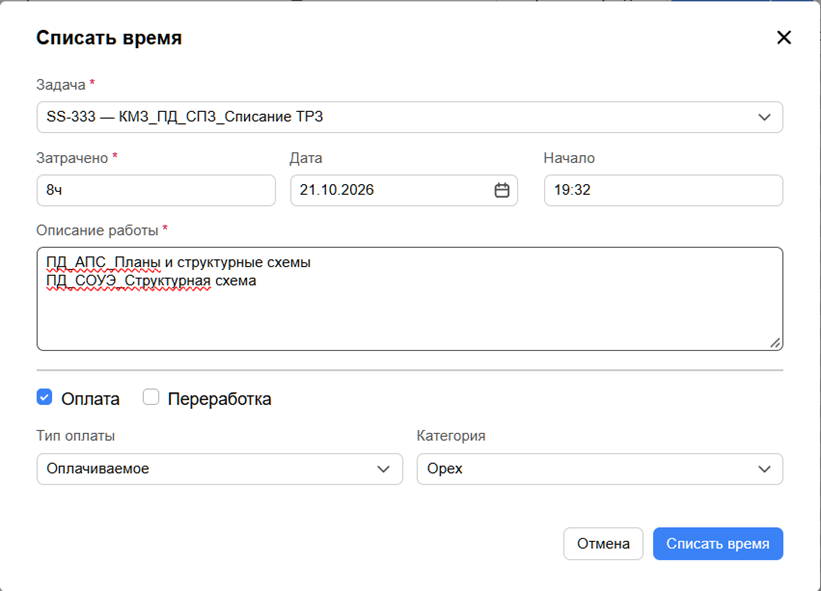

Для оценки затраченного времени на разработку той или иной стадии проекта томов СС и АК в каждом проекте созданы задачи <highlight color="purple">ХХХ_ПД_СС.АК_Списание ТРЗ</highlight> и <highlight color="blue">**ХХХ_РД_СС.АК_Списание ТРЗ**</highlight>, где ХХХ - номер проекта.

Вносить время разом за неделю в пятницу, или раз в два дня, не получится - выгрузка отчета не корректно отображает даты.

**Отчет заполнять ежедневно.**

При вызове окна плагина обязательно проверяйте следующие поля:

1. **Затрачено:** Указывайте реальное количество часов (шаг 30 минут)
2. **Дата:** Должна соответствовать дню, в который фактически выполнялась работа
3. **Описание работы (Комментарий):** Пишется тезисно с указанием разделов и конкретных действий.

*Шаблон: стадия_марка_что сделано*

{width=1674px height=755px}

В случае, если по проекту силами московского отдела выполняется только часть систем, задача будет выглядеть <highlight color="green">ХХХ_ПД_СПЗ_Списание ТРЗ</highlight>
