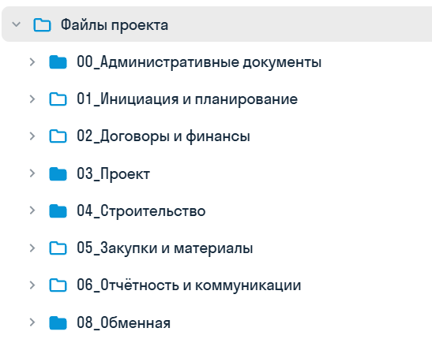
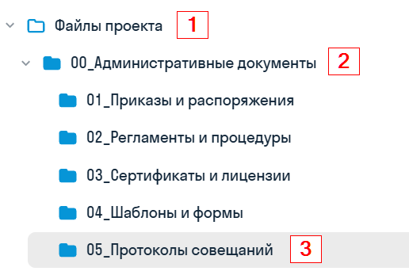
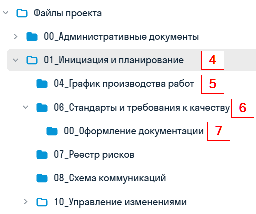

В каждом проекте создан перечень папок с разным назначением, доступом и ответсвенным за ведение

{width=547px height=449px scale=378px}

В разделе **«00_Административные документы»** проектировщиков интересует папка с протоколом, в которой хранится гугл-таблица со сквозным протоколом. Его ведет ГИП или помощник ГИПа.

{width=516px height=342px scale=389px}

В разделе **«01_Инициализация и планирование»** можно найти график выпуска документации (папка **«04_График производства работ»**) и требования к оформлению для каждой стадии проектирования (папка **«00_Оформление документации»**).

{width=513px height=429px scale=395px}
