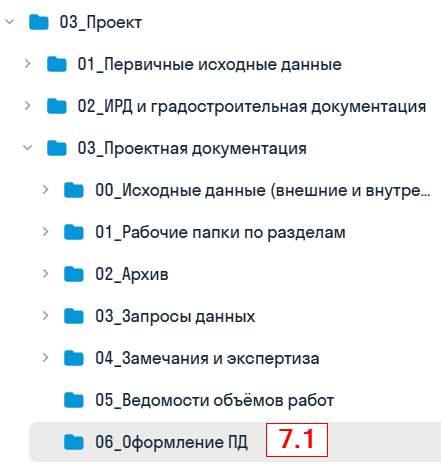
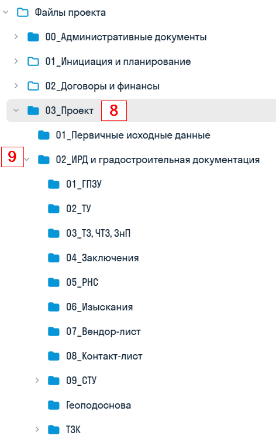
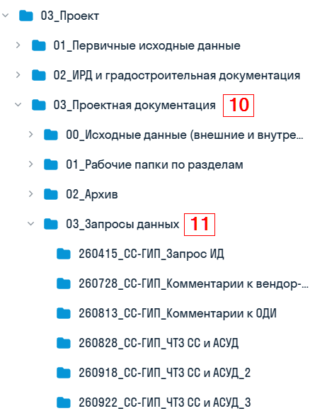
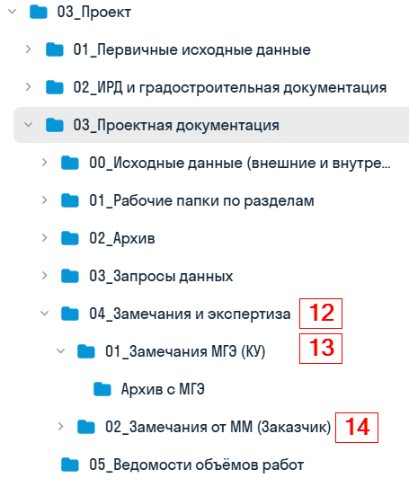

В каждом проекте создан перечень папок с разным назначением, доступом и ответсвенным за ведение

{width=547px height=449px scale=346px}

В разделе **«00_Административные документы»** проектировщиков интересует папка с протоколом, в которой хранится гугл-таблица со сквозным протоколом. Его ведет ГИП или помощник ГИПа.

{width=516px height=342px scale=351px}

В разделе **«01_Инициализация и планирование»** можно найти график выпуска документации (папка «04_График производства работ») и требования к оформлению для каждой стадии проектирования (папка «00_Оформление документации»).

<image src="./0-papki-proekta-3.webp" scale="346px" width="513px" height="429px" float="left" />

{width=441px height=464px scale=281px}

P.S: если оформление не нашлось в папке «00_Оформление документации», его можно поискать в «06_Оформление ПД»

Раздел **«02_Договоры и финансы»** нас не интересует, и доступа у проектировщиков туда нет.

В разделе **«03_Проект»** хранятся все исходные данные для старта проектирования

{width=472px height=751px scale=357px}

Также в разделе **«03_Проект»** хранятся запросы данных у ГИПа и [гугл-таблица RFI](./../glava-5-zaprosy-dannykh.md)

{width=462px height=580px scale=342px}

Замечания экспертизы или заказчика также хранятся в разделе **«03_Проект»**

{width=455px height=542px scale=342px}
