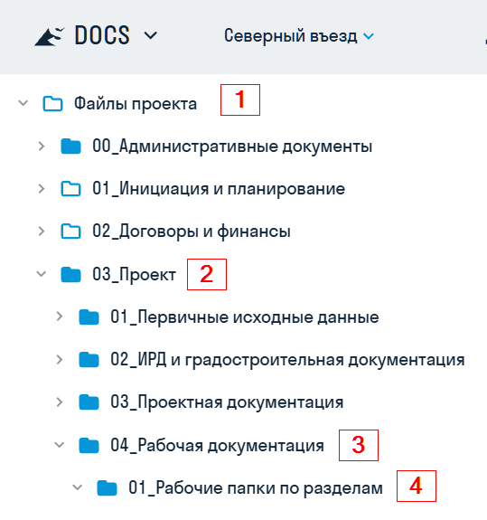
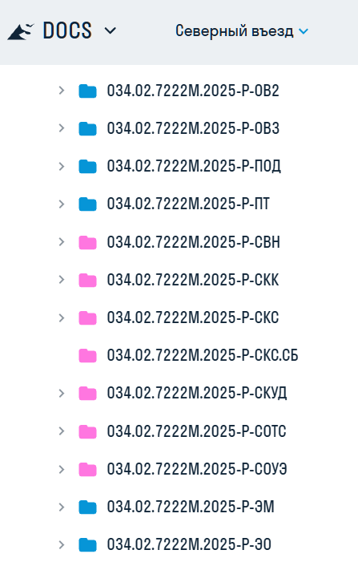
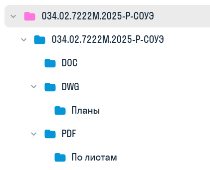

Выпущенные тома РД тут:

{width=539px height=575px scale=284px}

Для быстрого визуального поиска папки томов СС и АК выделены цветом:

{width=447px height=701px scale=246px}

Состав папки принят следующий:

{width=421px height=341px scale=247px}

**DOC** - для загрузки ред.формата расчетов, спецификаций, кабельного журнала, обложек, титулов и пр

**DWG** - для загрузки ред.формата схем, листов, на которые выведены спецификации или кабельные журналы

**Планы** - выгрузка оформленных листов с планами из Revit

**PDF** - для собраного альбома

**По листам** - один лист документации - один файл pdf.
