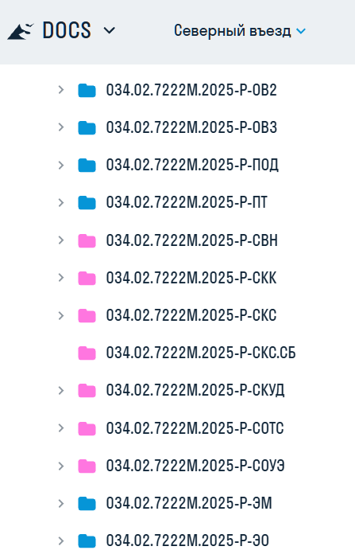

Поскольку на момент написания статьи все тома по Северному въезду уже дважды выпускались, для новой версии нужно использовать текущие наименования файлов.

Путь с нужному тому находиться по пути на скринах ниже:

<image src="./1-naimenovanie-listov-albomov-rd-4.webp" scale="284px" width="539px" height="575px" float="left" />

{width=447px height=701px scale=246px}

Для новых объектов наименования фалов принять как:

<table header="row"><colgroup><col width="240" /><col width="57" /><col width="76" /><col /><col /></colgroup>
  <tr><td>034\.02.7222М.2025-Р-АОВ</td><td>   \_</td><td>лист</td><td>\_</td><td>2</td></tr>
</table>

\-шифр, согласно ведомости рабочей документации

\-нижнее подчеркивание без пробелов

\-лист

\-нижнее подчеркивание без пробелов

\-порядковый номер листа

034\.02.7222М.2025-Р-АОВ_лист_2
