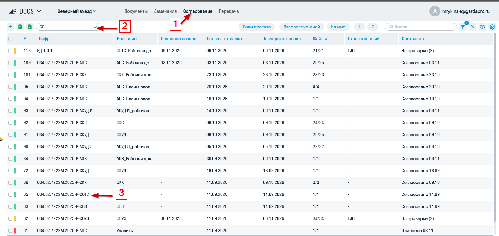
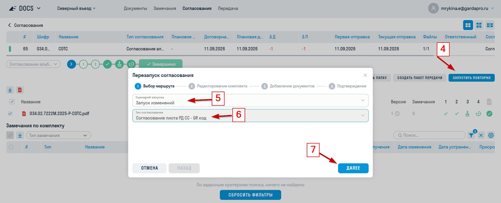
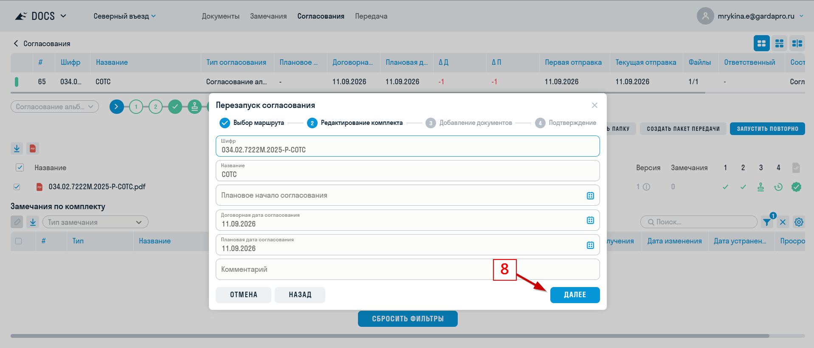
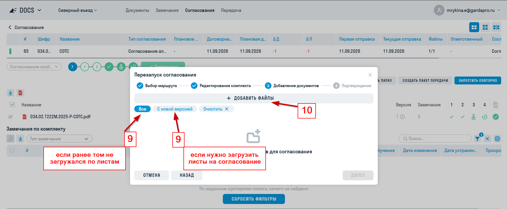
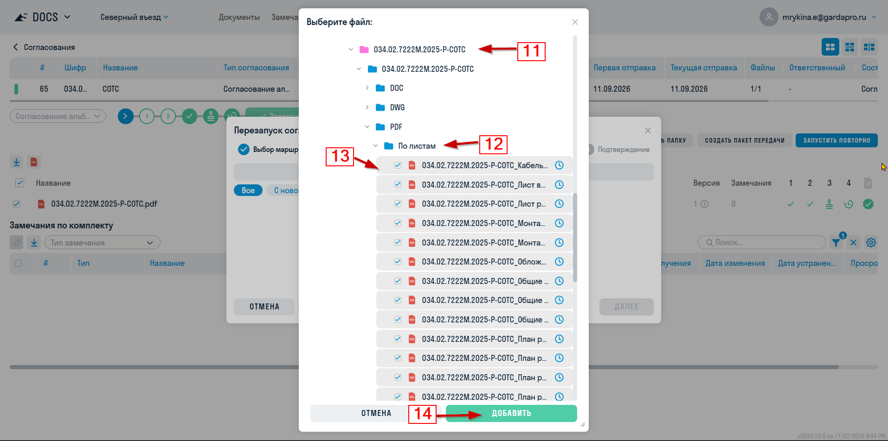
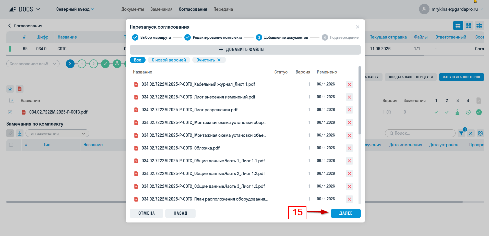
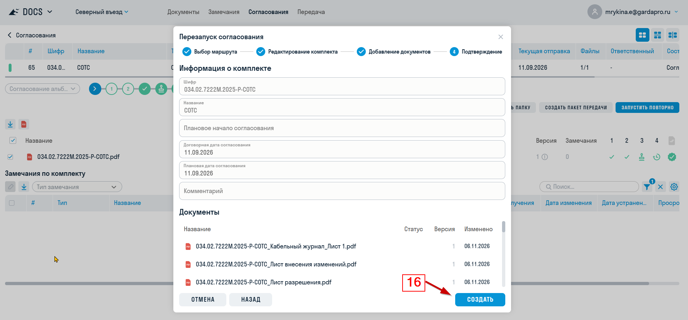
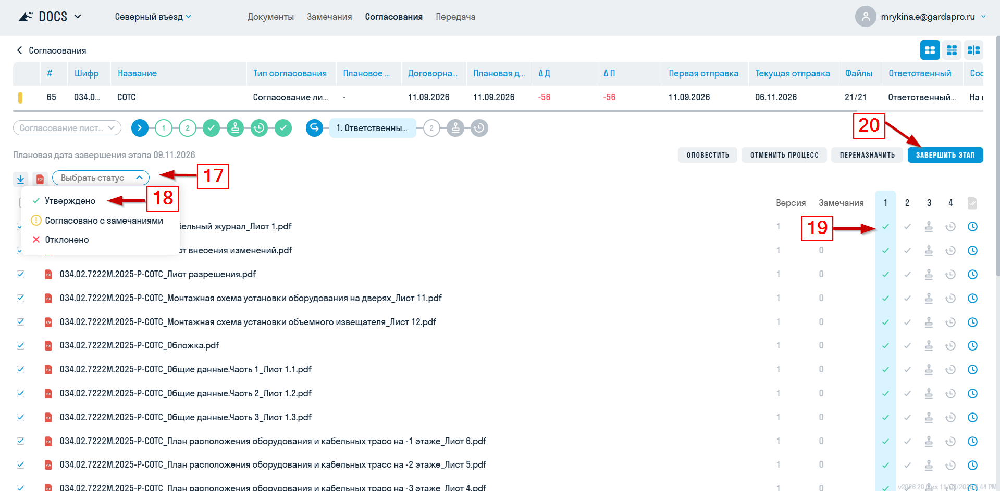
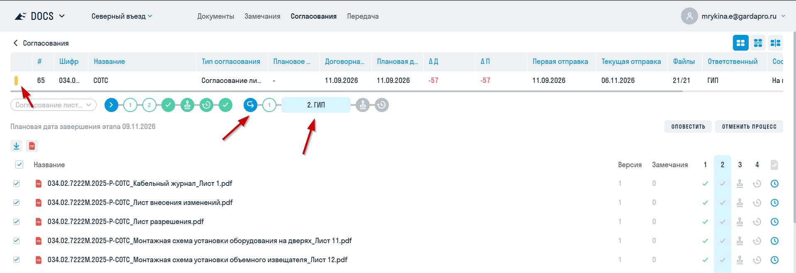

{width=1907px height=903px}

{width=1919px height=778px}

{width=1917px height=822px}

{width=1918px height=792px}

{width=1914px height=952px}

{width=1915px height=925px}

{width=1909px height=890px}

Действия, со скриншотов ниже, выполяются по согласованию со мной или в мое отсутствие:

{width=1919px height=944px}

Результат правильно проделаных действий выглядит так:

{width=1918px height=658px}
