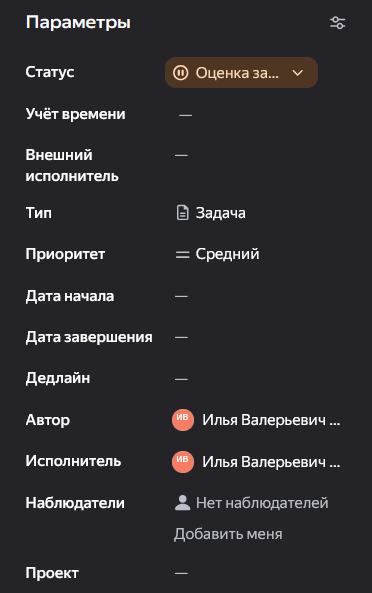
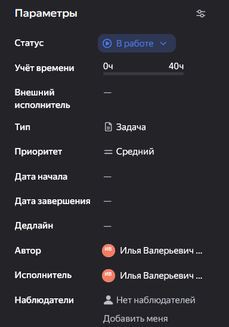

**Цель статьи:** научиться оценивать трудоёмкость задач, фиксировать фактические затраты и объяснять причины отклонений.

Учёт времени помогает видеть загрузку сотрудников, собирать данные для ежемесячной отчётности и обосновывать дополнительный объём работ при обсуждении с Заказчиком.

Работа с учётом времени состоит из двух этапов:

- **Планирование** -- оценка трудоёмкости.
- **Фиксация** -- запись фактических затрат.

## 1\. Оцените трудоёмкость и согласуйте сроки

<note type="info">
  **Трудоёмкость** -- сколько человеко-часов требуется для выполнения работы.

  **Длительность** -- календарный период прохождения задачи от даты начала до дедлайна.

  Это разные показатели: несколько календарных дней не означают непрерывную работу одного сотрудника над задачей.
</note>

При переводе задачи из статуса **«Новый»** в **«Оценка задачи»** исполнитель заполняет поле **«Общая оценка задачи»** в разделе **«Учёт времени»**.

{width=372px height=593px}

В поле указывается **трудоёмкость полного объёма работы в человеко-часах**, а не количество календарных часов между датой начала и дедлайном.

Оценку выполняет профильный специалист. На этапе **«Оценка задачи»** автор задачи или ГИП обязательно подтверждает:

- Общую оценку трудоёмкости.
- Плановые сроки -- дату начала и дедлайн.

**Комментарий с подтверждением желателен, но не обязателен. Само согласование обязательно.**

Оценку можно корректировать в процессе выполнения. **Её увеличение требует письменного обоснования в комментариях:** что изменилось и почему требуется дополнительное время.

### Повторная оценка после переоткрытия

При переоткрытии задачи ранее записанные затраты сохраняются. Поле **«Общая оценка задачи»** должно отражать полный ожидаемый объём работы:

**Общая оценка = ранее затраченное время + оценка оставшейся доработки.**

Не заменяйте общую оценку только часами нового цикла и не записывайте ранее учтённое время повторно. Повторную оценку и новые сроки подтверждает автор задачи или ГИП; увеличение оценки обосновывается в комментариях.

## 2\. Фиксируйте фактические затраты

После перевода задачи в статус **«В работе»** и выполнения работы добавляйте запись о затраченном времени.

{width=384px height=548px}

| Поле | Что указать |
|---|---|
| **Затрачено** | Время, фактически потраченное с момента последней записи |
| **Комментарий** | Что именно выполнено за указанное время |
| **Осталось** | Вручную заполнять не нужно -- система автоматически пересчитает остаток |

В каждой новой записи указывайте **только ещё не учтённое время**, а не общий итог работы над задачей.

<note type="danger">
  **Комментарий обязателен при каждой записи времени.**

  Это правило действует и для очевидной работы. Поясните выполненное действие: какой материал подготовлен, что проверено или какое решение согласовано.
</note>

Не путайте два разных требования:

- Комментарий о **подтверждении оценки и сроков** -- желателен.
- Комментарий к **записи фактических затрат** -- обязателен.

<note type="tip">
  Записывайте время регулярно: два раза в день -- до и после обеда -- или после завершения логического этапа работы.

  Так проще вспомнить содержание работы и не восстанавливать всю неделю по памяти. Время обеда в затраты не включается.
</note>

<note>
  **Записывайте фактические затраты. Не увеличивайте записи искусственно, чтобы получить ожидаемый итог за день.**
</note>

## 3\. Выбирайте карточку по содержанию работы

### Работа по конкретной задаче

Время относится к рабочей задаче, если оно потрачено на получение или проверку её результата.

В этой же карточке учитываются:

- Подготовка чертежа, расчёта или другого материала.
- Поиск необходимой информации.
- Обсуждение решения и согласование по задаче.
- Помощь коллеге.
- Проверка результата и подготовка замечаний.

<note type="info">
  Чтобы записать время, не обязательно быть исполнителем задачи.

  Каждый участник отражает собственные затраты в той же карточке с поясняющим комментарием. Создавать отдельную задачу только для помощи или проверки не требуется.
</note>

### Общая организационная работа

Для общих совещаний и сопутствующей работы, которую нельзя отнести к конкретной рабочей задаче, используется карточка **«Совещания и сопутствующие задачи»**.

Такая карточка создаётся:

- **Отдельно в каждом проекте.**
- **Заново на каждый месяц**, чтобы записи не накапливались в одной карточке за весь период проекта.

При записи времени выбирайте карточку соответствующего проекта и месяца, за который учитываются затраты.

Карточку создаёт **руководитель любого из отделов или ГИП**.

Организационная карточка ведётся **без исполнителя и сроков**. Каждый сотрудник добавляет в неё собственные записи и поясняет содержание работы.

<note>
  Не переносите в организационную карточку все обсуждения подряд.

  Если совещание, поиск информации или помощь относятся к конкретной рабочей задаче, записывайте время в эту задачу с соответсвующими комментариями.
</note>

Если совещание относится к нескольким проектам, **разделите фактически затраченное время между организационными карточками этих проектов без дублирования**. Сумма записей одного сотрудника по всем проектам должна равняться фактической продолжительности его участия.

**На сводные уровни Epic и Story время не списываем.**

## 4\. Объясняйте отклонения с помощью хэштегов

В ходе проектирования возникают обстоятельства, увеличивающие трудозатраты. Для анализа причин используем хэштеги в комментариях к записям времени.

Если затраты относятся к одной из категорий ниже, **начинайте комментарий с соответствующего хэштега**, затем описывайте причину и выполненную работу.

| Хэштег | Когда использовать |
|---|---|
| `#source` | **Изменение исходных данных.** Дополнительные затраты из-за изменения ИРД, градостроительных условий или концепции по решению Заказчика либо Техзаказчика. Данные используются для обоснования дополнительного объёма работ |
| `#contractor` | **Влияние третьих лиц и стройки.** Адаптация проекта из-за замены оборудования, изменения технологии или ошибок монтажа, а также расхождений фактических условий на площадке с изысканиями. Данные используются при разборе причин и обсуждении дополнительных работ |
| `#internal` | **Внутренние доработки и ошибки.** Исправление коллизий, неувязок разделов, технических ошибок или последствий организационных сбоев внутри компании. Данные используются для анализа качества и улучшения процессов |
| `#expertise` | **Замечания экспертизы.** Устранение замечаний МГЭ/НГЭ, выходящих за рамки базовых трудозатрат, а также время на повторные прохождения |

**Хэштег не заменяет пояснение.** По комментарию должно быть понятно, что произошло и на что потрачено время.

<note>
  Если ситуация не относится ни к одной категории, напишите содержательный комментарий без хэштега.

  Не выбирайте неподходящую категорию только ради наличия отметки.
</note>

При изменении исходных данных дополнительно обновите описание задачи по правилам статьи [Как поставить понятную задачу](./../untitled-4.md). Хэштег в записи времени не заменяет актуализацию задания.

## Проверка записей

- Время отнесено к соответствующей рабочей или организационной карточке.
- В новой записи нет часов, уже учтённых ранее.
- Каждая запись содержит комментарий о выполненной работе.
- Помощь и проверка отражены теми сотрудниками, которые их выполняли.
- Для организационной работы выбран нужный проект и месяц.
- Причины дополнительных затрат отмечены подходящим хэштегом и объяснены.
- Увеличение общей оценки обосновано в комментариях.

## Результат

В задаче видны согласованная трудоёмкость, фактические затраты и причины отклонений. Общая организационная работа учитывается отдельно по проектам и месяцам, а записи позволяют понять содержание выполненной работы.

Следующая статья -- [Как связать рабочие задачи с вехами ГПР](./../kak-svyazat-rabochie-zadachi-s-vekhami-gpr.md).
