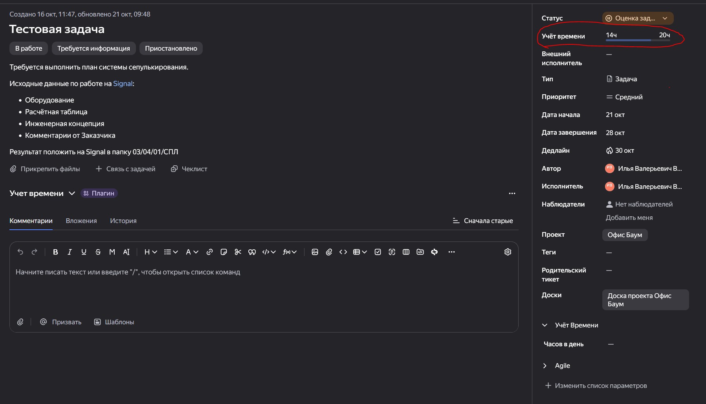
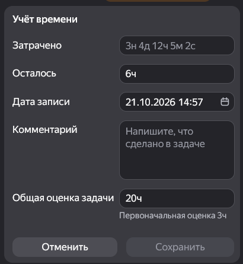
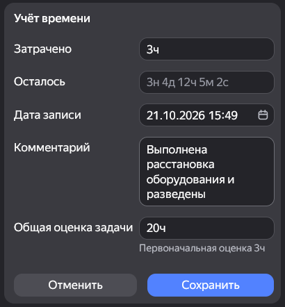

Для выполнения контрольных срезов по динамике работы и повышения прозрачности работы сотрудников проектного департамента, автоматизации сбора ежемесячной отчётности по затратам времени необходимо вести учёт затраченных человеко-часов по каждой выполняемой задаче.

<note type="info">
  В Трекере существует возможность учитывать затраты времени несколькими способами - штатным и с помощью плагина.
</note>

## Учёт времени в интерфейсе Трекера

### Оценка времени на выполнение задачи

При работе над выбранной задачей после перехода из статуса задачи **Новый** в статус **Оценка задачи** необходимо оценить количество времени для выполнения рассматриваемой задачи. В панели справа находим поле **Учёт времени**

{width=1797px height=1029px}

При нажатии на поле оно разворачивается - оценка времени на выполнение записывается в нижнюю строку **Общая оценка задачи**

{width=410px height=445px}

Оценка времени выполняется профильным специалистом и подтверждается автором задачи.

Оценка задачи может быть изменена при дальнейшем выполнении задачи, однако автор задачи или ГИП вправе потребовать обоснование увеличения оценки.

<note type="danger">
  Необходимо различать **Общую оценку задачи** по времени и временной период на выполнение задачи, который задаётся полями **Дата начала** и **Дедлайн** - общая оценка времени не может превышать указанный временной период, но не обязана совпадать с количеством часов во временном периоде - например на задачу может быть выделено три дня при оценочных затратах в 8 рабочих часов.
</note>

### Учёт временных затрат

После перехода из статуса задачи **Оценка задачи** в статус **В работе** необходимо вести отчётность по затратам времени. Для увеличения точности отчётности следует указывать затраты по времени не менее двух раз в день (до обеда и вечером).

В поле **Учёт времени** в первой строке **Затрачено** указываем количество фактически затраченных часов на дату записи с момента последнего указания затрата.

В строке **Комментарий** заполняется указание по выполненным работам в виде короткого отчёта для понимания какая часть работы по задачи была выполнена за это время.

<note>
  Строка **Комментарий** должна заполняться в обязательном порядке, даже если объём работы вам кажется самоочевидным или вы только что проговорили с автором задачи что было выполнено.
</note>

Строку **Осталось** заполнять не требуется - по умолчанию в нём стоит значение оставшихся после прошлой записи часов - оно будет пересчитано автоматически.

{width=410px height=442px}

<note>
  Если в строке осталось указать значение, которое будет превышать оставшуюся разницу между планом и затратами это приведёт к автоматическому увеличению значения **Общая оценка задачи**
</note>

### Особенности заполнения строки Комментарий при учёте изменений

В ходе работы над задачей могут возникнуть обстоятельства при которых временные затраты увеличатся или работу потребуется выполнить заново. В таком случае, в зависимости от источника изменений, в поле комментарий вписывается хэштег для возможности автоматизированного поиска и учёта данных временных затрат.

`#source` - дополнительные временные затраты из-за изменения исходных данных по задаче
