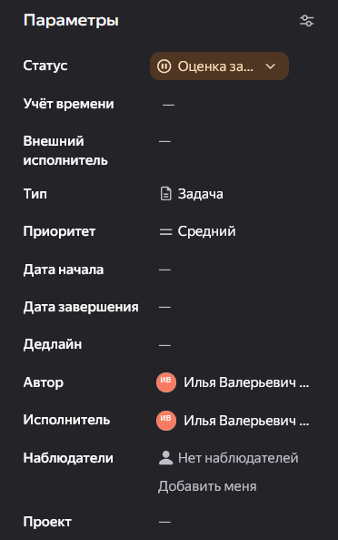
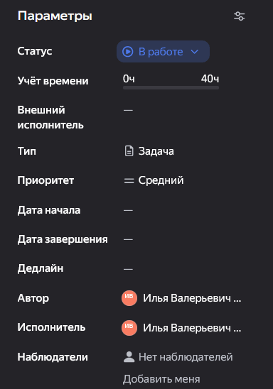

**Цель документа:** Обеспечить прозрачность загрузки сотрудников, автоматизировать сбор данных для ежемесячной отчётности и сформировать доказательную базу для дополнительных соглашений с Заказчиком. Учёт времени это способ защитить проектный департамент от неоправданных переработок и зафиксировать реальный объём работ.

В **Трекере** учёт времени ведётся двумя этапами: **Планирование** (Оценка трудоемкости) и **Фиксация** (Фактические затраты).

## **Планирование и оценка трудозатрат**

<note type="info">
  Мы разделяем **Трудоемкость** (сколько часов чистого времени нужно) и **Длительность** (календарный срок выполнения).
</note>

При переводе задачи из статуса `Новый` в `Оценка задачи` исполнитель заполняет `Общую оценку задачи` в поле **Учёт времени**

{width=372px height=593px}

В поле `Общая оценка задачи` указывается **Трудоемкость** в человеко-часах.

<note>
  **Важно**: Трудоемкость не обязана совпадать с календарной длительностью (поля `Дата начала` и `Дедлайн`). Пример: На задачу отведено 3 календарных дня (Длительность), но чистого времени на неё требуется всего 8 часов (Трудоемкость).
</note>

Оценка выполняется профильным специалистом и **обязательно подтверждается** автором задачи или ГИПом.

Оценку можно корректировать в процессе, но её увеличение требует обязательного письменного обоснования в комментариях.

## **Фиксация фактических затрат**

<note type="tip">
  Факт выполнения работы должен быть задокументирован. Память обретает свойство «стираться» к концу недели, поэтому фиксируем время регулярно.
</note>

После перевода задачи в статус `В работе` и выполнения работы фиксируем факт в поле `Затрачено`

{width=384px height=548px}

`Затрачено` Указываем часы, фактически потраченные с момента **последней** записи.

`Комментарий` Краткий отчёт о том, **что именно** было сделано за эти часы.

`Осталось` Поле заполнять не нужно. Система автоматически пересчитает остаток часов.

<note type="info">
  Для того, чтобы зафиксировать затраты не обязательно быть исполнителем по задаче - вы можете вписать затраты на помощь коллеге или на проверку работы в ту же самую задачу - создавать отдельную задачу по помощи и проверке не требуется.
</note>

<note type="tip">
  Для повышения точности и снижения стресса в конце дня, вносите записи 2 раза в день (до и после обеда) или по факту завершения логического этапа работы. Часы обеда в задачу вносить не требуется.
</note>

<note type="danger">
  **Строгое правило:** Поле `комментарий` заполняется **всегда**. Даже если задача кажется очевидной («чертил узел», «согласовывал с конструкторами»).
</note>

## **Учёт отклонений и изменений (Система хэштегов)**

В ходе проектирования возникают обстоятельства, увеличивающие трудозатраты. Чтобы отделить «норму» от «сверхнормы» и подготовить базу для претензионной работы, первое слово в `Комментарий` при учёте таких затрат должно быть #хэштегом.

### **Справочник хэштегов:**

| Хэштег | Когда использовать |
|---|---|
| `#source` | **Изменение исходных данных.** Доп. затраты из-за изменения ИРД, градостроительных условий, концепции по решению Заказчика или Техзаказчика. *(Основание для Доп. соглашения).* |
| `#contractor` | **Влияние третьих лиц и стройки.** Затраты на адаптацию проекта из-за действий снабжения (замена оборудования на аналог), подрядчиков (изменение технологии монтажа, ошибки монтажа) или расхождений фактических условий на площадке с изысканиями. *(Основание для претензии к подрядчику или Доп. соглашения).* |
| `#internal` | **Внутренние доработки и ошибки.** Затраты на исправление технических ошибок (коллизии, неувязки разделов) или организационных сбоев (срыв сроков внутри компании, возврат на доработку после внутреннего контроля). *(Данные для анализа качества и улучшения процессов).* |
| `#expertise` | **Замечания экспертизы.** Затраты на устранение замечаний МГЭ/НГЭ, выходящих за рамки базовых трудозатрат, а также время на повторные прохождения. |

<note type="lab">
  **Примечание:** Если ситуация не попадает ни в одну категорию, пишите подробный текстовый комментарий без хэштега.
</note>
